Week 1 covers what cybersecurity is: famous hacks from 1903 to 2017, key definitions, why complexity makes systems so hard to secure, how attacks have evolved, the motives behind them, and the basic attack pattern.

*Sources: SEC-110 slides "What is Cybersecurity" and "Module 1 - Understanding the Threats: Cyber-Threat Overview" (notes deck), plus the web links listed in [Sources & Credits](#8-sources--credits).*

## Contents

1. [Historic Hacks](#1-historic-hacks)
   - [Morse Code & Wireless](#morse-code--wireless)
   - [Phone Phreaking Whistle](#phone-phreaking-whistle)
   - [Creeper](#creeper)
   - [Morris Worm](#morris-worm)
   - [Yahoo Email Breaches](#yahoo-email-breaches)
   - [WannaCry Ransomware](#wannacry-ransomware)
   - [Historic Hacks at a Glance](#historic-hacks-at-a-glance)
2. [Key Definitions](#2-key-definitions)
   - [WarGames & the First National Policy](#wargames--the-first-national-policy)
   - [Internet vs. Web vs. Cyberspace](#internet-vs-web-vs-cyberspace)
   - [Cybersecurity Defined](#cybersecurity-defined)
3. [Why Cybersecurity Is Hard: Complexity](#3-why-cybersecurity-is-hard-complexity)
4. [The Evolution of Attacks](#4-the-evolution-of-attacks)
5. [Cyber-Attack Motives](#5-cyber-attack-motives)
   - [Cybercrime](#cybercrime)
   - [Intellectual Property Theft](#intellectual-property-theft)
   - [Espionage](#espionage)
   - [Cyberterrorism](#cyberterrorism)
   - [Hacktivism](#hacktivism)
   - [Messing Around](#messing-around)
6. [Activity: Steal the Cookie Recipe](#6-activity-steal-the-cookie-recipe)
7. [The Cyber-Attack Method](#7-the-cyber-attack-method)
8. [Sources & Credits](#8-sources--credits)

---

# 1. Historic Hacks

The warm-up question was **"What was the first hack?"** The slides walk through some early hacks and some recent ones. As you read, think about the discussion questions at the end of this section.

## Morse Code & Wireless

- In London, **John Ambrose Fleming** was set to publicly demonstrate a wireless (Morse code) message sent from about **300 miles away** by **Guglielmo Marconi**, "the Father of Modern Radio."
- Before Marconi's real message arrived, the magician **Nevil Maskelyne** set up his own transmitter and broadcast an insulting message into the demonstration.
- This was essentially a **Man-in-the-Middle (MitM) attack**: someone placed himself between sender and receiver and injected his own message.
- Maskelyne said he did it to expose the security holes **for the public good**, but he was also a long-time rival of Marconi.

> **Correction:** The slides date this 1904. The Maskelyne hack happened on **4 June 1903**, during Fleming's lecture at the Royal Institution in London.

## Phone Phreaking Whistle

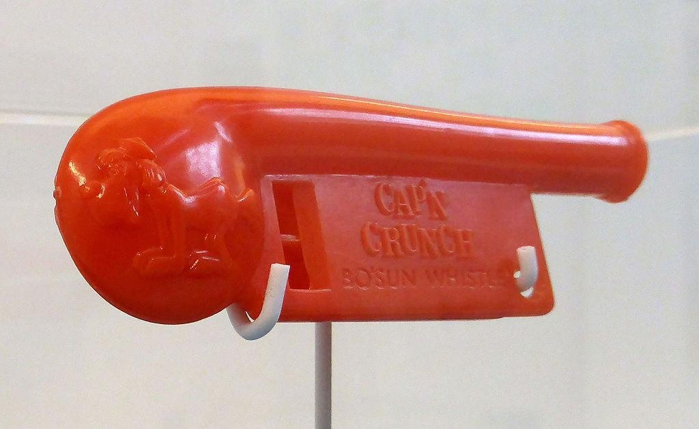

- In the 1950s and 60s, **phone phreakers** (telephone system attackers) got free long-distance service. That sounds quaint today, but long-distance calls were expensive back then.
- **John Draper** found that a toy whistle from Cap'n Crunch cereal played a tone of exactly **2600 Hz**. That was the same frequency AT&T's network used to signal that a trunk line was free for a new call. Blowing the whistle into the phone gave access to "free" long distance.

> **Clarification:** Draper didn't discover the whistle trick alone. Other phreakers knew about it, and Draper became the famous one, earning the nickname "Captain Crunch." The trick worked because the phone network sent its control signals on the same channel as voice (**in-band signaling**), so anyone who could make the right sound could control the switch. The hacker magazine *2600* is named after this tone.

 

## Creeper

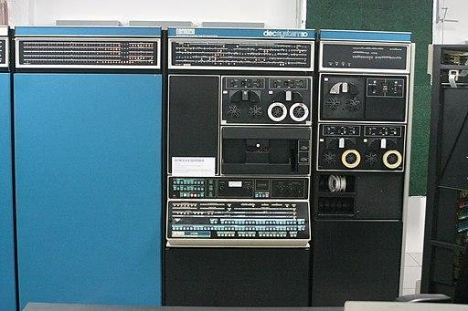

- In **1971**, the first computer virus hit mainframe computers on **ARPANET**. It was called **Creeper**, and it displayed the message *"I'm the Creeper: catch me if you can."*
- It wasn't malicious. It was an experimental, **self-replicating program** written by **Bob Thomas**.
- A program called **Reaper** was written to find Creeper and remove it, which arguably makes it the first antivirus.

> **Clarification:** Creeper is usually called the first **worm** rather than a virus, because it moved between machines over the network on its own instead of attaching to other files. It ran on DEC PDP-10 machines like the one pictured.

 

## Morris Worm

- On **November 2, 1988**, code was released that targeted specific versions of Unix computers.
- It exploited a **backdoor in the Internet's email system** and a **bug in the "finger" program**, which identified network users.
- It didn't damage or destroy files, but it **replicated itself** as it traveled across networks, and **thousands of computers slowed down or crashed**.

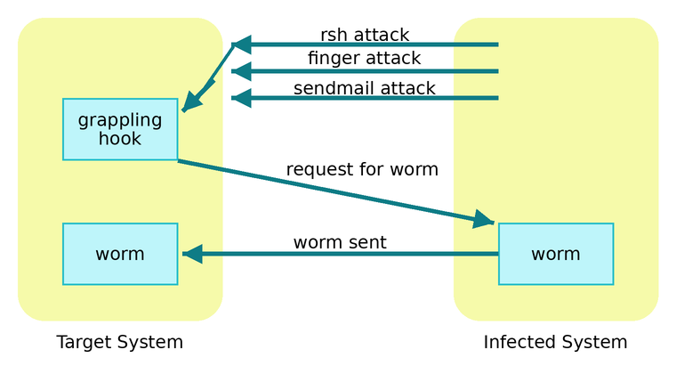

How the worm spread, following the slide's diagram:

| Step | What happened |
| --- | --- |
| 1. Attack | The infected system tries three ways into the target: **rsh**, **finger** and **sendmail** attacks. |
| 2. Grappling hook | If one works, a small "grappling hook" program is planted on the target. |
| 3. Request | The grappling hook calls back to the infected system and requests the full worm. |
| 4. Worm sent | The full worm is copied over, and the target becomes a new infected system. |

> **Clarification:** The "backdoor" was sendmail's **debug mode**, which let a remote user run commands. The finger bug was a **buffer overflow** in the finger server. The rsh attack abused trusted-host settings and weak passwords. The worm reinfected machines that were already infected, and that is what made so many slow down and crash. Its author, Robert Tappan Morris, became the first person convicted under the U.S. Computer Fraud and Abuse Act.

## Yahoo Email Breaches

- In **September 2016**, Yahoo disclosed that **500 million** user accounts had been hacked in **2014**.
- Later that year, it revealed an earlier **2013** attack that compromised **more than 1 billion** accounts.
- Stolen data included names, phone numbers, dates of birth, encrypted passwords, and **unencrypted security questions** that could be used to reset a password.
- Yahoo was founded by Stanford grad students **Jerry Yang and David Filo** and was an early pioneer of directory-based web search.

> **Clarification:** The passwords were **hashed**, not encrypted. A hash can't be decrypted, but weak hashes can be cracked. Much of the 2013 data used MD5, an old and weak hash.
>
> **Modern note:** In October 2017, Yahoo raised the 2013 count to **all 3 billion** accounts.

## WannaCry Ransomware

- **WannaCry** was a **ransomware** attack in **2017** that exploited a flaw in Microsoft Windows. **Unpatched** systems were vulnerable.
- The malware either **locked users out** of their computers or **encrypted their files** so they couldn't be read. The attackers promised to restore access once the **ransom** was paid in **Bitcoin**.
- It was reported in **150 countries** and is estimated to have caused **$4 billion** in losses.

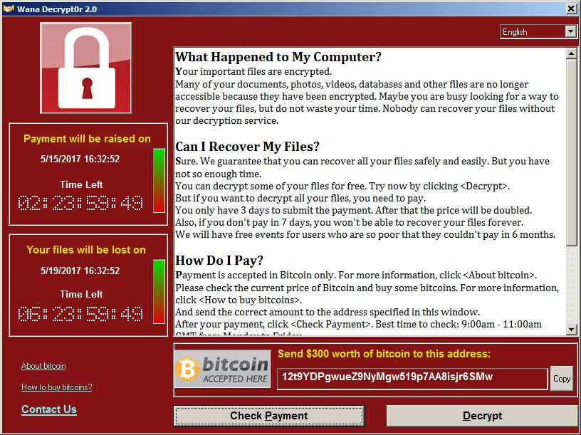

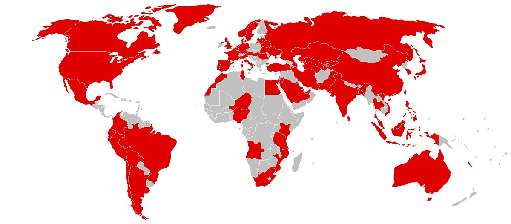

> **Note:** WannaCry spread through the Windows file-sharing protocol (**SMBv1**) using a leaked NSA exploit called **EternalBlue**. Microsoft had released a patch (MS17-010) about two months before the outbreak, so every infected machine was one that hadn't been updated. Lesson: **patch your systems.**

## Historic Hacks at a Glance

| Year | Attack | Type | Harm |
| --- | --- | --- | --- |
| 1903 | Maskelyne's wireless hack | Man-in-the-middle / message injection | Embarrassment; showed wireless wasn't private |
| 1950s–60s | Phone phreaking | Abusing in-band signaling | Free long-distance calls (theft of service) |
| 1971 | Creeper | Self-replicating program (experiment) | None, just a message |
| 1988 | Morris worm | Worm exploiting software bugs | Thousands of machines slowed or crashed |
| 2013–14 | Yahoo breaches | Data breach | Billions of accounts' personal data exposed |
| 2017 | WannaCry | Ransomware | About $4 billion in losses across 150 countries |

**Discussion questions from class:**

- What similarities do you see in these attacks?
- What differences do you see?
- Who or what was harmed?
- What do you think was the purpose or intent of each attack?

---

# 2. Key Definitions

Video from class: [Why Isn't the Internet Secure?](https://youtu.be/sdpxddDzXfE)

## WarGames & the First National Policy

- In **1983**, the film ***WarGames*** came out. A teenage computer whiz (Matthew Broderick) accidentally connects to the military computer that controls nuclear weapons. He thinks he's playing a game between the US and Russia and nearly starts World War III.
- **President Reagan** screened the movie at Camp David for his national security team and asked whether something like that could really happen.
- His question led to the **first national policy on reducing the vulnerability of computers**.

> **Note:** That policy was **NSDD-145**, "National Policy on Telecommunications and Automated Information Systems Security," signed in September 1984.

## Internet vs. Web vs. Cyberspace

These three terms get mixed up a lot. The definitions are from the [NIST glossary](https://csrc.nist.gov/glossary).

| Term | Definition | Key point |
| --- | --- | --- |
| **The Internet** | A global **network of networks**. | No single entity is in charge of it. |
| **The Web** | The collection of **information accessed via the Internet**. | It runs *on* the Internet; email, gaming, etc. use the Internet without being the Web. |
| **Cyberspace** | A global domain within the information environment made of the **interdependent network of information systems infrastructures**: the Internet, telecom networks, computer systems, and embedded processors and controllers. | The biggest of the three; it includes the Internet and much more. |

**Warm-up: how would you draw the Internet today?** In 1970, ARPANET looked like this:

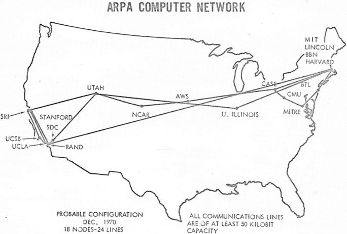

Compare that to today's billions of devices. The class question: **how does cybersecurity look different today than it did on ARPANET in 1970?** Back then, a few trusted research sites knew each other. Today the network is huge, global and full of strangers.

## Cybersecurity Defined

NIST gives two definitions:

1. **Prevention of damage to, protection of, and restoration of** computers and electronic communications systems and services, including the information in them, to ensure their **availability, integrity, authentication, confidentiality, and nonrepudiation**.
2. **The ability to protect or defend the use of cyberspace from cyber attacks.**

The five goals in the first definition:

| Goal | Meaning | Example of a failure |
| --- | --- | --- |
| **Confidentiality** | Only authorized people can read the data. | Yahoo's stolen account data |
| **Integrity** | Data isn't changed without authorization. | Maskelyne's injected message |
| **Availability** | Systems and data are there when needed. | Morris worm crashing machines; WannaCry locking files |
| **Authentication** | You can verify who someone is. | A fake sender in a phishing email |
| **Nonrepudiation** | Someone can't deny an action they took, such as sending a message. | Unsigned messages that anyone could claim weren't theirs |

> **Note:** The first three are known as the **CIA triad**, the core model of information security you'll see all through this program.

---

# 3. Why Cybersecurity Is Hard: Complexity

## Computers Are Complex Systems

- In a **complex system**, outcomes depend on the **parts AND their interactions**. Looking only at the parts can't explain how they behave together.
- **Driving to school:** your route can change because of traffic or a bridge being out. Your car interacts with other cars, drivers, roads and the weather.
- **Restarting a malfunctioning program fixes it:** many parts work together, and the interactions make it hard to predict why something failed one time and worked the next.

## The Maze Exercise

The class solved a maze, then the rules changed twice:

| | Maze | What it shows |
| --- | --- | --- |
| **1. Solve the maze** | 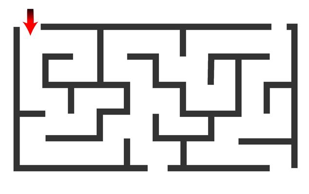 | Find a path to an exit. |
| **2. Same setup, different outcomes** | 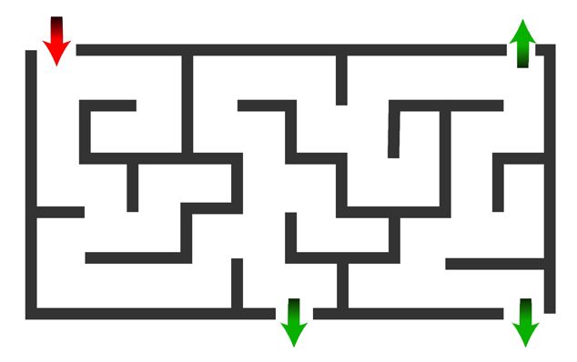 | There are **multiple exits and multiple paths**. The same input and environment can give **different results**, like a video game level that plays out differently each time. Complex cyber systems can produce unpredictable output even with the same input. |
| **3. A little more information** | 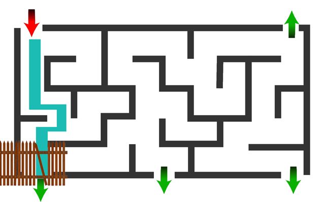 | The walls weren't impenetrable: there were **holes to slip through**. The shortest path uses one. **Systems and agents, including humans, learn and adapt.** |

## Emergent Behavior

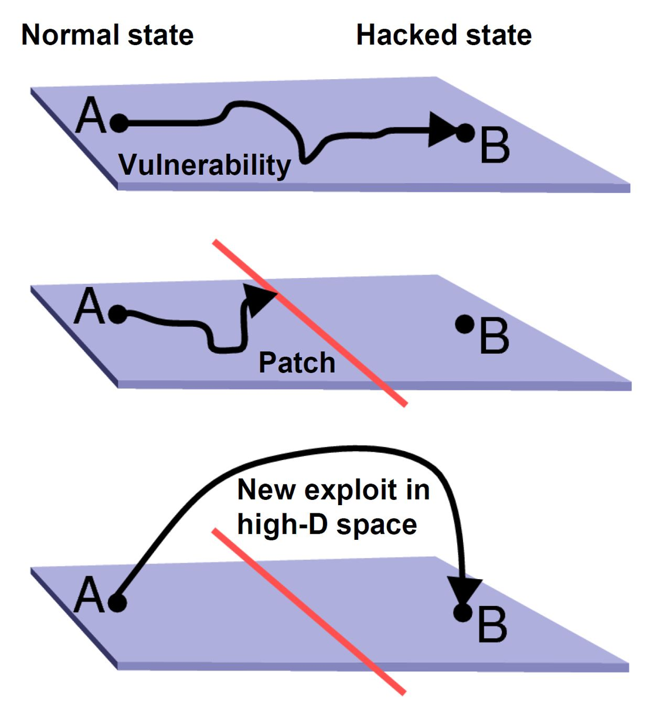

- When you find a better route in real life or a game, you (a complex system) **learn and adapt** over time. This is called **emergent behavior**.
- Attackers do the same. They learn from past failures and successes:
  - A **patch** fixes one vulnerability.
  - The adversary finds a **new way around** that patch.

 

## No One Can Guarantee "This Code Is Clean"

- Securing a complex system is tough. The slide says **it's impossible to build a machine that tests another one in all cases.**
- So no one can guarantee that a program has no vulnerabilities.

> **Clarification:** This comes from computer science theory (the **halting problem** and **Rice's theorem**): no program can correctly decide, for *every possible* program, whether it behaves safely. Testing and scanning tools still help a lot. They just can't prove perfection.

## Complexity Makes Threats Asymmetric

| | Attacker | Defender |
| --- | --- | --- |
| **What they know** | Can't know every vulnerability | Can't know every vulnerability either |
| **What they need** | Find and exploit **just one** vulnerability to compromise the whole system | Find and fix **all of them** (impossible in general) |

This **asymmetry** is the core reason defense is harder than attack.

> **Note:** Since you can't find every hole, defenders use **defense in depth**: several layers of protection, so one hole doesn't lose everything.

---

# 4. The Evolution of Attacks

The notes deck opens with screenshots showing how attacks on everyday users have changed, from tricking people into installing fake software to encrypting their files for ransom.

| Era | Attack | What the victim sees |
| --- | --- | --- |
| Late 2000s | **Malicious links** on popular sites | A 2009 YouTube video description linking to a fake antivirus download site |
| Late 2000s | **Scareware / fake antivirus** | A fake "Windows Security Alert" scan claiming the PC is infected, pushing a paid "cleanup" |
| ~2011 | **Fake antivirus on Mac** | A fake "Apple Security Center" claiming Trojans were found |
| ~2012 | **Lockscreen ransomware** | A fake FBI notice: "Your computer has been locked," pay a $200 "fine" |
| 2013 | **Crypto-ransomware: CryptoLocker** | "Your personal files are encrypted," with a countdown timer before the key is destroyed |
| 2016 | **Petya** | A Tor payment site walking the victim through buying and sending Bitcoin |
| 2017 | **WannaCry** | "Ooops, your files have been encrypted!" and a demand for $300 in Bitcoin |

<table>
<tr>
<td>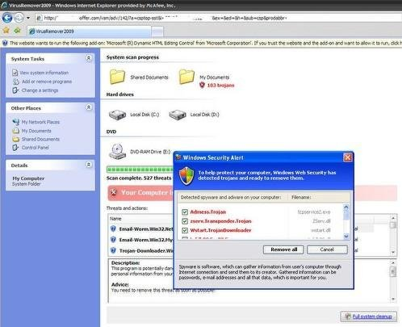</td>
<td>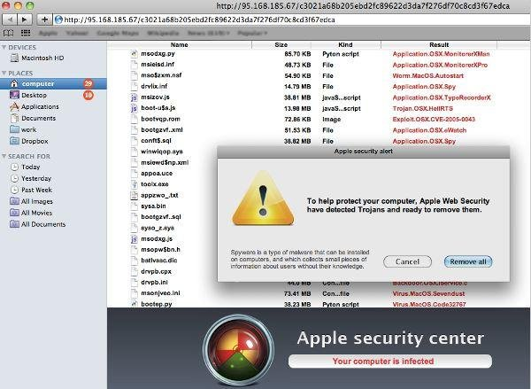</td>
</tr>
<tr>
<td>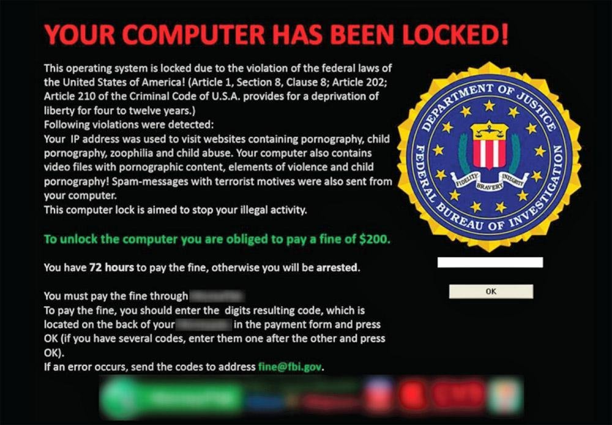</td>
<td>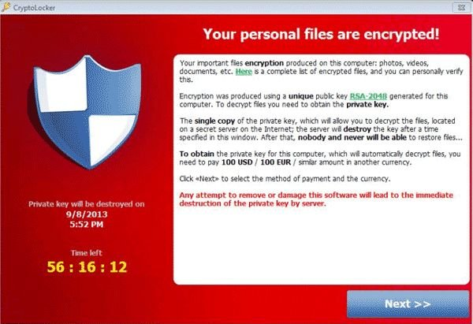</td>
</tr>
<tr>
<td colspan="2">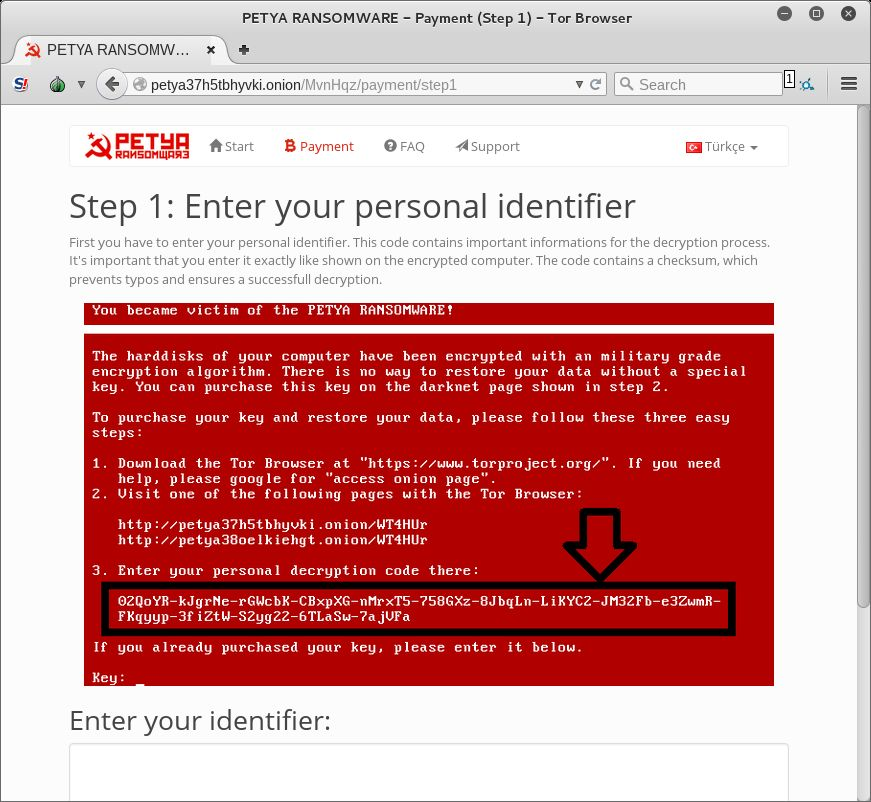</td>
</tr>
</table>

The trend: attackers moved from **tricking** people into paying for fake fixes, to **locking** the screen, to **encrypting** files with strong cryptography, which is much harder to undo. Bitcoin made the payments easier to collect and harder to trace.

> **Note:** The FBI never locks computers or collects fines through a pop-up. Any screen like that is a scam.

---

# 5. Cyber-Attack Motives

| Motive | Who | Goal |
| --- | --- | --- |
| **Cybercrime** | Criminals, ransomware gangs | Money |
| **Intellectual property theft** | Competitors, pirates, nation-states | Get valuable ideas, designs or media without paying |
| **Espionage** (personal, state, corporate) | Spies, governments, companies | Secret information |
| **Terrorism** | Terrorist groups | Fear and intimidation for political goals |
| **Hacktivism** | Activists | Promote a political or social cause |
| **Messing around** | Curious or bored individuals | Fun, curiosity, bragging rights |

## Cybercrime

### Economic Impact

A **2020 report from McAfee and the Center for Strategic and International Studies (CSIS)** found:

- Global losses from cybercrime topped **$1 trillion**, an increase of **more than 50% since 2018**.
- **Two-thirds** of surveyed companies reported some kind of cyber incident in 2019.
- The average **interruption to operations was 18 hours**, and the average cost was **more than half a million dollars per incident**.
- **56%** of surveyed organizations had **no plan** to both prevent and respond to a cyber incident.

> **Clarification:** The $1 trillion figure is the total *cost* of cybercrime: about $945 billion in direct losses plus about $145 billion spent on cybersecurity.

**And now?** Newer reading from class: [World Economic Forum (2024)](https://www.weforum.org/agenda/2024/01/cybersecurity-cybercrime-system-safety/) and [USAID Cybersecurity Briefer (2023)](https://www.usaid.gov/sites/default/files/2023-10/Cybersecurity%20Briefer_Economic%20Growth.pdf).

### The Economics of Ransomware

- Ransomware gangs reportedly earned **over $1.1 billion in 2023**, about double the **$560+ million** of 2022.
- **LockBit** is a leading **ransomware-as-a-service (RaaS)** operation. Its developers rent the malware to affiliates who carry out attacks, and it targets organizations big enough to pay.
  - Its average ransom demand in 2023 was reportedly **nearly $1 million**.
  - The FBI reports about **1,700 LockBit incidents in the US**, with victims paying **over $91 million**.
- Other costs from the slides:

| Victim | Attack | Reported cost |
| --- | --- | --- |
| Maersk (shipping) | NotPetya | Over $200 million |
| Forward Air (trucking) | Ransomware | $7.5 million |
| CWT (travel management) | Ransomware | $4.5 million paid to the hackers |

> **Modern note:** In February 2024, an international law enforcement operation (Operation Cronos) seized LockBit's infrastructure and leak site. The group tried to come back, but it was badly disrupted.

### Recent Threats

- [Social media account hijacking](https://thehackernews.com/2022/02/social-media-hijacking-malware.html): malware that steals logins for social media accounts.
- [Malicious Instagram mod app](https://www.mcafee.com/blogs/other-blogs/mcafee-labs/instagram-credentials-stealer-disguised-as-mod-app/): a fake "modded" Instagram app that steals your credentials.

Attackers follow the news. This chart shows the fake apps that pretended to be popular or COVID-related apps in early 2021:

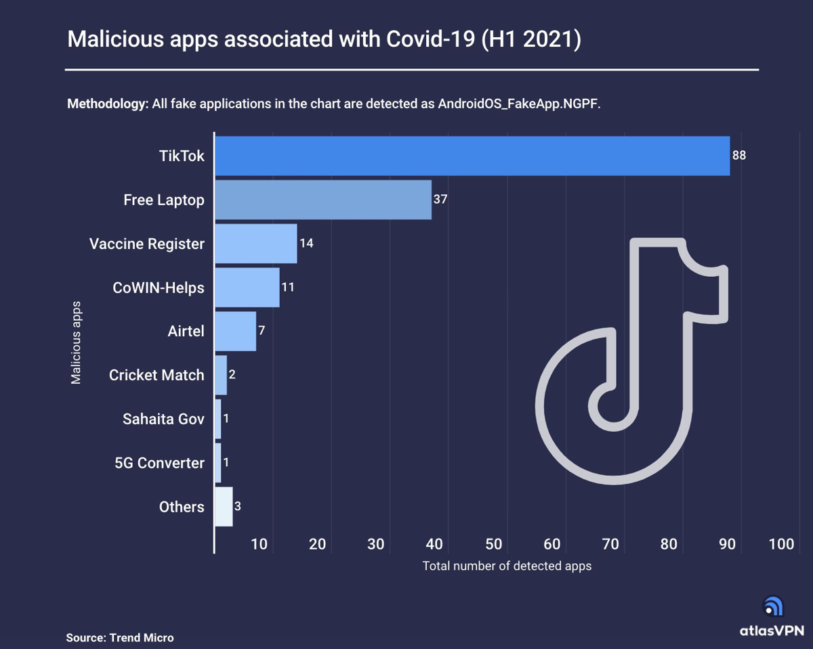

### Identity Theft

The FTC's Consumer Sentinel data shows reports climbing quickly, especially in 2020:

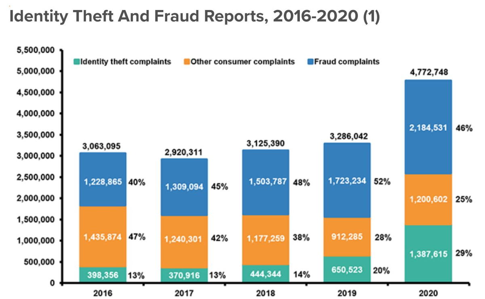

**Top five types of identity theft in 2020 (FTC):**

| Type of identity theft | Reports | % of top five |
| --- | ---: | ---: |
| Government benefits applied for/received | 394,324 | 32.0% |
| Credit card fraud: new accounts | 365,597 | 29.7% |
| Miscellaneous identity theft | 281,434 | 22.9% |
| Business/personal loan | 99,667 | 8.1% |
| Tax fraud | 89,391 | 7.3% |
| **Total, top five** | **1,230,413** | **100.0%** |

Government benefits fraud jumped in 2020 because criminals filed fake unemployment claims during the pandemic.

**Bureau of Justice Statistics (DOJ), *Victims of Identity Theft, 2018*:**

- About **23 million people (9% of US residents age 16+)** were victims in a 12-month period.
- Losses totaled **$15.1 billion**.
- The three categories of identity theft:

| Category | Example |
| --- | --- |
| **Misuse of an existing financial account** | Someone uses your stolen credit card number |
| **Misuse of personal information to open a new account** | Someone opens a credit card in your name |
| **Misuse of personal information for other fraud** | Someone files a tax return or benefits claim as you |

- **Most victims (90%)** had an existing account misused.

> **Correction:** The slides say 16.3 million people (9% of adults). The BJS report counts about **23 million** victims (9%). 16.3 million is the number of victims who had a known loss of $1 or more, and the $15.1 billion is their total.

### Cryptocurrency Mining Malware (Cryptojacking)

- Malware that secretly uses the victim's computer to **mine cryptocurrency** for the attacker.
- It competes with ransomware as a money-maker for malware distributors.
- It's cyclical: after a drop in 2019, the slides cite SonicWall reporting a **252% rise in 2020**. **XMRig** (a Monero miner) made up most recent infections.
- It's **more subtle than ransomware**, with less up-front payoff, but it offers the potential for long-term illicit earnings because victims often don't notice.

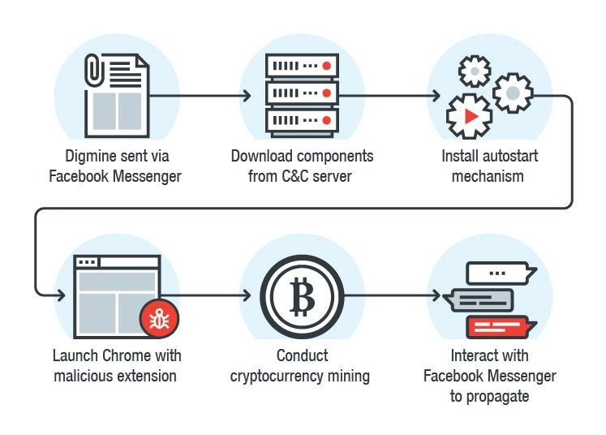

The example above is **Digmine**, which spread through Facebook Messenger, downloaded its parts from a **command-and-control (C&C) server**, set itself to start automatically, mined cryptocurrency through a malicious Chrome extension, and then messaged the victim's friends to spread.

**Risks of cryptojacking:**

| Risk | Why it matters |
| --- | --- |
| Wasted power | Mining burns electricity on the infected machine |
| Slower systems | Mining uses the CPU/GPU heavily |
| Data breach notification | If attackers got in to install a miner, the system counts as compromised, and the organization may have to report a breach |

### Watch Out for Scams

Scammers exploit whatever is in the news. These pandemic-era examples were fact-checked as fake:

| Fake "World Health Organization" email | Fake NHS vaccine text |
| --- | --- |
| 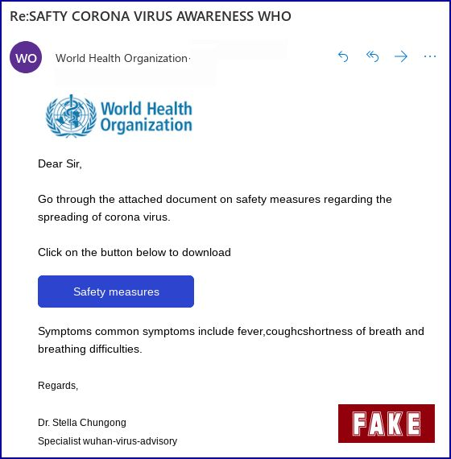 | 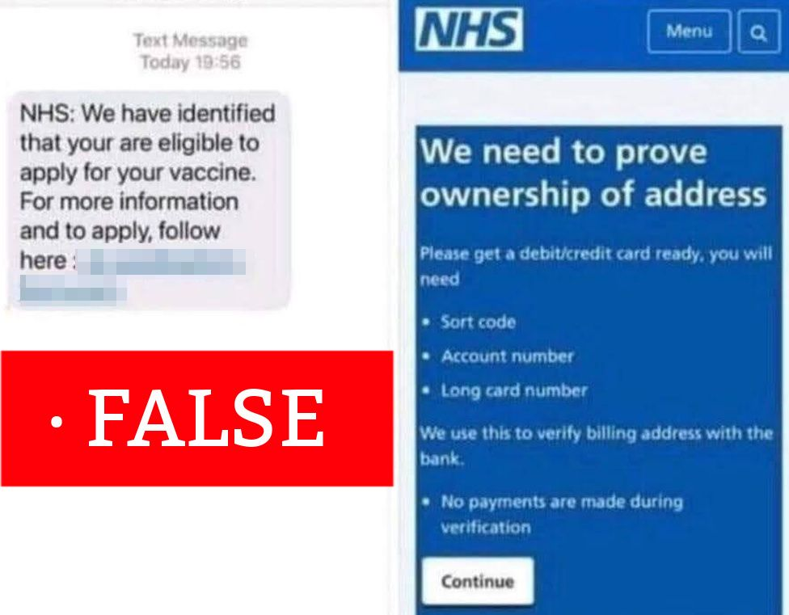 |

**Red flags:** urgency, a trusted name (WHO, NHS, your bank), a link or attachment, and a request for personal or payment information.

**Activity:** take the [Google Phishing Quiz](https://phishingquiz.withgoogle.com/).

## Intellectual Property Theft

**Warm-up ("Property?"):** look at the [most valuable companies in 1917 and 1929](https://americanbusinesshistory.org/largest-companies-1917-and-1929/), which were steel, oil, railroads and meatpacking. Then search for the most valuable companies today and ask what makes them valuable. Hint: today's leaders are mostly tech companies, and their value is mostly **ideas and data**, not physical goods.

- **Intellectual property (IP)** means "**creations of the mind**." Some of the most valuable property today:
  - Software
  - Designs
  - Research findings
- **Digital assets:** individuals, companies and others want them without paying, as in movie, music and software **piracy**.
- Protecting IP and digital assets is a **major cybersecurity challenge** for many organizations.

Examples from the slides:

- Hackers stole **FIFA 21 source code** and tools in a breach of **Electronic Arts (EA)** (2021).
- **Apex Legends** was hacked by people protesting hacks of another game, *Titanfall*, which shows how IP attacks and hacktivism can overlap.

## Espionage

- Spying targets **confidential communications** and **data and information**, and both now live on computers.
- **Nation-states and other groups have moved much of their spying into the cyber world.**
- The slides note that the Director of National Intelligence's [2021 Annual Threat Assessment](https://www.dni.gov/files/ODNI/documents/assessments/ATA-2021-Unclassified-Report.pdf) ranks cyber threats ahead of terrorism, near the top of the list.

## Cyberterrorism

There's **controversy over what counts as cyberterrorism**. One definition to consider:

> Cyberterrorism is the **use of the Internet to conduct violent acts** that result in or **threaten** the **loss of life or significant bodily harm**, in order to achieve **political gains through intimidation**.

Discussion questions from class:

- **Threaten** is an important word. Does an attack need to succeed, or is the fear and panic it causes enough?
- What about online activities that **support** other terrorist actions?
  - Recruiting, propaganda, false intelligence
  - **Diversion tactics**: disrupting detection of, or response to, a physical attack

## Hacktivism

- A **portmanteau** of **hack** and **activism**: using computers and networks to promote **political ends**.
- Common attacks:

| Attack | What it does |
| --- | --- |
| **Denial-of-Service (DoS)** | Floods a site or service so real users can't reach it |
| **Defacement** | Replaces a website's content with the hacktivists' message |
| **Information disclosure** | Leaks stolen documents or data to embarrass the target |

- Further reading: [Top 15 most active hacktivist groups (Radware, 2023)](https://www.radware.com/newsevent/pressreleases/2023/radware-report-ranks-top-15-most-active-political-and-religious-hacktivists/) and [Reuters: "New wave of 'hacktivism' adds twist to cybersecurity woes"](https://www.reuters.com/article/us-cyber-hacktivism-focus-idUSKBN2BH3HJ).

## Messing Around

The last motive on the list. Some attackers are just curious, bored, or showing off. The slides don't go further, but the history in [section 1](#1-historic-hacks) shows how often "just experimenting" (Creeper, the Morris worm) still caused real harm.

---

# 6. Activity: Steal the Cookie Recipe

The "Steal the Jewels" group activity. Based on the instructor's scenario, your group:

- Plans how to achieve the mission's objective
- Outlines the plan as the steps that need to be followed
- **Classifies the major phases** needed for success

**Scenario: Big Green Cookie Co.** Your mission is to steal the secret cookie recipe, kept in a **locked cabinet in the President's office**.

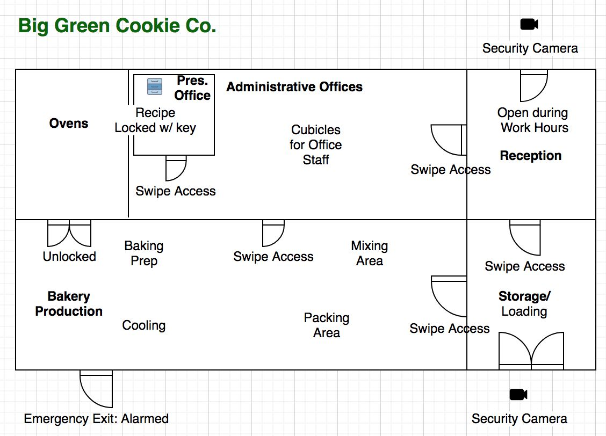

| Access | Who has it |
| --- | --- |
| **Key to the recipe cabinet** | President, VP, Bakery Manager, Assistant Bakery Manager |
| **Access to the office** | Everyone above, plus Admin Assistant, Office Manager and Custodian |

- Office staff can only access the office.
- Bakery staff can only access the bakery.
- Managers can access both.

> **Hint:** Before planning the theft itself, ask what you'd need to *learn* first, and which people or doors look weakest. Then compare your phases with [section 7](#7-the-cyber-attack-method).

---

# 7. The Cyber-Attack Method

Cyber-attacks are as varied as their motives and targets, but they generally follow the same pattern:

| Step | Phase | What the attacker does |
| --- | --- | --- |
| 1 | **Reconnaissance** | Find the targets: gather information about the organization, its people and its systems |
| 2 | **Probe** | Find the vulnerability: test for weak spots |
| 3 | **Exploit** | Take advantage of the vulnerability to successfully complete the attack |

> **Note:** You'll see more detailed versions of this pattern later, like the **Cyber Kill Chain** (Lockheed Martin) and **MITRE ATT&CK**. They split these three steps into finer stages, such as weaponization, delivery, installation, command and control, and actions on objectives.

---

# 8. Sources & Credits

**Class materials**

- SEC-110 slides: *What is Cybersecurity*
- SEC-110 notes deck: *Module 1 - Understanding the Threats: Cyber-Threat Overview*

**Links from the slides**

- [Why Isn't the Internet Secure? (video)](https://youtu.be/sdpxddDzXfE)
- [NIST CSRC Glossary](https://csrc.nist.gov/glossary)
- [Rob Armstrong, *Living with Complexity: Cyber Security* (OSTI)](https://www.osti.gov/biblio/1141988-living-complexity-cyber-security), the source of the complexity, maze-path and asymmetry slides
- [World Economic Forum: cybercrime and system safety (2024)](https://www.weforum.org/agenda/2024/01/cybersecurity-cybercrime-system-safety/)
- [USAID Cybersecurity Briefer: Economic Growth (2023)](https://www.usaid.gov/sites/default/files/2023-10/Cybersecurity%20Briefer_Economic%20Growth.pdf)
- [Trend Micro: LockBit, BlackCat and Clop top RaaS groups, 1H 2023](https://www.trendmicro.com/vinfo/us/security/news/ransomware-by-the-numbers/lockbit-blackcat-and-clop-prevail-as-top-raas-groups-for-1h-2023)
- [SecurityWeek: Inside the ransomware economy](https://www.securityweek.com/inside-ransomware-economy)
- [TechHQ: What we know about LockBit ransomware](https://techhq.com/2023/10/what-we-know-about-lockbit-ransomware/)
- [Fisher Phillips: Ransomware costs businesses a record $1 billion in 2023](https://www.fisherphillips.com/en/news-insights/ransomware-costs-businesses-record-high-1-billion-in-2023.html)
- [The Hacker News: social media hijacking malware](https://thehackernews.com/2022/02/social-media-hijacking-malware.html)
- [McAfee Labs: Instagram credentials stealer disguised as a mod app](https://www.mcafee.com/blogs/other-blogs/mcafee-labs/instagram-credentials-stealer-disguised-as-mod-app/)
- [BJS: Victims of Identity Theft, 2018](https://bjs.ojp.gov/library/publications/victims-identity-theft-2018)
- [Google Phishing Quiz](https://phishingquiz.withgoogle.com/)
- [American Business History: largest companies, 1917 and 1929](https://americanbusinesshistory.org/largest-companies-1917-and-1929/)
- [ODNI Annual Threat Assessment 2021](https://www.dni.gov/files/ODNI/documents/assessments/ATA-2021-Unclassified-Report.pdf)
- [Radware: top 15 most active hacktivist groups (2023)](https://www.radware.com/newsevent/pressreleases/2023/radware-report-ranks-top-15-most-active-political-and-religious-hacktivists/)
- [Reuters: New wave of 'hacktivism' adds twist to cybersecurity woes](https://www.reuters.com/article/us-cyber-hacktivism-focus-idUSKBN2BH3HJ)

<b>Image credits (from the course slides)</b>

- Cap'n Crunch Bo'sun whistle: © 1971markus@wikipedia.de, CC BY-SA 4.0, [Wikimedia Commons](https://commons.wikimedia.org/w/index.php?curid=44260782)
- DEC PDP-10 mainframe: Gah4, [CC BY-SA 4.0](https://creativecommons.org/licenses/by-sa/4.0)
- Morris worm diagram: redrawn from the course slide
- WannaCry ransom note: © 황승환, CC BY-SA 4.0, [Wikimedia Commons](https://commons.wikimedia.org/wiki/Category:WannaCry_ransomware_attack)
- Countries initially affected by WannaCry: Roke, CC BY-SA 3.0, [Wikimedia Commons](https://upload.wikimedia.org/wikipedia/commons/3/3a/Countries_initially_affected_in_WannaCry_ransomware_attack.png)
- ARPANET map, 1970: UCLA and BBN, [CC BY-SA 4.0](https://creativecommons.org/licenses/by-sa/4.0)
- Maze and patch/exploit diagrams: adapted from [Rob Armstrong, OSTI](https://www.osti.gov/biblio/1141988-living-complexity-cyber-security)
- Malicious apps associated with COVID-19 chart: Atlas VPN, using Trend Micro data (from the SEC-110 notes deck)
- Ransomware and scareware screenshots, scam examples, cryptojacking diagram, and Big Green Cookie Co. floor plan: from the SEC-110 notes deck
- Identity theft chart: FTC Consumer Sentinel Network data, from the SEC-110 notes deck

