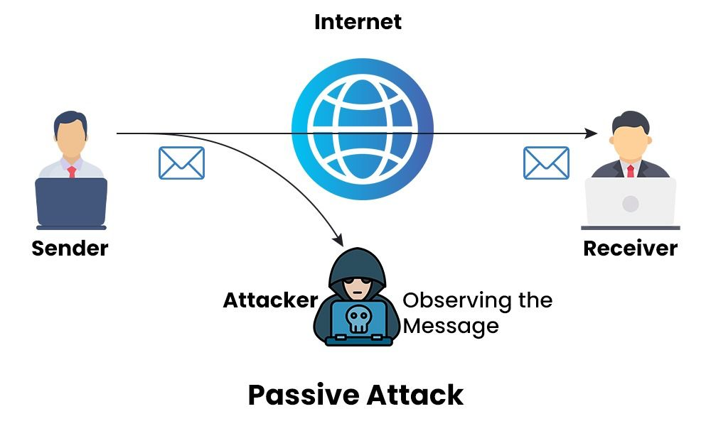
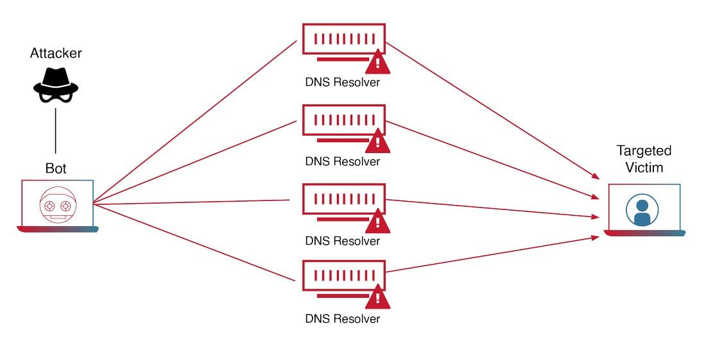
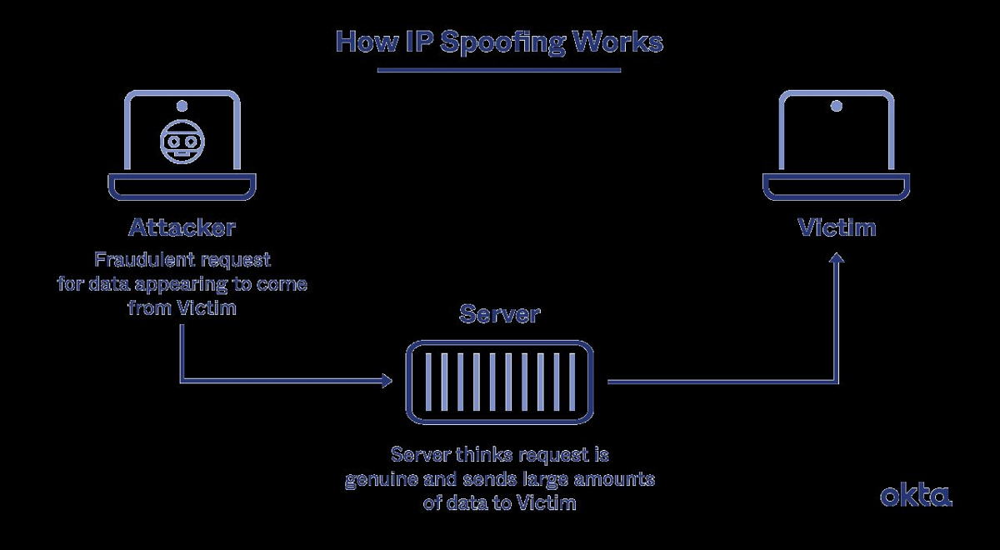
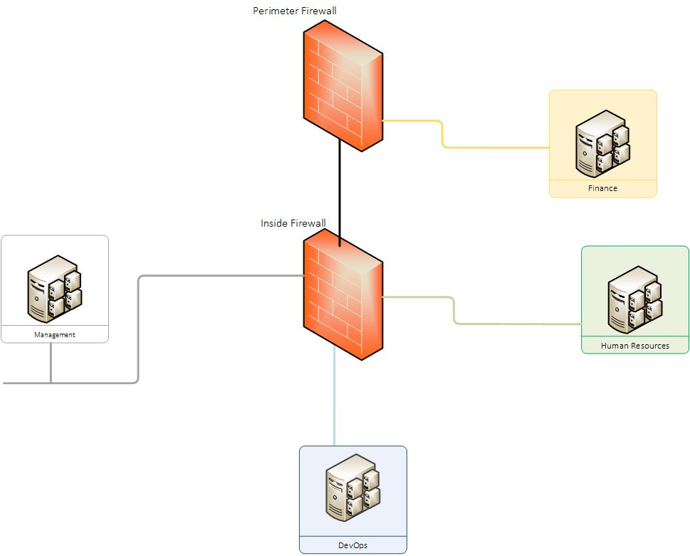
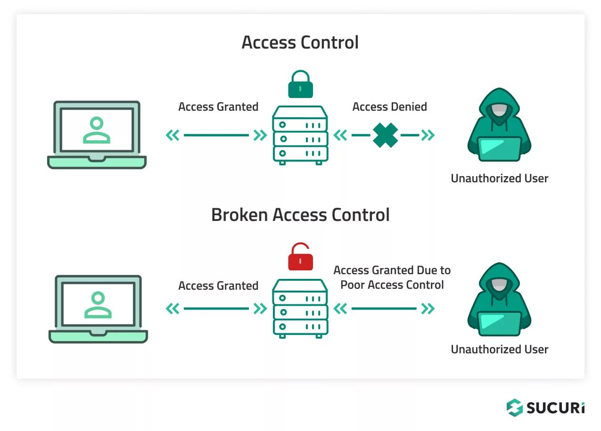
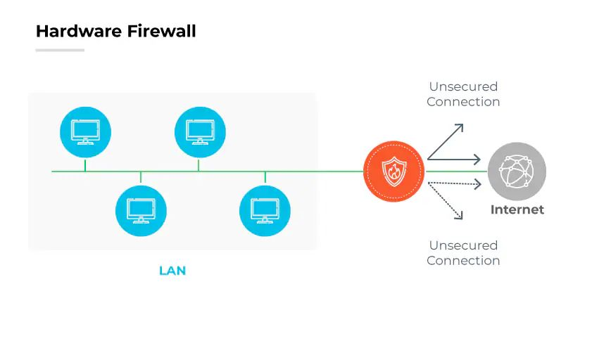
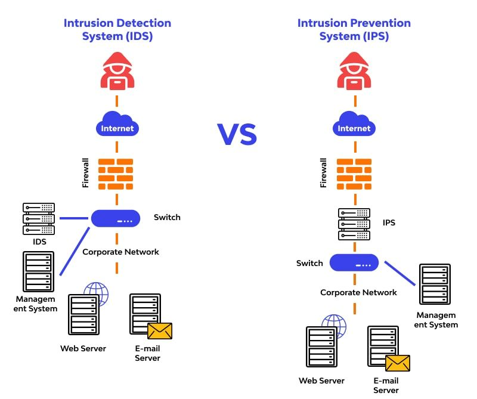
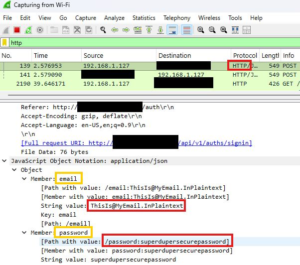
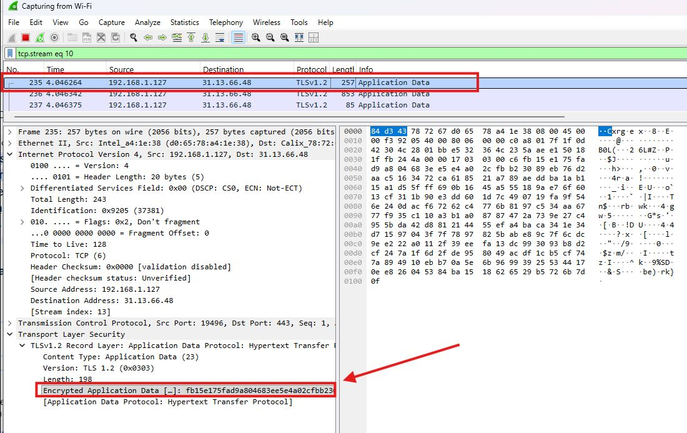

Week 10 covers network security: why it matters (with the 2025 Allianz Life breach), passive, active and social-engineering threats, common network vulnerabilities, attacks at each OSI layer, and the main defenses: defense in depth, segmentation, AAA, firewalls, IDS/IPS, secure protocols, VPNs and Wi-Fi security.

*Sources: SEC-110 notes "Mod 10 – Network Security."*

## Contents

1. [Why Network Security Matters](#1-why-network-security-matters)
2. [Common Network Threats](#2-common-network-threats)
   - [Passive Attacks](#passive-attacks)
   - [Active Attacks](#active-attacks)
   - [Social Engineering](#social-engineering)
3. [Network Vulnerabilities](#3-network-vulnerabilities)
4. [Security at Each OSI Layer](#4-security-at-each-osi-layer)
5. [Network Defense Strategies](#5-network-defense-strategies)
   - [Defense in Depth](#defense-in-depth)
   - [Network Segmentation](#network-segmentation)
   - [Access Controls (AAA)](#access-controls-aaa)
   - [Firewalls](#firewalls)
   - [Intrusion Detection & Prevention](#intrusion-detection--prevention)
6. [Encryption & Secure Protocols](#6-encryption--secure-protocols)
   - [Secure Protocol Example in Wireshark](#secure-protocol-example-in-wireshark)
   - [VPNs](#vpns)
   - [Wi-Fi Security](#wi-fi-security)
7. [Network Security at a Glance](#7-network-security-at-a-glance)
8. [Sources & Credits](#8-sources--credits)

---

# 1. Why Network Security Matters

| Reason | Why |
| --- | --- |
| **More devices = more vulnerabilities** | Every connected device can be a target (see the [IoT risks in Week 7](Week-7-‐-System-Security#iot-risks)) |
| **Security vs. convenience** | Easier access often means weaker protection |
| **Real-world impact** | **Data breaches** (personal info stolen or exposed), **financial losses** (downtime and recovery can cost millions), **privacy violations** (personal data exposed or misused) |

**The state of data breaches.** The slides include an infographic and chart with these figures:

| Statistic (from the slides) | |
| --- | --- |
| Average cost of a breach | $4.88 million |
| Breaches involving a human element | 68% |
| Increase in exploited vulnerabilities | 180% |
| Breaches involving AI | 12% |
| Cost by industry | Healthcare $7.42M, Financial services ~$5M, Technology & pharmaceuticals ~$4.9M |

> **Correction:** The **$4.88 million** average is IBM's **2024** figure. IBM's **2025** Cost of a Data Breach Report put the global average at **$4.44 million** (a 9% drop, the first in five years), while the **US** average hit a record **$10.22 million**. The industry chart matches 2025: healthcare $7.42M is correct, and financial was $5.56M. The 68% and 180% figures appear to come from Verizon's 2024 Data Breach Investigations Report; I didn't verify them.

## Real-World Breach: Allianz Life Insurance (2025)

| | |
| --- | --- |
| **What happened** | A **third-party cloud vendor** was hacked, exposing personal data for **most of Allianz Life's 1.4 million US customers** |
| **Cause** | A breach at the **vendor**, not Allianz's own network |
| **Impact** | Data exposure and customer privacy risk |
| **Lesson** | **Even secure companies can be vulnerable through their partners** |

> **Note:** More detail from news reports: on **July 16, 2025**, attackers used **social engineering** (phoning employees while posing as IT support) to get into a cloud-based **CRM** system, widely reported to be Salesforce. Allianz said its own internal network wasn't accessed. The attack is attributed to the extortion group **ShinyHunters**, part of a wave of attacks on Salesforce customers; about 2.8 million records were later leaked. It's a textbook case of the [vendor management](Week-7-‐-System-Security#1-what-is-system-security) and [human-element](#social-engineering) risks.

---

# 2. Common Network Threats

## Passive Attacks

**Passive attacks** monitor network traffic **without changing it**, which makes them hard to detect.

| Attack | What it is |
| --- | --- |
| **Packet sniffing** | Capturing data as it crosses the network, using tools like **Wireshark** ([Week 4](Week-4-‐-Networking-Basics-&-Network-Models#6-wireshark)) |
| **Traffic analysis** | Studying communication **patterns** (who talks to whom, when, how much) to gather intelligence, even if the content is encrypted |
| **Adversary-in-the-middle (AitM)** | Intercepting, and possibly **altering**, private communications |

> **Clarification:** Adversary-in-the-middle (the newer name for **man-in-the-middle**) is listed with passive attacks, but once the attacker **alters** messages it becomes an **active** attack. Pure eavesdropping is passive.

## Active Attacks

**Active attacks** change, disrupt or inject traffic.

| Attack | What it is |
| --- | --- |
| **Denial of Service (DoS)** | Overwhelming network resources so real users can't get through |
| **Distributed DoS (DDoS)** | A DoS attack launched from **many compromised systems** at once (a **botnet**) |
| **IP spoofing** | Faking a packet's source IP address to impersonate another device |
| **Session hijacking** | Taking over someone else's **active login session** (e.g. by stealing their session cookie) |

The slide's DDoS diagram actually shows a specific kind, a **DNS amplification attack**: bots send small DNS requests with the **victim's IP spoofed** as the source, and DNS servers send much **larger** replies to the victim. That combines spoofing and DDoS.

> **Note:** Spoofed packets work for floods because the attacker **doesn't need the replies**. Spoofing can't easily be used to log in somewhere, since the responses go to the real owner of the address.

## Social Engineering

**Social engineering** tricks **people** into giving up sensitive information. It usually follows a cycle: **information gathering → developing a relationship → exploitation → execution**.

| Technique | What it is |
| --- | --- |
| **Phishing** | Fake emails or websites that steal login data |
| **Pretexting** | Pretending to be someone trustworthy (IT support, a bank, a boss) to get information. The Allianz attackers used this, posing as IT. |

See also [bias and social engineering in Week 8](Week-8-‐-Bias-in-Information#2-bias-in-cybersecurity).

---

# 3. Network Vulnerabilities

| Vulnerability | Example |
| --- | --- |
| **Unencrypted communications** | Data sent in **plaintext** that anyone sniffing can read ([see Wireshark below](#secure-protocol-example-in-wireshark)) |
| **Weak authentication** | **Default passwords**, poor access controls (how [Mirai](Week-2-‐-Security-Concepts-&-Threats-and-Adversaries#loss-of-availability) spread) |
| **Unpatched systems** | Known security flaws left unfixed (how [WannaCry](Week-1-‐-What-Is-Cybersecurity-&-Cyber-Threats#wannacry-ransomware) spread) |
| **Misconfigured devices** | Routers, switches or firewalls set up incorrectly (e.g. [Baltimore's open port](Week-2-‐-Security-Concepts-&-Threats-and-Adversaries#loss-of-availability)) |

The slides' "network vulnerability" wheel adds: lack of **patch management**, **unmanaged mobile devices** (laptops, phones, tablets), **poorly configured and outdated firewall rules**, and **insider privilege misuse** (USB drives, screenshots, optical media).

---

# 4. Security at Each OSI Layer

Every layer of the [OSI model (Week 4)](Week-4-‐-Networking-Basics-&-Network-Models#4-the-osi-model) has its own attacks.

| Layer | What it does | Threats | Defenses (added) |
| --- | --- | --- | --- |
| **1 Physical** | Sends the raw bit stream | Unauthorized **physical access**, **wireless** signal interception and **rogue access points**, **cable tapping** | Locked server rooms, cable protection, Wi-Fi encryption |
| **2 Data Link** | Defines the format of data on the network (frames, MAC addresses) | **MAC spoofing** (changing a device's MAC), **ARP poisoning** (corrupting the table that maps IPs to MACs, so traffic is sent to the attacker) | **VLANs** to isolate segments, switch port security |
| **3 Network** | Chooses the path the data takes (IP, routing) | **IP spoofing**, **routing attacks** (manipulating paths), **ICMP attacks** (misusing ping and traceroute, e.g. ping floods or mapping a network) | Router filtering, firewalls |
| **4 Transport** | Transmits data with TCP and UDP | **Port scanning** (finding open services), **TCP hijacking** (taking over a connection), **UDP flooding** | Firewalls, closing unused ports |
| **5–7 Session, Presentation, Application** | Sessions; formatting and encryption; the services people use | **Application vulnerabilities** (web apps, email, file sharing), **exploitation** of design flaws, **malware delivery** through legitimate protocols (e.g. a malicious email attachment) | Patching, secure coding, email filtering, encryption |

> **Clarification:** The slides list **VLAN security** under Layer 2 *threats*. VLANs are mainly a **defense** (isolating network segments), though they can be attacked too (**VLAN hopping**, where an attacker gets traffic into a VLAN they shouldn't reach).
>
> **Note:** You saw ARP's job in [Week 4](Week-4-‐-Networking-Basics-&-Network-Models#5-the-tcpip-model): it finds the MAC address for an IP address. ARP has **no authentication**, so an attacker can just announce "I'm the router" and receive everyone's traffic. That's a common way to set up a man-in-the-middle attack on a local network.

---

# 5. Network Defense Strategies

## Defense in Depth

([First seen in Week 2](Week-2-‐-Security-Concepts-&-Threats-and-Adversaries#the-six-cybersecurity-concepts).)

- **Multiple security layers:** no single point of failure
- **Redundant controls:** backup security measures
- **The security onion:** an attacker has to peel back layer after layer of protection

The slides' layer diagram, from the outside in:

| Layer | Example controls |
| --- | --- |
| **Policies, procedures & awareness** | Password policies, data classification, training |
| **Physical** | Locks, fences, security guards |
| **Perimeter** | Firewall, VPN, packet filters |
| **Internal network** | Firewalls, intrusion detection, encryption |
| **Host** | OS patches, malware protection |
| **Application** | Single sign-on (SSO), authentication and authorization |
| **Data** | Database, content and message security (e.g. encryption) |

## Network Segmentation

Dividing a network into separate parts so an attacker who gets into one part can't reach everything.

| Technique | What it does |
| --- | --- |
| **DMZ** (Demilitarized Zone) | A buffer network that **separates public-facing servers** (web, email) from the private internal network |
| **VLANs** | Virtually isolate groups of devices on the same physical switches |
| **Subnetting** | Splits a network into smaller [subnets](Week-4-‐-Networking-Basics-&-Network-Models#network-id-host-id--subnet-mask), limiting **broadcast domains** and who can reach what |

In this diagram, each department (Finance, HR, DevOps, Management) is on its **own segment** behind firewalls, so a compromised HR computer can't directly reach Finance's servers.

> **Note:** In a classic DMZ design, public servers sit **between** the perimeter firewall and the inside firewall. Internet users can reach the DMZ but not the internal network, so a hacked web server doesn't hand over access to everything else.

## Access Controls (AAA)

| A | Meaning | Examples |
| --- | --- | --- |
| **Authentication** | **Proving identity**: who are you? | Passwords, certificates, biometrics, [MFA](Week-5-‐-Basic-Cryptography-&-Passkeys#3-multi-factor-authentication) |
| **Authorization** | **Determining permissions**: what are you allowed to do? | [Access control models and least privilege](Week-7-‐-System-Security#3-access-control) |
| **Accounting** | **Logging and monitoring** access: what did you do? | Login records, audit logs, [SIEM](Week-7-‐-System-Security#system-surveillance--monitoring) |

**Broken access control** is when authorization fails: an unauthorized user is let in because of a poor access control setup.

> **Note:** Broken access control is ranked **#1** on the OWASP Top 10 list of web application security risks.

## Firewalls

A **firewall** filters traffic between networks using rules.

| Type | How it works |
| --- | --- |
| **Packet filtering** | Examines each packet **individually**: source/destination IP, port, protocol |
| **Stateful inspection** | **Tracks connection states**, so it knows whether a packet belongs to a connection someone inside started |
| **Application-layer filtering** | **Deep packet inspection (DPI)**: looks inside the packet's content (e.g. blocking certain websites or malware) |
| **Firewall rules** | **Allow, deny and log** policies, checked in order |

**Hardware firewalls** sit between your network and the Internet and protect every device behind them. **Software firewalls** run on individual computers or as cloud services (e.g. Windows Defender Firewall, cloud "firewall as a service").

> **Note:** A common best practice is **default deny**: block everything, then only allow the specific traffic you need. Example rule list for a web server:
>
> | # | Action | Traffic |
> | --- | --- | --- |
> | 1 | Allow | TCP port 443 (HTTPS) from anywhere |
> | 2 | Allow | TCP port 22 (SSH) from the admin subnet only |
> | 3 | Deny + log | Everything else |

## Intrusion Detection & Prevention

| Type | What it does |
| --- | --- |
| **Network IDS (NIDS)** | Monitors network traffic for **suspicious patterns** |
| **Host-based IDS (HIDS)** | Watches **individual systems** (files, logs, processes), e.g. the [file integrity monitoring](Week-7-‐-System-Security#integrity-monitoring) from Week 7 |
| **Signature-based detection** | Matches **known attack patterns**, like antivirus signatures. Accurate, but misses brand-new attacks. |
| **Anomaly-based detection** | Flags **unusual behavior** compared with a normal baseline. Can catch new attacks, but produces more false alarms. |

| | **IDS** (Intrusion Detection System) | **IPS** (Intrusion Prevention System) |
| --- | --- | --- |
| **Position** | Off to the side, watching a **copy** of traffic | **In line**: all traffic passes through it |
| **Action** | **Alerts** a human | **Blocks** the attack automatically |
| **Risk** | An attack may succeed before someone responds | A false alarm can block legitimate traffic |

---

# 6. Encryption & Secure Protocols

**Cryptography basics** (covered in [Week 5](Week-5-‐-Basic-Cryptography-&-Passkeys) and [Week 6](Week-6-‐-PKI-&-Hash-Functions)):

| Tool | Purpose |
| --- | --- |
| **Symmetric encryption** | Same key to encrypt and decrypt |
| **Asymmetric encryption** | Public/private key pairs |
| **Hashing** | One-way integrity verification |
| **Digital signatures** | Proving authenticity and integrity |

**Replacing insecure protocols:**

| Insecure | Secure replacement | Default port (insecure → secure) |
| --- | --- | --- |
| **HTTP** (web) | **HTTPS** (TLS encryption) | 80 → 443 |
| **Telnet** (remote login) | **SSH** (Secure Shell) | 23 → 22 |
| **FTP** (file transfer) | **SFTP** / **FTPS** (secure file transfer) | 21 → 22 (SFTP) / 990 (FTPS) |
| **SMTP** (email sending) | **SMTPS** / SMTP with STARTTLS | 25 → 465 / 587 |

> **Clarification:** **SFTP** and **FTPS** aren't the same thing: **SFTP** runs over **SSH**, while **FTPS** is old FTP wrapped in **TLS**. Also, the slides' Week 5 protocol list says "SSL/TLS"; [SSL itself is obsolete](Week-5-‐-Basic-Cryptography-&-Passkeys#6-encrypting-data-in-transit--at-rest), so HTTPS today means TLS.

## Secure Protocol Example in Wireshark

**Insecure protocol (HTTP):** a login sent over plain HTTP shows the email and password in **plaintext**:

**Secure protocol (HTTPS/TLS):** the same kind of traffic over TLS shows only **"Encrypted Application Data"**:

| | HTTP | HTTPS |
| --- | --- | --- |
| **Protocol column** | `HTTP` | `TLSv1.2` |
| **Port** | 80 | **443** |
| **Can a sniffer read the password?** | **Yes**, it's right there | **No**, only encrypted bytes |
| **What's still visible** | Everything | IP addresses, ports, timing and size, which is enough for **traffic analysis** |

## VPNs

A **VPN (Virtual Private Network)** creates an encrypted **tunnel** across an untrusted network like the Internet.

| Type | Use |
| --- | --- |
| **Site-to-site VPN** | Permanently connects whole **office locations** to each other |
| **Remote access VPN** | Gives **individual remote workers** a secure connection back to the company network |
| **Tunneling protocols** | **IPSec**, **L2TP** (usually paired with IPSec for encryption), **OpenVPN** (also WireGuard, a newer option) |

## Wi-Fi Security

| Standard | Status |
| --- | --- |
| **WEP** | **Broken**: its encryption can be cracked in minutes. Never use it. |
| **WPA / WPA2** | Stronger wireless protection. WPA2 (with AES) is still widely used; original WPA is outdated. |
| **WPA3** | The **latest** standard, with better protection against password-guessing attacks |

| Mode | Authentication |
| --- | --- |
| **Personal** (PSK) | **One shared password** for everyone, typical at home |
| **Enterprise** | **Each user logs in with their own credentials**, checked by a central server (RADIUS/802.1X), typical at schools and businesses. Removing one person doesn't mean changing the password for everyone. |

> **Note:** Champlain's campus Wi-Fi asking for your college username and password is an example of **WPA2/WPA3-Enterprise**.

---

# 7. Network Security at a Glance

| Threat | Main defenses |
| --- | --- |
| Packet sniffing / traffic interception | Encryption (HTTPS, SSH, VPN), WPA2/WPA3 |
| Man-in-the-middle, ARP poisoning | Encryption, certificates, switch security |
| DoS / DDoS | Firewalls, rate limiting, DDoS protection services |
| IP spoofing | Router filtering of impossible source addresses |
| Port scanning, exploitation | Firewalls (default deny), patching, IDS/IPS |
| Session hijacking | HTTPS, secure cookies, short session timeouts |
| Phishing / pretexting | Training, MFA, call-back verification |
| Lateral movement after a breach | Segmentation (DMZ, VLANs, subnets), least privilege |
| Third-party / vendor breach | Vendor management, limiting data shared, monitoring |

---

# 8. Sources & Credits

**Class materials**

- SEC-110 notes: *Mod 10 – Network Security*

**Links**

- [BleepingComputer: Allianz Life confirms data breach impacts majority of 1.4 million customers (July 2025)](https://www.bleepingcomputer.com/news/security/allianz-life-confirms-data-breach-impacts-majority-of-14-million-customers/)
- [The Record: IBM Cost of a Data Breach 2025 findings](https://therecord.media/ibm-data-breach-report-us-losses)

<b>Image credits (from the course slides)</b>

- Passive attack, DDoS, IP spoofing (Okta), network segmentation, broken access control (Sucuri), hardware firewall, IDS vs. IPS, and Wireshark HTTP/TLS screenshots: from the Mod 10 notes
- Defense-in-depth layers (Wallarm), network vulnerability wheel, and breach statistics infographic: from the Mod 10 notes, typed out as tables

