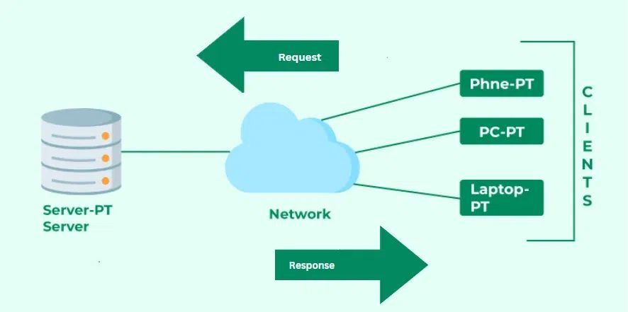
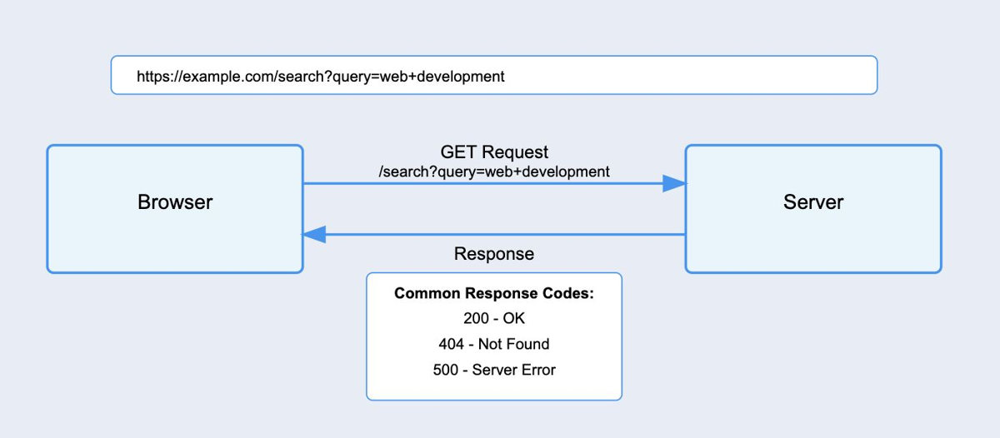
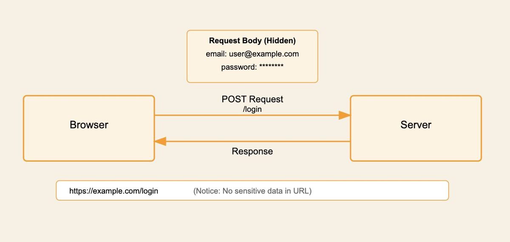
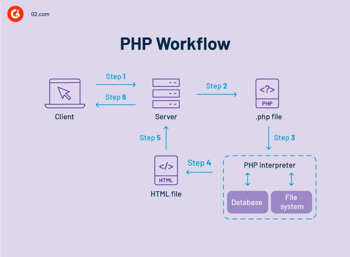

Week 11 covers web fundamentals and security: how websites work, HTML, CSS and JavaScript, forms, DNS and URLs, HTTP requests and status codes, GET vs. POST, PHP and how it works with HTML, web shells, common web attacks and secure web practices, plus a case study of the October 2026 **PHP2Shell** vulnerabilities.

*Sources: SEC-110 notes "Mod 12 – Web Fundamentals and Security" (taught as Week 11); Wiz Research, [PHP2Shell: unauthenticated RCE in PHP](https://www.wiz.io/blog/php2shell-php-rce); Wikipedia, [PHP2Shell](https://en.wikipedia.org/wiki/PHP2Shell).*

## Contents

1. [The Internet vs. the Web](#1-the-internet-vs-the-web)
2. [Building Blocks: HTML, CSS & JavaScript](#2-building-blocks-html-css--javascript)
   - [HTML](#html)
   - [CSS](#css)
   - [JavaScript](#javascript)
   - [HTML Forms](#html-forms)
3. [How the Web Delivers Pages](#3-how-the-web-delivers-pages)
   - [DNS, IP Addresses & URLs](#dns-ip-addresses--urls)
   - [Requests, Responses & Caching](#requests-responses--caching)
   - [HTTP Status Codes](#http-status-codes)
   - [GET vs. POST](#get-vs-post)
4. [PHP](#4-php)
5. [Web Shells](#5-web-shells)
6. [Common Web Attacks](#6-common-web-attacks)
7. [Secure Web Practices](#7-secure-web-practices)
8. [Case Study: PHP2Shell (2026)](#8-case-study-php2shell-2026)
9. [Sources & Credits](#9-sources--credits)

---

# 1. The Internet vs. the Web

| | **The Internet** | **The Web** |
| --- | --- | --- |
| **What it is** | The **global network** of computers and networks | A **service** that runs on the Internet |
| **What it does** | Provides connectivity and data transfer | Distributes and gives access to websites and web programs |

(Week 1 compared these too, along with [cyberspace](Week-1-‐-What-Is-Cybersecurity-&-Cyber-Threats#internet-vs-web-vs-cyberspace).)

## How Websites Work: the Client-Server Model

The **client-server model** is a network framework where **clients** ask **servers** for information or services.



Your browser (the **client**) sends a **request** across the network; the web **server** sends back a **response**: the page, image or data you asked for.

## Static vs. Dynamic Pages

| | **Static** | **Dynamic** |
| --- | --- | --- |
| **What it is** | Text files of HTML whose content **stays fixed** | Pages that are **interactive** and **change** based on user input or real-time data |
| **Example** | A simple "About Us" page | A social media feed, a shopping cart, a search results page |
| **Built with** | HTML (and CSS) | HTML plus JavaScript in the browser and/or server-side code like PHP |

**Markup tags** describe the structure of a page's content.

---

# 2. Building Blocks: HTML, CSS & JavaScript

| Language | Role | Analogy from the slides |
| --- | --- | --- |
| **HTML** | **Content and structure** | A plain white T-shirt (or a car's frame) |
| **CSS** | **Design and presentation** | Printing a design on the T-shirt (or painting the car) |
| **JavaScript** | **Interactivity** | Making the car actually drive |

## HTML

**HTML (HyperText Markup Language)** is the most basic building block of the Web. It describes and defines a page's content.

- **HyperText** means **links** that connect web pages, within one site or between sites.
- **Markup** means **annotating** text, images and other content so the browser knows how to display it.

An HTML **element** is made of an **opening tag**, **content** and a **closing tag**:

```html
<p>My cat is very grumpy</p>
```

| Part | Here |
| --- | --- |
| Opening tag | `<p>` (paragraph) |
| Content | `My cat is very grumpy` |
| Closing tag | `</p>` (the `/` means "end") |

**Common tags:**

| Tag | Meaning |
| --- | --- |
| `` | Image |
| `<b>` | Bold |
| `<a>` | Link ("anchor") |
| `<header>` | The introduction of a page or section |
| `<title>` | The page's title (shown in the browser tab) |
| `<body>` | The main content of the page |

**Basic HTML template:**

```html
<html>
  <head>
    <title>Title goes here</title>
  </head>
  <body>
    Webpage stuff goes here!
  </body>
</html>
```

| Line | What it does |
| --- | --- |
| `<html>` … `</html>` | Opens and closes the whole document |
| `<head>` … `</head>` | Information for the browser, **not displayed** on the page |
| `<title>` … `</title>` | The name printed in the **browser tab** |
| `<body>` … `</body>` | Everything that's **displayed** in the browser |

> **Note:** Real pages start with `<!DOCTYPE html>` on the very first line, which tells the browser to use modern HTML rules (you can see it in the [PHP example](#4-php) below). Also, `<header>` (a page section) and `<head>` (the hidden info block) are different tags.

## CSS

**CSS (Cascading Style Sheets)** describes the **design and presentation** of web pages: colors, fonts, sizes, spacing and layout.

```css
h1 {
  font-family: Arial, sans-serif;
  color: blue;
}
```

| Part | What it does |
| --- | --- |
| `h1` | The **selector**: which elements this style applies to (here, all `<h1>` headings) |
| `font-family: …;` / `color: …;` | **Property: value** pairs describing the style |

## JavaScript

**JavaScript (JS)** is a **client-side** scripting language (it runs in your **browser**) used to make web pages **interactive** and dynamic. Week 9 walked through a [JavaScript greeting example](Week-9-‐-Intro-to-CyberRange-&-Kali-Linux#javascript).

## HTML Forms

**HTML forms** accept **user input**: fields to fill in and buttons to click. The slides show a simple form asking for a name and email with a Submit button. Its code would look like this:

```html
<form action="welcome.php" method="get">
  Name: <input type="text" name="name"><br>
  E-mail: <input type="text" name="email"><br>
  <input type="submit" value="Submit">
</form>
```

| Part | What it does |
| --- | --- |
| `action="welcome.php"` | Where the form's data is sent (a server-side script) |
| `method="get"` | **How** it's sent ([GET vs. POST](#get-vs-post)) |
| `name="name"` / `name="email"` | The labels the server uses to read each field |
| `type="submit"` | The button that sends the form |

> **Note:** Forms are the main way user data reaches a server, which makes them a top target for attacks like [SQL injection](#6-common-web-attacks). Everything typed into a form must be treated as **untrusted**.

---

# 3. How the Web Delivers Pages

## DNS, IP Addresses & URLs

| Term | Meaning |
| --- | --- |
| **DNS** (Domain Name System) | Converts **domain names** into **IP addresses** ([Week 4](Week-4-‐-Networking-Basics-&-Network-Models#3-domain-name-system)) |
| **IP address** | The number that identifies a device on the Internet ([Week 4](Week-4-‐-Networking-Basics-&-Network-Models#ip-addresses)) |
| **URL** (Uniform Resource Locator) | The address that identifies a specific **resource** on the Internet |

**Parts of a URL:**

```text
https://www.example.com:443/search?query=web+development
```

| Part | Example | Meaning |
| --- | --- | --- |
| **Scheme** | `https` | The protocol |
| **Domain** | `www.example.com` | The server's name (looked up with DNS) |
| **Port** | `:443` | Usually hidden; 443 is the default for HTTPS |
| **Path** | `/search` | Which resource on the server |
| **Query string** | `?query=web+development` | Extra data sent to the server (`name=value` pairs) |

## Requests, Responses & Caching

| Term | Meaning |
| --- | --- |
| **Request/response cycle** | The client sends a **request** to the server, and the server sends back a **response** |
| **Caching** | **Temporarily saving** data (images, pages) on your computer so it loads faster next time |

## HTTP Status Codes

Every HTTP response includes a three-digit **status code**:

| Range | Category | Common examples |
| --- | --- | --- |
| **1xx** | Informational | `100 Continue` |
| **2xx** | **Success** | **`200 OK`**: the request succeeded |
| **3xx** | **Redirection** | `301 Moved Permanently`, `302 Found` |
| **4xx** | **Client error** (problem with the request) | **`400 Bad Request`**: the server couldn't understand the request because its format is wrong; `401 Unauthorized`; `403 Forbidden`; **`404 Not Found`**: the requested page doesn't exist |
| **5xx** | **Server error** (problem on the server) | `500 Internal Server Error`; `503 Service Unavailable` |

> **Clarification:** The slides describe `404` as "the requested website is not found." More precisely, the **server** was reached, but the specific **page or resource** doesn't exist on it. If the whole website can't be found, you get a DNS or connection error instead, with no status code at all.

## GET vs. POST

**HTTP methods** are the actions a client asks a web server to perform.

| | **GET** | **POST** |
| --- | --- | --- |
| **Purpose** | **Requests** data from a resource | **Sends** data to a server to **create or update** a resource |
| **Where the data goes** | In the **URL** query string | In the request **body** |
| **Example** | `https://example.com/search?query=web+development` | `https://example.com/login` with `email` and `password` in the body |
| **Shows in browser history, bookmarks and server logs?** | **Yes** | No |
| **Use for** | Searches, viewing pages | Logins, forms, uploads |





> **Clarification:** The POST diagram labels the request body "hidden." It's hidden from the **URL**, not **encrypted**. Without HTTPS, anyone sniffing the network can read a POST body, exactly like the [plaintext password in Week 10's Wireshark example](Week-10-‐-Network-Security#secure-protocol-example-in-wireshark). **Never send passwords with GET**, and always use HTTPS.

---

# 4. PHP

**PHP** (**P**HP: **H**ypertext **P**reprocessor) is a **server-side** scripting language for building **dynamic** web pages. It's used for handling **forms**, interacting with **databases**, and **user authentication**.

| | **HTML** | **PHP** |
| --- | --- | --- |
| **Role** | **Structure** | **Logic** |
| **Side** | **Front-end**: defines the page's content and structure | **Back-end**: processes data, talks to databases, generates content |
| **Runs on** | The browser displays it | **The server**, **before** the HTML is sent to the browser |



| Step | What happens |
| --- | --- |
| 1 | The **client** (browser) requests a page |
| 2 | The **server** finds the requested `.php` file |
| 3 | The **PHP interpreter** runs the code, reading from the **database** or **file system** if needed |
| 4 | The result is plain **HTML** |
| 5–6 | The server sends that HTML back to the client |

**Example: PHP inside HTML**

```php
<!DOCTYPE html>
<html>
<head>
    <title>PHP & HTML Together</title>
</head>
<body>
    <h1>Welcome!</h1>
    <?php
        $name = "Student";
        echo "<p>Hello, $name!</p>"; // PHP generates dynamic content
    ?>
</body>
</html>
```

| Line | What it does |
| --- | --- |
| `<h1>Welcome!</h1>` | Ordinary HTML |
| `<?php` … `?>` | Everything between these tags is **PHP**, run on the server |
| `$name = "Student";` | Creates a variable (PHP variables start with `$`) |
| `echo "<p>Hello, $name!</p>";` | Outputs HTML into the page |
| `// …` | A comment, ignored by PHP |

The browser receives only `<p>Hello, Student!</p>`. It **never sees the PHP code**, which is why PHP can safely hold things like database logic, and why a flaw in PHP itself is so serious ([section 8](#8-case-study-php2shell-2026)).

---

# 5. Web Shells

A **web shell** is a malicious script uploaded to a web server that lets an attacker **run operating system commands through a web page**.

**The slides' example:**

| | |
| --- | --- |
| **Setup** | A web server at `192.168.1.100` has a file called `shell.php` in its **web root** (`/var/www/html`, the folder the web server serves files from) |
| **Attacker types** | `http://192.168.1.100/shell.php?cmd=uname` |
| **Server does** | Runs the `uname` command (which prints the OS name) and sends back the result |
| **Attacker sees** | `Linux` |

Notice the command travels in a **GET** query string (`?cmd=uname`). From then on, the attacker can run any command the web server's user is allowed to run: read files, steal data, install more malware.

**How web shells get there:** usually through a vulnerability such as an **insecure file upload** form (uploading `.php` instead of an image), an unpatched web app or plugin, or stolen admin credentials.

**Defenses:**

| Defense | How it helps |
| --- | --- |
| Restrict file uploads | Only allow safe file types, and never let uploaded files run as code |
| Patch web software | Close the holes attackers use to plant shells |
| [Least privilege](Week-7-‐-System-Security#principle-of-least-privilege) | Run the web server as a low-privilege user, so a shell can do less |
| [File integrity monitoring](Week-7-‐-System-Security#integrity-monitoring) | Alert when a new or changed `.php` file appears in the web root |
| Web application firewall (WAF) | Block suspicious requests like `?cmd=` |

> **Safety note:** Only experiment with web shells inside the class **CyberRange** or another lab you're authorized to use. Uploading one to a real server you don't own is illegal unauthorized access under the CFAA ([Week 3](Week-3-‐-OSINT-&-Data-Security-Principles#key-laws)).

---

# 6. Common Web Attacks

| Attack | What it is | Defense (added) |
| --- | --- | --- |
| **SQL injection (SQLi)** | Injecting malicious code into **SQL** (database) statements through web page input | **Parameterized queries** (prepared statements), input validation |
| **Cross-site scripting (XSS)** | Injecting malicious **script** into a web application, which then runs in other users' browsers | **Escaping/encoding** output, `textContent` instead of `innerHTML` ([Week 9](Week-9-‐-Intro-to-CyberRange-&-Kali-Linux#javascript)), Content Security Policy |
| **Clickjacking** | Tricking a user into clicking something (often a hidden page layered on top) while they think it's something else | The `X-Frame-Options` / CSP `frame-ancestors` security header |
| **Man-in-the-browser (MitB)** | A **Trojan** installed in the user's **browser** that secretly reads or changes what they do, like altering a bank transfer | Antivirus, avoiding untrusted extensions, transaction confirmation on another device |

**Example: SQL injection.** A login page builds its database query from what the user types:

```sql
SELECT * FROM users WHERE username = 'alice' AND password = '...';
```

If the code just pastes the input into the query, a crafted username can **change the query's logic** (for example, adding a condition that's always true, or commenting out the password check), logging the attacker in without a password. Parameterized queries prevent this by keeping the user's input as **data**, never as part of the SQL code.

> **Note:** SQL injection and XSS are both **injection** attacks: user input gets treated as **code**. It's the same root problem as the `eval` calculator script in [Week 9](Week-9-‐-Intro-to-CyberRange-&-Kali-Linux#script-2-calculator).

---

# 7. Secure Web Practices

| Practice | What it does |
| --- | --- |
| **HTTPS** | The encrypted version of HTTP, protecting users from **eavesdropping** and **tampering** ([Week 10](Week-10-‐-Network-Security#6-encryption--secure-protocols)) |
| **Input validation** | Checking that user input meets specific rules (type, length, allowed characters) before using it |
| **Security headers** | Instructions the server sends the browser to help defend against attacks |

**Common security headers (added):**

| Header | Protects against |
| --- | --- |
| `Strict-Transport-Security` (HSTS) | Forces the browser to always use HTTPS |
| `Content-Security-Policy` (CSP) | Limits where scripts can load from, reducing XSS |
| `X-Frame-Options` | Stops the page being framed by other sites (clickjacking) |
| `X-Content-Type-Options: nosniff` | Stops the browser from guessing file types (e.g. treating an upload as a script) |

> **Note:** Input validation should happen **on the server**. Checks in the browser (HTML or JavaScript) are good for usability, but an attacker can skip the browser entirely and send requests directly.

---

# 8. Case Study: PHP2Shell (2026)

**PHP2Shell** is the name Wiz Research gave to two critical **memory-safety vulnerabilities in PHP itself**, disclosed on **October 21, 2026**. Because PHP runs about **70% of websites** with a known server-side language (including WordPress, Drupal, Joomla and MediaWiki), Wiz compared its severity to **Heartbleed** (2014).

## What It Is

| | |
| --- | --- |
| **CVEs** | **CVE-2026-109618** (upload-progress handling: use-after-free and remote **memory disclosure**) and **CVE-2026-109619** (fatal-error handling and OPcache: use-after-free and type confusion) |
| **Severity** | **CVSS 4.0: 9.2 (critical)** for both. Under CVSS 3.x, 9.8 and 8.1. watchTowr rated it 10.0. |
| **Impact** | **Unauthenticated remote code execution (RCE)**: an attacker with no login can run commands on the server, plus leaking sensitive memory (passwords, tokens, API keys, certificates) |
| **Affected** | **PHP 5.4 (2012) through 8.5**: essentially every version from the last decade |
| **Fixed in** | PHP **8.2.35, 8.3.36, 8.4.27 and 8.5.12**. Source patches for end-of-life 7.4, 8.0 and 8.1. |

**Why it matters for this week:** most web vulnerabilities are in the **application** (a bad form, a SQL injection). PHP2Shell is **below** the application, in the [PHP interpreter](#4-php) that runs every PHP page. So even a perfectly written website was vulnerable if its server ran an affected PHP version. The name reflects the outcome: getting from PHP to a **shell**, like the [web shell](#5-web-shells) in section 5, but without needing to upload anything.

## How It Works (Conceptually)

- When a PHP request **crashes partway through** (especially by running out of memory), PHP could leave **stale internal state** behind instead of cleaning up.
- A **later request** handled by the same worker process could then reuse that leftover state, pointing at memory that had already been freed (**use-after-free**).
- Attackers could use this to **read** other requests' memory, and then combine those leaks with memory corruption to **run their own code**.

The exploit chain was complex. Notably, **both discovery teams used AI models** (Wiz and Calif), making these among the first major vulnerabilities found with significant AI assistance. A PHP core developer had actually spotted one underlying out-of-memory bug in **2024**, but it was deprioritized because no exploit had been demonstrated.

## Timeline

| Date (2026) | Event |
| --- | --- |
| **August** | Found independently by **Calif** (Ryan Austin, using OpenAI's GPT-5.6 Sol for OpenAI's "Patch the Planet" project) and by **Wiz Research** (using Gemini 4 Argon, GPT-5.6 Sol and its own Wiz Atlas). Wiz dates its first find to **Aug 19** and confirmed RCE on Drupal (Aug 20) and WordPress (Aug 21). |
| **Aug 24** | Wiz reports to the PHP security team |
| **Sep 21** | PHP acknowledges and starts developing a fix |
| **Oct 17** | Amazon later found an exploitation **attempt** in its honeypot data from this date, four days before disclosure |
| **Oct 20** | Details **leak** (Hacker News, watchTowr on X, and an accidental proof-of-concept video from Calif). PHP announces an upcoming critical release; Cloudflare deploys emergency firewall rules. |
| **Oct 21** | Advisories go live (slightly early) and patches are released. An early patched package from Chainguard let attackers see the fix before the official release. watchTowr reports **in-the-wild exploitation**. |

## The Response

- **Governments:** CERT-EU, the UK's NCSC, Japan and Singapore urged immediate patching. The US NSA recommended **taking sites offline** if they couldn't be updated right away.
- **Precautionary shutdowns:** government sites in the Netherlands, Denmark, Finland, France and Canada; Wikimedia services; 4chan and Something Awful; and briefly the Internet Archive.
- **Help for defenders:** Cloudflare offered WAF rules to all customers including free accounts; cPanel and CloudLinux released backports; a volunteer maintainer packaged fixes for older versions.
- **Mitigation:** PHP's maintainers said **updating is the only complete fix**. WAF rules only reduce risk.

**Signs of attack to look for (per Wiz):** unusual multipart (file upload) requests followed by memory-limit errors or repeated **HTTP 500** responses ([status codes](#http-status-codes)), oversized or malformed `PHPSESSID` cookies, and PHP worker processes restarting unexpectedly. Application logs may show little, because the bugs are below the application.

## Lessons

| Lesson | Connection |
| --- | --- |
| **Patch fast** | Exploitation started within a day of disclosure; leaks gave attackers a head start. Same lesson as [WannaCry](Week-1-‐-What-Is-Cybersecurity-&-Cyber-Threats#wannacry-ransomware). |
| **Defense in depth** | WAF rules, monitoring and least privilege bought time when patching couldn't happen instantly ([Week 10](Week-10-‐-Network-Security#defense-in-depth)) |
| **Secure code isn't enough** | Your app depends on the platform under it, which has its own vulnerabilities |
| **Critical open-source is under-resourced** | The Guardian noted the PHP Foundation had only about 13 staff and relies on donations |
| **AI cuts both ways** | AI helped defenders find the bugs, and also helps attackers adapt exploits faster |

> **Note:** My two sources disagree on a few details. Wiz's post reports **no observed exploitation in the wild** and dates the first discovery to **Aug 19**; Wikipedia reports **exploitation on Oct 21** (from watchTowr) and an attempt on Oct 17 (from Amazon), and lists **Aug 1** as the discovery date. Wiz's post may have been written before those reports came in.
>
> **Note:** This section is a conceptual summary only. It deliberately doesn't include exploit details.

---

# 9. Sources & Credits

**Class materials**

- SEC-110 notes: *Mod 12 – Web Fundamentals and Security*

**Links**

- [Wiz Research: PHP2Shell – unauthenticated RCE in PHP](https://www.wiz.io/blog/php2shell-php-rce)
- [Wikipedia: PHP2Shell](https://en.wikipedia.org/wiki/PHP2Shell)

<details>
<summary><b>Image credits (from the course slides)</b></summary>

- Client-server model diagram, GET and POST request diagrams, and PHP workflow (G2.com): from the Mod 12 notes
- HTTP status code chart, HTML template, and PHP example code: typed out from the Mod 12 notes

</details>
