Week 13 introduces digital forensics: what it is, the skills and jobs involved, artifacts vs. evidence, patent vs. latent evidence, common Windows artifacts, the forensic tools Magnet AXIOM and Autopsy, and a step-by-step guide to setting up a case in AXIOM.

*Sources: SEC-110 notes "Mod 13 – Intro to Digital Forensics" and the handout "How to Setup AXIOM."*

## Contents

1. [What Is Digital Forensics?](#1-what-is-digital-forensics)
2. [Skills & Jobs](#2-skills--jobs)
3. [Artifacts & Evidence](#3-artifacts--evidence)
4. [Common Artifacts](#4-common-artifacts)
5. [Forensic Tools](#5-forensic-tools)
6. [How to Set Up AXIOM](#6-how-to-set-up-axiom)
   - [Part 1: Create the Case in AXIOM Process](#part-1-create-the-case-in-axiom-process)
   - [Part 2: Process the Evidence](#part-2-process-the-evidence)
   - [Part 3: Explore in AXIOM Examine](#part-3-explore-in-axiom-examine)
7. [Sources & Credits](#7-sources--credits)

---

# 1. What Is Digital Forensics?

NIST defines **digital forensics** as *"the application of computer science and investigative procedures involving the examination of digital evidence."*

- The process of **extracting evidence** from computers and electronic devices
- Usually for **cybercrimes**, but also for other cases (fraud, harassment, even murder investigations, where a phone's location history can matter)
- Also called **computer forensics**. It's commonly paired with incident response as **DFIR** (Digital Forensics and Incident Response).

> **Note:** NIST's full definition continues: following proper **search authority**, **chain of custody**, validation with mathematics, use of **validated tools**, **repeatability**, **reporting** and possibly **expert testimony**. In other words, it isn't just finding data. It's finding it in a way that will **hold up in court**.

**Core forensic principles (added):**

| Principle | Why it matters |
| --- | --- |
| **Work on a copy** | Investigators make a bit-for-bit **forensic image** of a drive (like the class's `.E01` file) and examine the copy, never the original |
| **Don't change the evidence** | A **write blocker** lets you read a drive without accidentally writing to it |
| **Prove it's unchanged** | **Hash** the original and the image ([Week 6](Week-6-‐-PKI-&-Hash-Functions#4-uses-of-hash-functions)). Matching hashes prove the copy is exact and hasn't been altered. |
| **Chain of custody** | A record of **who** handled the evidence, **when**, and **what** they did with it. A gap can get evidence thrown out. |

---

# 2. Skills & Jobs

Many cybersecurity skills apply to digital forensics, and the reverse.

| Skill | Why forensics needs it |
| --- | --- |
| **Operating systems** (Windows, macOS, Linux, iOS, Android) | Each one stores artifacts in different places |
| **Coding** | Writing scripts to parse data or automate analysis ([Week 9](Week-9-‐-Intro-to-CyberRange-&-Kali-Linux#6-scripting)) |
| **Malware analysis** | Figuring out what malicious software did on a machine |
| **Network security** | Reading network traffic and logs ([Week 10](Week-10-‐-Network-Security)) |
| **Cryptography** | Dealing with encrypted data and verifying hashes |
| **Law** | Knowing what you're **legally allowed** to search and how evidence must be handled |
| **Ethics** | Handling private data responsibly and reporting honestly |

**Jobs in digital forensics** form a pyramid, from beginner to specialist:

| Level | Area | Example roles |
| --- | --- | --- |
| **1. Beginner** | Entry level | Entry-level technician, IT support / network specialist, cybersecurity technician, **SOC analyst** |
| **2. Core** | Network security | Entry-level network admin / security admin, data security analyst, security operator |
| | Ethical hacking | Vulnerability assessment analyst, cybersecurity analyst (levels 1–3), cyber defense analyst |
| **3. Specialization** | Incident handling | Incident response lead / manager, engagement lead |
| | Forensics investigation | Cryptanalyst, **forensic computer analyst** |

---

# 3. Artifacts & Evidence

**Artifacts** are anything that **can be used as evidence** in a case. They can show:

- **Process execution** (which programs ran, and when)
- **Information about the device**
- Currently installed **apps**
- **Folders** that were opened
- **Internet connections** that were made
- And much more

**Class question: what would you look at during a case?** Think about who used the computer, when, what they ran, what files they touched, and where they went online.

## Patent vs. Latent Evidence

| | **Patent** | **Latent** |
| --- | --- | --- |
| **Meaning** | Evidence that's **immediately visible** | Evidence that must be **extracted and/or found** |
| **Physical example** | A visible footprint | A fingerprint that needs dusting powder |
| **Digital example** | A file sitting on the desktop | Deleted files, browser history, event logs, registry entries |

**Digital forensic artifacts are usually latent**: you need tools like AXIOM to find and extract them.

## Artifacts vs. Evidence

**So artifacts are evidence, right? Not quite.**

- **Judges and lawyers decide** what counts as evidence in a case.
- Artifacts are things that **could** be evidence.
- Forensic **reports** are written with that in mind: the examiner reports what the artifacts **show**, factually, and the court decides how much weight they carry.

> **Note:** This is where [Week 8's lesson on bias](Week-8-‐-Bias-in-Information#5-types-of-bias) matters. An examiner who decides early who's guilty risks **confirmation bias**: only reporting artifacts that fit. Good reports state what the data shows **and** what it doesn't (for example, an artifact can show *a* user account did something, not necessarily *which person* was at the keyboard).

---

# 4. Common Artifacts

| Artifact | Where / what | What it can show |
| --- | --- | --- |
| **Event logs** | `C:\Windows\System32\winevt\Logs` | Events on the machine: **power on/off**, **logon/logoff**, **remote access** |
| **File system** | All the files on the drive (AXIOM has a dedicated **File System** view) | Especially **user files**: Documents, Downloads, Desktop, etc. |
| **Web related** | Browser data from **every browser** on the device | **Google searches**, **browsing history** and much more |

**Event log example.** In the slides' AXIOM screenshot, a Windows event log entry with **Event ID 4720**, "**A user account was created**," shows exactly when (date and time) a new account appeared on the computer:

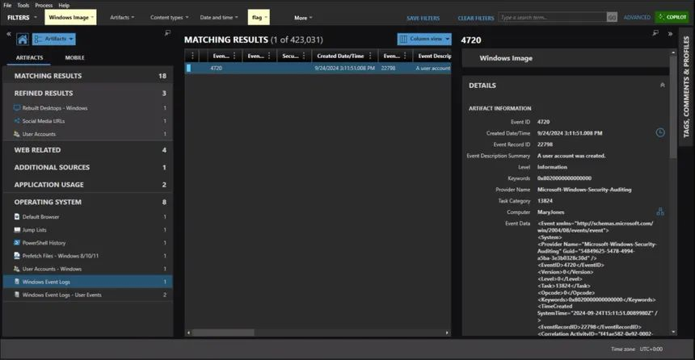

**Useful Windows event IDs (added):**

| Event ID | Meaning |
| --- | --- |
| **4624** | Successful logon |
| **4625** | Failed logon |
| **4634 / 4647** | Logoff |
| **4720** | User account created |
| **6005 / 6006** | Event Log service started / stopped (a sign the computer powered on / shut down) |

**Web-related example.** AXIOM groups browser artifacts by type, such as history, bookmarks, cache and open tabs:

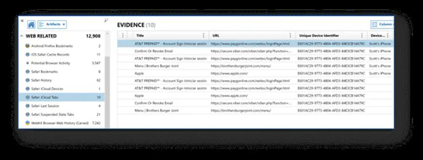

> **Note:** Times in forensic tools are often shown in **UTC** (AXIOM's status bar shows "Time zone UTC+0:00"). Always check the time zone before saying when something happened: 3:11 PM UTC is 11:11 AM in Vermont during daylight saving time.

---

# 5. Forensic Tools

| | **Magnet AXIOM** | **Autopsy** |
| --- | --- | --- |
| **What it is** | A highly popular commercial forensics tool | A **free and open-source** forensics platform |
| **Covers** | **Desktop, mobile and cloud** forensics | Mainly computer/disk forensics |
| **Access** | **Free for Champlain students**, and used in class | Free for anyone to download |
| **Learning help** | Magnet's training resources | Many free resources online; you can also ask professors and current students |

AXIOM comes in two parts:

| Program | Job |
| --- | --- |
| **AXIOM Process** | **Loads** the evidence and **processes** it, searching the image and pulling out artifacts |
| **AXIOM Examine** | Lets you **browse, search and report on** the processed results |

---

# 6. How to Set Up AXIOM

*From the "How to Setup AXIOM" handout. You'll need the **`.E01`** evidence file provided for the case.*

> **Note:** An **`.E01`** file is a forensic disk image in the **EnCase Evidence File** format. Besides the copy of the disk, it stores **case metadata** and **hashes** so the image can be verified.

## Part 1: Create the Case in AXIOM Process

**Step 1. Make the case.** Open **AXIOM Process** and click **Create New Case**.

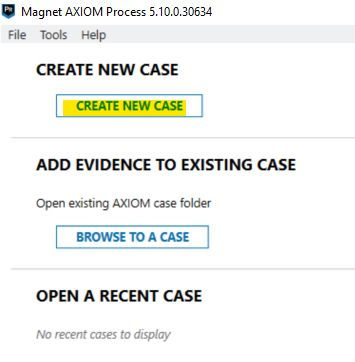

**Step 2. Case details.**

- Enter **any number** for the **Case Number**.
- Click **Browse**, make a folder where you'd like the case files to be stored, and select it.
- Click **Go to Evidence Sources** (bottom right).

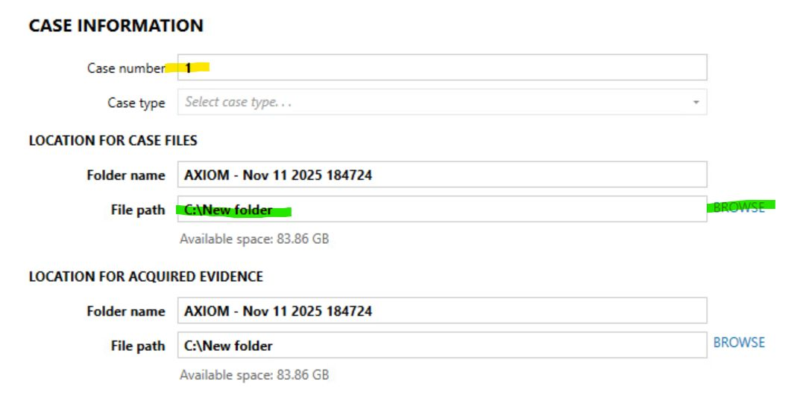

**Step 3. Choose the evidence source.** Select **Computer → Windows → Load Evidence → Image**, then select the `.E01` file you were given.

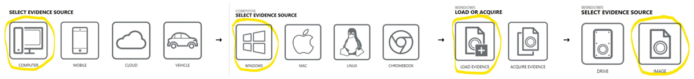

| Screen | Choose | Why |
| --- | --- | --- |
| Select evidence source | **Computer** | (not Mobile, Cloud or Vehicle) |
| Computer | **Windows** | The image is of a Windows machine |
| Load or acquire | **Load Evidence** | The image already exists. **Acquire** would mean making a new image from a connected device. |
| Select evidence source | **Image** | You're loading an image file, not a physical **drive** |

**Step 4. Confirm the evidence.** You should see the image listed (names and disk size may differ):

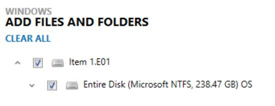

Click **Next** until you see **Go to Processing Details** in the bottom right.

## Part 2: Process the Evidence

**Step 5. Processing details.** You'll see the **Processing Details** page (options like adding keywords to search, calculating hash values, and categorizing pictures). Leave the defaults unless your instructor says otherwise.

**Step 6. Analyze evidence.** Click **Analyze Evidence** in the left sidebar, then **Analyze Evidence** in the bottom right.

**Step 7. Close Examine for now.** **AXIOM Examine** will start and pop up automatically. **Close it for now** to save computer resources while processing runs.

**Step 8. Wait for processing.** Return to **AXIOM Process**, which shows its progress:

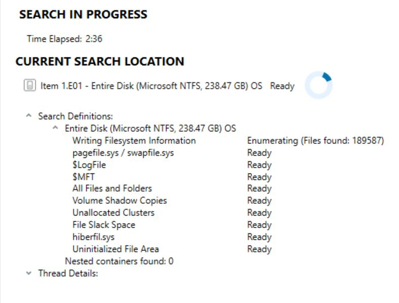

**Step 9. Processing complete.** When it finishes, you'll see **Search Complete**. Press **Close** (bottom right).

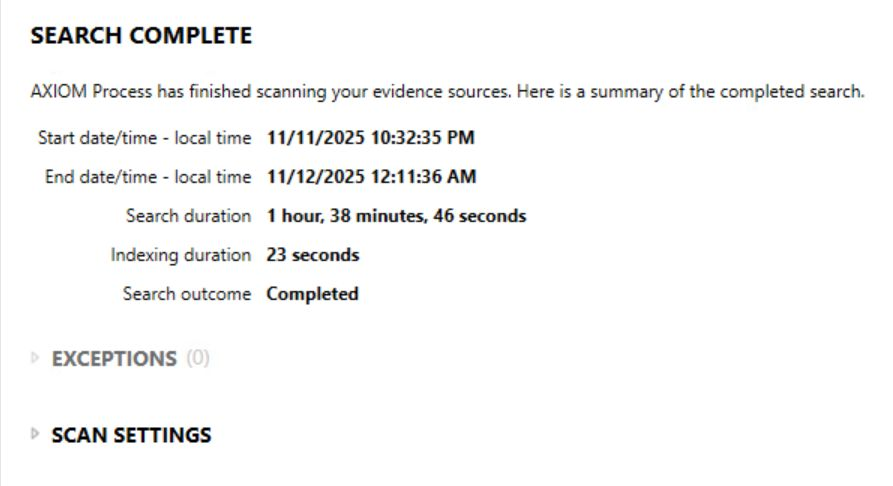

> **Tip:** In the handout's example, processing a 238 GB disk took about **1 hour 39 minutes**. Start early, and keep the computer plugged in and awake.
>
> **Note:** The search list shows places latent evidence hides: **`$MFT`** (the NTFS Master File Table, a record of every file), **unallocated clusters** (space where deleted files may still exist), **file slack space**, **`pagefile.sys`** and **`hiberfil.sys`** (memory saved to disk), and **Volume Shadow Copies** (older snapshots of files).

## Part 3: Explore in AXIOM Examine

**Step 10. Open the case.** Open **AXIOM Examine** and double-click your case under **Open a Recent Case**.

**Step 11. Load all results.** You'll see a screen like earlier, but with many more artifacts under **Artifact Categories**. If there's a **Load More Results** button (bottom left), click it. Then click **View All Artifact Categories**.

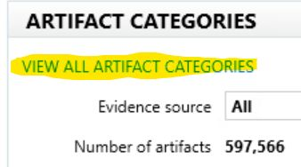

**Step 12. The artifact view** has three panels:

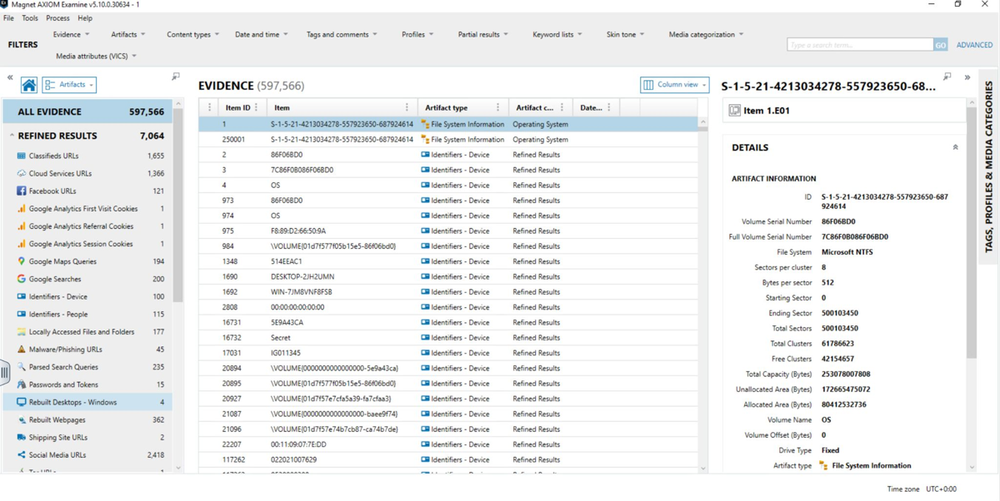

| Panel | Shows |
| --- | --- |
| **Left** | The **artifact categories** (e.g. Google Searches, Passwords and Tokens, Social Media URLs), with counts |
| **Center** | All the **items** in the selected category |
| **Right** | **Details** of the selected item |

**Step 13. File system view.** To see the files on the drive, click the dropdown next to the **Home** icon (it says **Artifacts**) and choose **File system**.

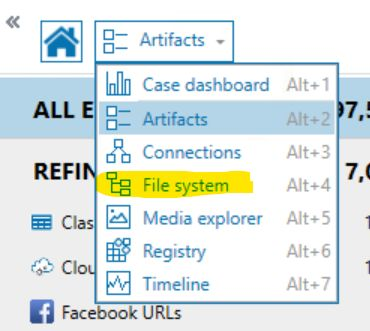

**Step 14. Browse the drive.** Expand the arrows in the left panel until you see folder icons. This is likely the **C:** drive of the image, though it isn't always.

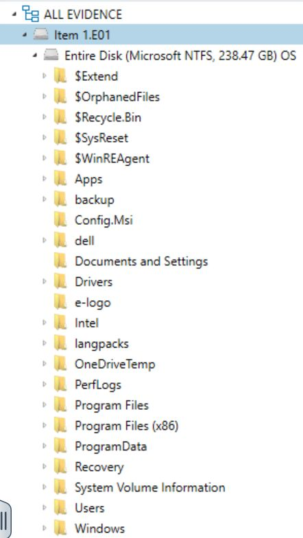

Good places to start, based on the [common artifacts](#4-common-artifacts): `Users\<name>\Documents`, `Downloads` and `Desktop`; `$Recycle.Bin` (deleted files); and `Windows\System32\winevt\Logs` (event logs).

**Good luck with the case!**

> **Note:** The case questions are graded, so this page only covers setup and navigation, not the case's answers.

**AXIOM setup at a glance:**

| # | Program | Step |
| --- | --- | --- |
| 1 | Process | Create New Case |
| 2 | Process | Case number + case folder → Go to Evidence Sources |
| 3 | Process | Computer → Windows → Load Evidence → Image → select `.E01` |
| 4 | Process | Next → Go to Processing Details |
| 5–6 | Process | Analyze Evidence (sidebar), then Analyze Evidence (bottom right) |
| 7 | Examine | Close it while processing runs |
| 8–9 | Process | Wait for Search Complete → Close |
| 10 | Examine | Open a Recent Case → your case |
| 11 | Examine | Load More Results (if shown) → View All Artifact Categories |
| 12–14 | Examine | Browse artifacts; Artifacts dropdown → File system |

---

# 7. Sources & Credits

**Class materials**

- SEC-110 notes: *Mod 13 – Intro to Digital Forensics*
- SEC-110 handout: *How to Setup AXIOM*

<b>Image credits (from the course materials)</b>

- AXIOM event log and web-related artifact screenshots: from the Mod 13 notes
- AXIOM Process and Examine screenshots: from the How to Setup AXIOM handout (the four evidence-source screens combined into one image)
- Jobs pyramid: typed out as a table from the Mod 13 notes

