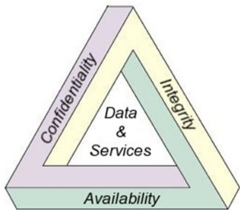
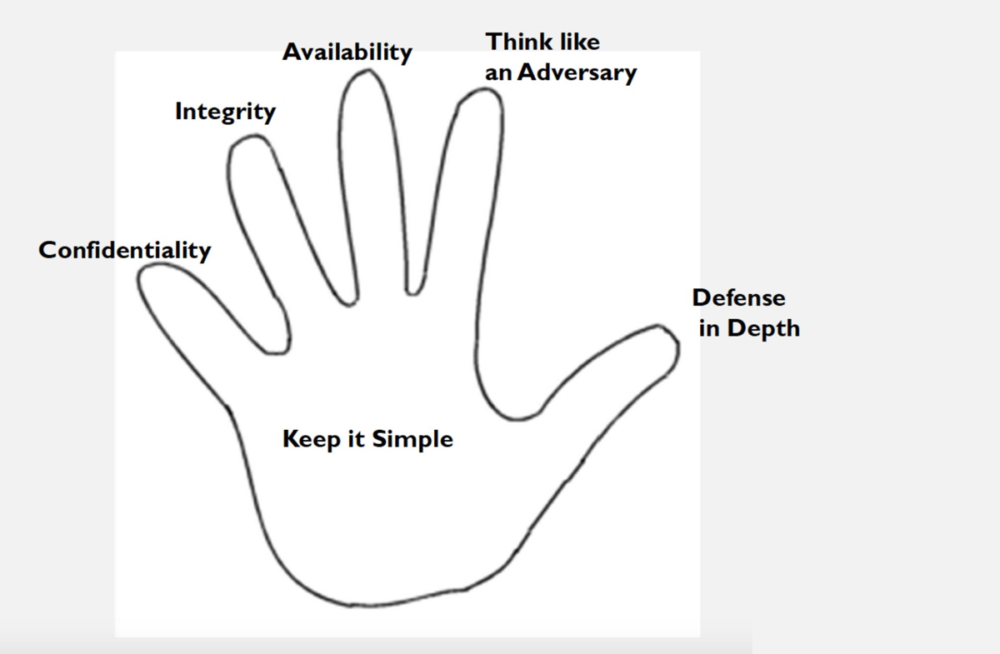
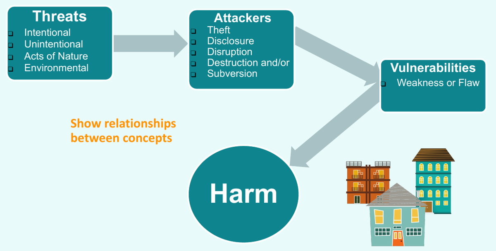
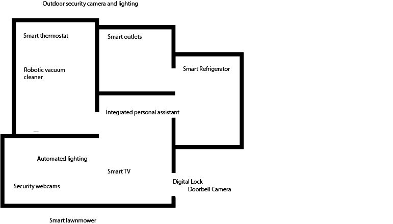
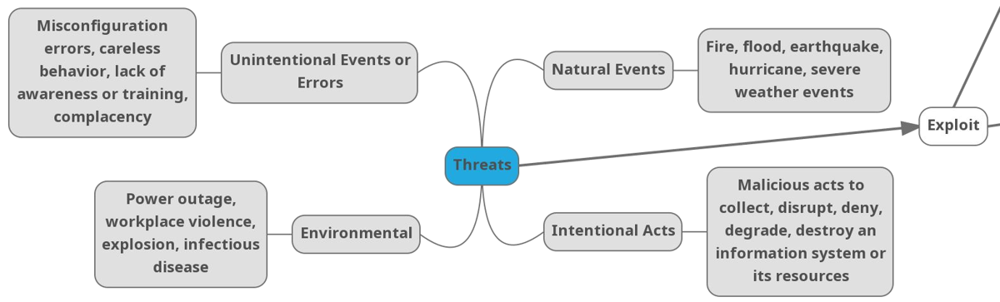
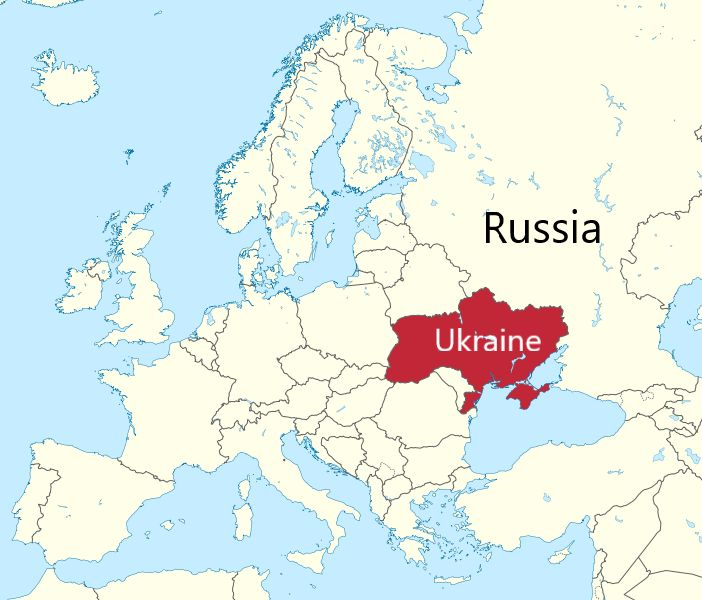
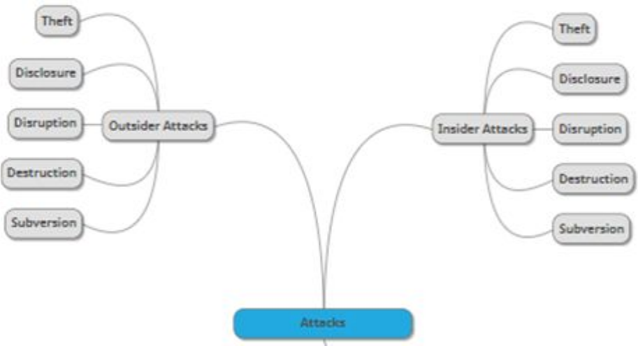

Week 2 covers the foundations of cybersecurity (the CIA triad and the six cybersecurity concepts), the difference between threats, vulnerabilities and attacks, how software flaws break confidentiality, integrity and availability, who the adversaries are and what drives them, insider vs. outsider threats, and why cybersecurity comes down to managing risk.

*Sources: SEC-110 notes deck "Cybersecurity Foundations Triad, and Cybersecurity Concepts" and SEC-110 slides "Module 2 - Risk, Adversity, and Trust" (Unit 2, Lesson 2).*

## Contents

1. [Cybersecurity Foundations](#1-cybersecurity-foundations)
   - [The CIA Triad](#the-cia-triad)
   - [The Six Cybersecurity Concepts](#the-six-cybersecurity-concepts)
2. [Threats, Vulnerabilities & Attacks](#2-threats-vulnerabilities--attacks)
   - [Key Definitions](#key-definitions)
   - [Kinds of Threats, Attackers & Vulnerabilities](#kinds-of-threats-attackers--vulnerabilities)
   - [Activity: The Smart Home](#activity-the-smart-home)
3. [Software Vulnerabilities & the CIA Triad](#3-software-vulnerabilities--the-cia-triad)
   - [Loss of Confidentiality](#loss-of-confidentiality)
   - [Loss of Integrity](#loss-of-integrity)
   - [Loss of Availability](#loss-of-availability)
4. [Threat Sources](#4-threat-sources)
   - [Natural Disasters & Disaster Planning](#natural-disasters--disaster-planning)
   - [Environmental Factors](#environmental-factors)
   - [Unintentional Threats](#unintentional-threats)
   - [Intentional Threats](#intentional-threats)
5. [Adversaries](#5-adversaries)
   - [What Drives an Adversary](#what-drives-an-adversary)
   - [Advanced Persistent Threats](#advanced-persistent-threats)
   - [Case Study: Ukraine & Sandworm](#case-study-ukraine--sandworm)
6. [Insiders vs. Outsiders](#6-insiders-vs-outsiders)
7. [Why Cybersecurity Is a Hard Problem](#7-why-cybersecurity-is-a-hard-problem)
8. [Risk](#8-risk)
9. [My Notes](#9-my-notes)
10. [Sources & Credits](#10-sources--credits)

---

# 1. Cybersecurity Foundations

## The CIA Triad

The foundational goals of cybersecurity are summed up in the **CIA triad**. (Week 1 introduced these as part of [NIST's definition of cybersecurity](Week-1-‐-What-Is-Cybersecurity-&-Cyber-Threats#cybersecurity-defined).)

| Goal | In one line | Formal definition (notes deck) |
| --- | --- | --- |
| **Confidentiality** | Only those who should have access to data do. | Information is **not disclosed** to unauthorized individuals, entities or processes. This means preserving authorized restrictions on access and disclosure, including protecting **personal privacy** and **proprietary information**. |
| **Integrity** | The data hasn't been changed. | Assurance that information is **accurate and trustworthy**. Information must be protected from **unauthorized modification**. |
| **Availability** | Data is accessible when needed. | Information is **accessible to authorized persons**. |

## The Six Cybersecurity Concepts

The **"hand model"** (from the GenCyber program) adds three more concepts to the CIA triad, one per finger plus the palm. The extra three exist to **further support CIA**.

| Concept | What it means |
| --- | --- |
| **Confidentiality** | Keep information from unauthorized people (see above). |
| **Integrity** | Keep information accurate and unchanged (see above). |
| **Availability** | Keep information accessible to authorized people (see above). |
| **Defense in Depth** | Put **multiple layers of security controls** in place, so if one layer fails, another is already there to stop the attack or unauthorized access. |
| **Think Like an Adversary** | Consider what the opposing force (the **adversary**) might do against you. Anticipating their actions lets you build defenses that prevent unauthorized access and data loss. |
| **Keep It Simple** | Keep programs and system designs **simple**, without weakening the ability to protect data. Simpler systems have fewer places for flaws to hide. |

> **Note:** "Keep it simple" ties back to Week 1's point that [complexity makes cybersecurity hard](Week-1-‐-What-Is-Cybersecurity-&-Cyber-Threats#3-why-cybersecurity-is-hard-complexity). Every extra feature or connection is more to defend.

---

# 2. Threats, Vulnerabilities & Attacks

**Learning objectives for this lesson:**

- **U2.L2.1** Differentiate among threats, vulnerabilities and attacks.
- **U2.L2.2** Identify the impact of software vulnerabilities on confidentiality, integrity and availability.
- **U2.L2.3** Describe adversaries in terms of their resources, capabilities and motivations.
- **U2.L2.4** Identify threats that don't have malicious intent.

**Warm-up: home security.** What are the vulnerabilities in your home's security? What is a threat to your home? What is an example of an attack on your home? An unlocked window is a **vulnerability**, a burglar is a **threat**, and the burglar climbing through the window is the **attack**.

The concept map below shows how the ideas connect: threats and attackers find vulnerabilities, and the result is harm.

## Key Definitions

| Term | Definition (NIST) | Key point |
| --- | --- | --- |
| **Threat** | Anything that can exploit a vulnerability, intentionally or accidentally, and obtain, damage or destroy an asset. Formally: any circumstance or event with the potential to adversely impact **organizational operations** (mission, functions, image, reputation), **organizational assets**, **individuals**, **other organizations** or **the Nation** through an information system, via unauthorized access, destruction, disclosure, modification of information, and/or denial of service. | A threat **requires a vulnerability**. Not all threats are malicious, e.g. a user accidentally clicking a phishing link. |
| **Vulnerability** | A weakness in an information system, system security procedures, internal controls or implementation that could be exploited or triggered by a threat source. | A vulnerability is **exploited** (used). |
| **Attack** | Any malicious activity that attempts to collect, disrupt, deny, degrade or destroy information system resources or the information itself. Also: an attempt to gain unauthorized access to system services, resources or information, or to compromise integrity, availability or confidentiality. | **Attacks arise when threats exploit vulnerabilities.** |

## Kinds of Threats, Attackers & Vulnerabilities

**Threats can be:**

| Type | Examples |
| --- | --- |
| **Natural events** | Floods, wildfires, hurricanes, earthquakes |
| **Environmental events** | Climate change, a global pandemic, power outages/brownouts |
| **Unintentional events** (non-malicious) | Human error: misconfiguration, lack of awareness, complacency |
| **Intentional acts** | Deliberate attacks by an adversary |

**Attackers can be:**

- A curious teenager, a disgruntled worker, hacktivists, sophisticated criminal organizations, terrorists, or a nation-state or affiliated group
- Motivated by **theft, disclosure, disruption, destruction and/or subversion**
- **Inside or outside** the organization

**Vulnerabilities can be:**

| Type | Examples |
| --- | --- |
| **Human** | Errors from lack of awareness, carelessness |
| **Physical** | Unlocked doors, **shoulder surfing** (watching someone type), **dumpster diving** (searching trash for information), lost or stolen hardware |
| **Network** | Mobile use, e.g. untrusted Wi-Fi |
| **Hardware** | "Evil" (malicious) hardware, design flaws |
| **Software** | Lack of secure coding practices |
| **System** | Combining components can create vulnerabilities that none of the parts have on their own |

## Activity: The Smart Home

With a partner, identify example **threats, attackers and vulnerabilities** in this smart home.

Devices in the home: smart thermostat, robotic vacuum cleaner, smart outlets, smart refrigerator, integrated personal assistant, automated lighting, smart TV, security webcams, digital lock, doorbell camera, outdoor security camera and lighting, and a smart lawnmower.

> **Hint:** For each device, ask what it can **see or hear** (confidentiality), what it can **control** (integrity), and what happens if it **stops working** (availability). Then think about who might want to misuse it, and what non-malicious threats (a power outage, a forgotten default password) could hit it.

---

# 3. Software Vulnerabilities & the CIA Triad

A **software vulnerability** is a security flaw, glitch or weakness in software that an attacker can exploit. Software is everywhere: operating systems, apps, websites, game consoles, car systems, medical devices and smart home gadgets.

**Why secure software matters, using school as an example:**

| If insecure software let someone... | You'd lose... |
| --- | --- |
| View or steal your grades | **Confidentiality** |
| Change your homework scores, lowering each by 1–5 points | **Integrity** |
| Keep you from accessing a timed online exam | **Availability** |

## Loss of Confidentiality

**Sony Pictures (2014).** Attackers published private corporate data, including embarrassing emails. Five Sony films showed up on illegal file-sharing sites, and *The Interview* was pulled from its Christmas Day release. The attack was attributed to **North Korean** hackers.

> **Clarification:** The slide says the attack was in December 2014 and that Sony was "held ransom." The breach became public on **24 November 2014**, and the leaks continued through December. It wasn't ransomware: the attackers (calling themselves "Guardians of Peace") stole data, ran wiper malware that destroyed Sony's computers, and made threats about the film's release.

**SolarWorld (2014).** The US Justice Department indicted **five members of the Chinese People's Liberation Army** for hacking several large US companies, including the solar maker SolarWorld. They stole emails and attachments with financial data, proprietary technology, production methods and costs, and strategy discussions. The slides note that this IP theft, along with unfair subsidies, helped China flood the US market with cheap solar panels. It's a loss of time, money and R&D.

**Equifax (2017).** (Revisited from earlier.)

- Attackers stole names, Social Security numbers, birth dates and addresses for up to **145.5 million** people, plus some driver's license data.
- Causes: an unpatched flaw in a web component called **Apache Struts**, plus **human error**. Encrypted traffic wasn't being inspected because a **digital certificate had expired**.

> **Modern note:** Equifax later raised the total to about **147 million** people. The Struts patch had been available about two months before the breach. The expired certificate was on a traffic-inspection device and had been expired for about 19 months, so the stolen data left the network unseen.

**Other examples from the slides:**

- **Smart home assistants** (Amazon Echo, Google Home, Facebook Portal, Apple iPhones) can be hacked with a laser, and in other cases turned into **surveillance devices** that leak confidential data.
- **Location tracking** data revealed people's locations and mapped out **secret military bases**.
- People have lost sensitive data such as banking, health care, location and **home absences**, which tells a burglar when it's a good time to break in.

> **Note:** The laser attack is "Light Commands" (2019): researchers shone a laser at a device's microphone to silently inject voice commands. The military-base leak came from the **Strava** fitness app's public heat map (2018), which showed soldiers' running routes.

## Loss of Integrity

- **Jeep Cherokee (2015).** Two researchers wirelessly took control of a Jeep's air conditioning, audio, volume and windshield wipers. They could even **disable the brakes and transmission** and put their own images on the in-dash display.
- **Medtronic insulin pump.** The FDA issued a recall of the Medtronic **MiniMed** insulin pump. An unauthorized person could record and **replay** the wireless commands between the remote and the pump, then **over-deliver insulin or stop it**.

> **Note:** The Jeep research (by Charlie Miller and Chris Valasek) led Chrysler to recall about **1.4 million vehicles**. The Medtronic recall was in 2019. Recording a valid command and sending it again later is called a **replay attack**.

## Loss of Availability

- **Mirai (2016).** (Revisited.) This **botnet** infected vulnerable **IoT devices** (cameras, routers) across the Internet and used them as **zombies**. The infected devices took instructions from **command-and-control (C&C) servers** and launched massive **DDoS** attacks.
- **City of Baltimore (2018).** A ransomware attack forced the city to temporarily shut down its **911 computer-aided dispatch system**. **Human error**, a firewall change, left a port open to the Internet for about 24 hours. The attackers were likely running automated scans for exactly that kind of opening.
- **Germany (September 2020).** The slides call this the first known death from a cyberattack: a woman was turned away from a hospital crippled by ransomware and died.

> **Clarification:** That case was at Düsseldorf University Hospital. German prosecutors later concluded that the delay probably **didn't cause** the patient's death, because she was too ill to have survived anyway, so it isn't confirmed as a cyberattack death. It's still a clear example of ransomware putting lives at risk.

**At a glance:**

| Case | Year | CIA goal lost | Vulnerability |
| --- | --- | --- | --- |
| Sony Pictures | 2014 | Confidentiality (and availability: wiped machines) | Network intrusion |
| SolarWorld | 2014 | Confidentiality (IP theft) | Network intrusion |
| Equifax | 2017 | Confidentiality | Unpatched Apache Struts + expired certificate |
| Jeep Cherokee | 2015 | Integrity | Remotely reachable car software |
| Medtronic MiniMed | 2019 recall | Integrity | Unauthenticated wireless commands |
| Mirai | 2016 | Availability | IoT devices with default passwords |
| Baltimore 911 | 2018 | Availability | Open port from a firewall change |

---

# 4. Threat Sources

A **cyber threat** is an attempt to damage or disrupt a computer network or system. Cyber threats become real when vulnerabilities exist in a **network**, **hardware** or **software** that let an attacker reduce a system's **information assurance**.

## Natural Disasters & Disaster Planning

- Tornadoes, landslides, earthquakes, fires, floods and severe weather threaten **physical security**.
- **Countermeasures:** fire suppression systems, earthquake-proof server racks, elevated floors, tornado shelter rooms.
- **Off-site storage and backup systems** reduce the impact.

**Disaster planning** keeps confidentiality, integrity and availability intact during natural disasters. It covers prevention, detection, and response and recovery:

> **Protection = Prevention + Detection + Response**

## Environmental Factors

- Power outages or brownouts, explosions, workplace violence, infectious disease
- Responses: **power redundancy plans** (backup generators, UPS) and disaster planning

## Unintentional Threats

- Human error, uninformed employees, careless behavior, lack of awareness and complacency. These are **unintentional and not malicious**.
- Reduce the risk with **employee training, reminders and awareness campaigns**.

**Group activity:** make a list of intentional threats and a list of unintentional threats.

> **Hint:** Ask whether the person *meant* to cause harm. Emailing a file to the wrong person and stealing a file can expose the same data, but only one is intentional.

## Intentional Threats

| Threat source | Main motivations |
| --- | --- |
| **National governments** (state actors, APTs) | Disruption, destruction |
| **Terrorists** | Theft, destruction, disruption |
| **Industrial spies & organized crime groups** | Theft and fraud for money |
| **Hacktivists** | Ideology: disrupt, or disclose to gain attention |
| **Hackers** | Disruption, disclosure |
| **Botnet operators** | Take control of systems to disrupt |
| **Phishers & spammers** | Identity theft, stealing information for money |
| **Insiders** | Use their access for theft, disruption or destruction |

Week 1 covered several of these motives in more depth, such as [hacktivism](Week-1-‐-What-Is-Cybersecurity-&-Cyber-Threats#hacktivism) and [espionage](Week-1-‐-What-Is-Cybersecurity-&-Cyber-Threats#espionage).

---

# 5. Adversaries

An **adversary** (NIST) is:

- An individual, group, organization or government that conducts, or intends to conduct, **detrimental activities**.
- An entity that is **not authorized** to access or modify information, or that works to **defeat the protections** on that information.

## What Drives an Adversary

**Motivations:**

| Motivation | Examples |
| --- | --- |
| **Theft** | Selling stolen data on underground markets, ransomware, competitive advantage |
| **Disclosure** | A grudge, ideology |
| **Disruption** | Defacement, DoS and DDoS attacks, ideology |
| **Destruction** | Wiping data or damaging systems |
| **Subversion** | Cyberwar: secretly undermining a system or a nation |

**How an adversary attacks depends on four things:**

| Factor | What it covers |
| --- | --- |
| **Resources** (financial and other) | Government-supported, or financed by theft |
| **Capabilities / techniques** | Organized and state-supported, or an individual. Skill ranges from an organized nation-state team to a **script kiddie** (someone running other people's tools without understanding them). |
| **Intentions / motivation** | How motivated and willing they are |
| **Aversion to risk** | How much they care about getting caught or revealing too much about their capabilities |

## Advanced Persistent Threats

- **Nation-state-sponsored** espionage is linked to **Advanced Persistent Threat (APT)** groups.
- APTs are **highly skilled and adaptable**, and willing to spend **months or years** on an attack.
- They are motivated by **theft, disruption and destruction**, and they act on behalf of the nation-state that supports them.

> **Cyber espionage** is the use of computer networks to gain illicit access to confidential information of a government or organization.

**A few APT groups from the slides:**

| Group | Linked to | Notes |
| --- | --- | --- |
| Fancy Bear / APT28 | Russia | Russian military intelligence (GRU) |
| Sandworm Team | Russia | GRU; see the [case study](#case-study-ukraine--sandworm) below |
| Lazarus Group (aka Guardians of Peace) | North Korea | The Sony Pictures hack |
| APT1, APT41 | China | |
| Elderwood | China | |
| Dynamite Panda | China | |
| Elfin, Pioneer Kitten | Iran | |
| Viceroy Tiger | India | |
| Mythic Leopard | Pakistan | |
| Machete | South America | Spanish-speaking group targeting Latin America |
| Equation Group | USA | Widely linked to the NSA |
| Pinchy Spider | Eastern Europe / Russia | Criminal group, see below |

> **Clarification:** **Pinchy Spider** is a **cybercrime** group (behind the GandCrab and REvil ransomware), not a state-sponsored APT, even though it's on this list.
>
> **Note:** Many of these names come from the security company CrowdStrike, which uses an animal for each origin: **Bear** = Russia, **Panda** = China, **Kitten** = Iran, **Tiger** = India, **Leopard** = Pakistan, **Chollima** = North Korea, and **Spider** = criminal groups. Other companies use other names for the same group, such as APT28, Fancy Bear and STRONTIUM.

## Case Study: Ukraine & Sandworm

**Ukraine cyberattacks (2014–16):**

- Practically every sector of Ukraine was attacked: media, finance, transportation, military, politics and energy.
- News organizations were hit with malware that **bricked** their computers and servers, leaving them unusable.
- **Power blackouts** happened when energy companies were attacked.
- The railway's online booking system was attacked, halting **holiday travel**.
- A **logic bomb** (malware set to trigger later) deleted **terabytes** of data while the finance ministry was preparing its budget.

 

**Sandworm Team:**

| | |
| --- | --- |
| **Who** | A cyber espionage group operating since about **2009**, made up of members of the **GRU** (Russia's military intelligence agency) and backed by the Russian government |
| **Intent / motivation** | Disrupt infrastructure in Ukraine, and **test** attack tools for deployment elsewhere in the world, potentially in the US |
| **Resources** | Malware, **spear-phishing** (targeted phishing), **zero-day** vulnerabilities (flaws with no patch yet) |
| **Known targets** | Poland, Ukraine, France, the European Union, the United States and NATO |

> **Modern note:** Sandworm is also blamed for **NotPetya** (2017), the attack that cost Maersk over $200 million (see [Week 1](Week-1-‐-What-Is-Cybersecurity-&-Cyber-Threats#the-economics-of-ransomware)), and for attacks on Ukraine's power grid again during Russia's 2022 invasion. The Ukraine blackouts were in December 2015 and December 2016, the first known blackouts caused by a cyberattack.

---

# 6. Insiders vs. Outsiders

**Is an attacker always an outsider?** No.

An **insider** is a current or former employee, contractor or business partner who **has or had authorized access** to an organization's network, system or data, and **intentionally misuses** that access to harm the confidentiality, integrity or availability of the organization's information. In short, someone who knows the internal workings of the organization.

**Insider attacks by the numbers (2016 U.S. State of Cybercrime Survey):**

- **27%** of electronic crimes were suspected or known to be caused by insiders.
- **30%** of respondents thought insider attacks did **more severe** damage than outsider attacks.

**Notorious insider cases:**

- **Edward Snowden** took and disclosed classified NSA files.
- **Chelsea Manning**, a US Army soldier, took documents and released them to **WikiLeaks**.

> **Correction:** The slide calls Snowden an "NSA employee." He was an NSA **contractor** (working for Booz Allen Hamilton) when he took the files. That still fits the definition of an insider, which includes contractors.

| | **Insider threats** | **External (outsider) threats** |
| --- | --- | --- |
| **Who** | Someone from within the company or organization | Anyone outside the company, without "insider information" |
| **Examples** | An unhappy employee who didn't get a promotion leaks confidential information; a fired employee whose login still works gives it to hackers; an unhappy school district employee alters teachers' sick-time records | Individuals, other countries, criminal organizations, hacktivists, terrorists |

Both kinds of attackers have the same five motivations:

> **Note:** The "fired employee whose login still works" example shows why organizations **disable accounts immediately** when someone leaves.

---

# 7. Why Cybersecurity Is a Hard Problem

**Warm-up:** why is cybersecurity a hard problem to solve? The slides give seven reasons:

| # | Reason | Explanation |
| --- | --- | --- |
| 1 | **It's not just bugs** | Security means more than removing bugs from code. It means thinking about how people will **misuse** software, tools and other complex systems. |
| 2 | **The Defender's Dilemma** | There are lots of vulnerabilities. The attacker may need to exploit just **one**, while the defender must eliminate **all** of them. (Week 1 called this [asymmetry](Week-1-‐-What-Is-Cybersecurity-&-Cyber-Threats#complexity-makes-threats-asymmetric).) |
| 3 | **Many attack vectors** | Complex systems offer many ways in. IoT devices have greatly increased the **attack surface**. Hardware, software, data and people are all part of the environment. |
| 4 | **Tradeoffs** | Security is often sacrificed for usability, functionality, convenience or speed. |
| 5 | **Security is an afterthought** | The Internet's inventors were busy just making it work. Product designers rush to market and often don't consider unintended consequences, and some don't feel any obligation to security. |
| 6 | **People bypass controls** | Security measures can feel like obstacles, so people disable or work around them to finish a task without thinking about the consequences. |
| 7 | **You can't defend everything** | *"He who defends everything defends nothing."* (Frederick the Great). Perfect security may not be attainable, so organizations have to balance security against their other goals. |

> **The Principle of Easiest Penetration:** an intruder must be expected to use **any available means** of penetration. Attackers won't go through your strongest defense if a weaker one is available.

The goal of **risk assessment** is to decide **what** will be defended and **how**.

---

# 8. Risk

**Risk** in cyberspace is about the **likelihood** that a threat source will exploit a vulnerability, and the **damage** that results if the attack succeeds.

> **Risk = Likelihood × Consequences**

Risks can target **organizational operations** (mission, functions, image or reputation) as well as **data, hardware and software**.

> **Note:** Here's how the week's terms fit together. A **threat** exploits a **vulnerability**, which is an **attack**. **Risk** measures how likely that is and how bad the result would be. A threat with no matching vulnerability, or a vulnerability no threat can reach, is low risk. A likely attack with severe consequences is where defenders spend their effort.

---

# 9. My Notes

*From my tech journal. Lightly cleaned up for spelling; added context is in the notes below.*

**Threats, vulnerabilities & the home**

- Threats aren't just true hackers; they can be from the environment itself, such as a basement flooding or a car coming through your window. (See [Threat Sources](#4-threat-sources).)
- There will always be vulnerabilities at home.
- We are making our homes more vulnerable with all of the smart tech we are putting into them, such as Roombas and wireless security cameras. (See [The Smart Home](#activity-the-smart-home).)
- "My lightbulbs are mining crypto."
- **Botnets** are groups of automated systems that have been hijacked and are used remotely by hackers and other groups to use their processing power to do things they are not supposed to. (See [Mirai](#loss-of-availability).)
- You cannot make traps within your home; this is illegal due to entrapment laws.

**CIA**

- C, I, A stands for **Confidentiality, Integrity, Availability**. This is super important, as these can be used in a variety of ways to identify and classify risks when they are labeled as such.

**Phone stuff (class exercise)**

| | |
| --- | --- |
| **Threats** | Open access to phone, unsecured Wi-Fi, water, EMP, solar flares, dormant virus |
| **Vulnerabilities** | No casing, unprotected communication, no security features, no lock screen, non-verified apps |
| **Attacks** | Phishing, hacking, spyware, malicious apps, bad websites |
| **Protective measures** | Phone casing, encrypted calls, HTTPS, security protocols |

**Adversaries**

- A **supply chain attack** can be used to target a different person/group, as you would not be the intended victim.
- APTs are a major threat, but most people aren't big or important enough to register on their radar. (See [Advanced Persistent Threats](#advanced-persistent-threats).)
- Geopolitical stuff must be taken into account with this stuff.

**Tech, work & life**

- Data rots, and we own nothing. (This is why I frequent second-hand stores.)
- Vibe code work is becoming an issue.
- Don't work three jobs in one company; that is a bad idea and will get you burned out.
- Don't make things on the company's time. They will try to take it from you, as it belongs to them.
- A lot of companies are trying to become the next Netflix; this is NOT a long-term solution.
- I'm going to get radicalized, lmao.

> **Correction (traps):** Booby traps that can injure people are illegal in the US, even to protect your own home. A famous case is *Katko v. Briney* (1971), where homeowners were held liable for a spring-gun trap. But that's not **entrapment**: entrapment is when **police** trick someone into committing a crime they wouldn't otherwise commit. (I'm not a lawyer; this is general information.)
>
> **Note:** "My lightbulbs are mining crypto" is a real kind of risk: weak smart devices get hijacked into botnets or used for [cryptojacking](Week-1-‐-What-Is-Cybersecurity-&-Cyber-Threats#cryptocurrency-mining-malware-cryptojacking), though a lightbulb has too little computing power to mine much.
>
> **Note:** **Data rot** (or "bit rot") is the slow decay of stored data as storage media wears out. "Owning nothing" refers to digital purchases that are really licenses, which can disappear if a service shuts down. **Vibe coding** means building software mostly by prompting AI and accepting what it writes without fully understanding it, which can let security bugs slip through.
>
> **Clarification (company time):** Whether your employer owns what you make depends on your employment contract and local law. Many contracts assign anything built on company time or equipment to the company. Read the IP section of any job agreement.

---

# 10. Sources & Credits

**Class materials**

- SEC-110 notes deck: *Cybersecurity Foundations Triad, and Cybersecurity Concepts*
- SEC-110 slides: *Module 2 - Risk, Adversity, and Trust* (Unit 2, Lesson 2), licensed under a Creative Commons Attribution 4.0 International License
- Definitions marked NIST are from the [NIST CSRC Glossary](https://csrc.nist.gov/glossary)

<b>Image credits (from the course slides)</b>

- CIA triad triangle: from the notes deck, citing [Wikipedia: CIA triad](http://en.wikipedia.org/wiki/CIA_triad)
- Cybersecurity hand model: GenCyber, from the notes deck
- Concept map, smart home floor plan, threats concept map and attacks-by-adversaries map: from the Module 2 slides
- Map of Ukraine in Europe: modified from [Wikimedia Commons: Ukraine in Europe (-rivers -mini map).svg](https://it.wikipedia.org/wiki/File:Ukraine_in_Europe_(-rivers_-mini_map).svg), as credited on the slide

