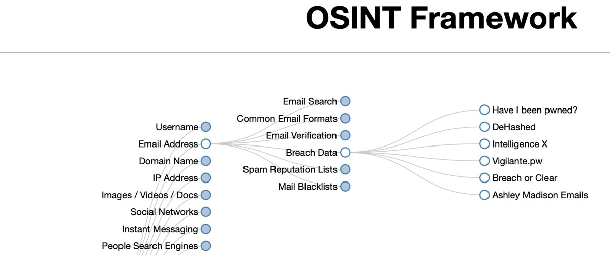
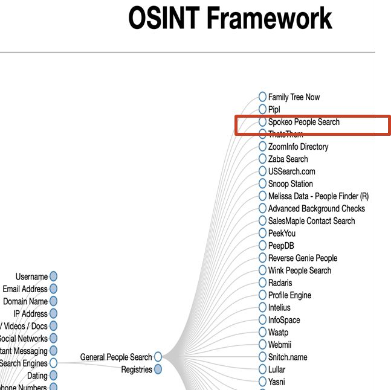
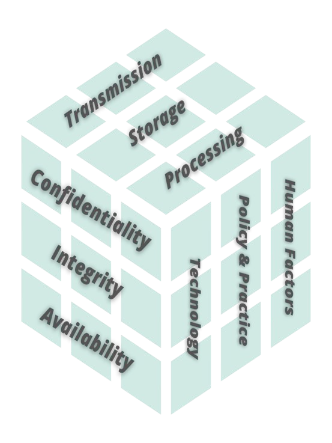
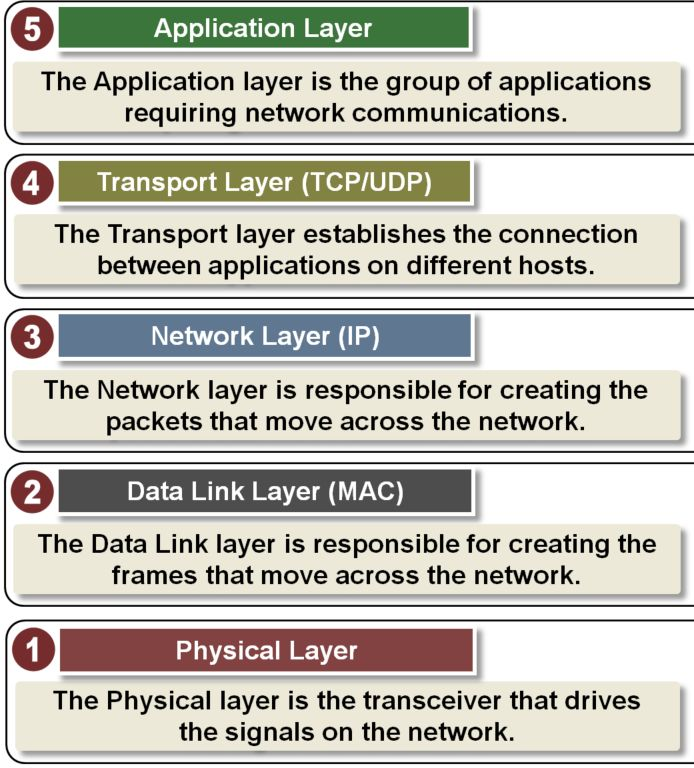

Week 3 covers open-source intelligence (OSINT), the levels of data and the McCumber Cube, how each part of the CIA triad gets compromised, hashing and password salting, the three information states (at rest, in transit, in processing), and the laws and policies that protect data.

*Sources: SEC-110 notes "3-1: Data Security Goals and Intro to OSINT" and "3-2: Data Security Principles - Information States and Controls", plus GeeksforGeeks, [What Is Password Salting?](https://www.geeksforgeeks.org/techtips/what-is-password-salting/)*

## Contents

1. [Review: The CIA Triad & Six Concepts](#1-review-the-cia-triad--six-concepts)
2. [Open Source Intelligence](#2-open-source-intelligence)
3. [Data Abstraction & the McCumber Cube](#3-data-abstraction--the-mccumber-cube)
4. [Compromising the CIA Triad](#4-compromising-the-cia-triad)
5. [Hashing](#5-hashing)
6. [Password Salting](#6-password-salting)
7. [Information States](#7-information-states)
8. [Laws, Policies & Controls](#8-laws-policies--controls)
9. [My Notes](#9-my-notes)
10. [Sources & Credits](#10-sources--credits)

---

# 1. Review: The CIA Triad & Six Concepts

Notes 3-1 opens by reviewing the **CIA triad** and the **six cybersecurity concepts** ("hand model"): Confidentiality, Integrity, Availability, Defense in Depth, Think Like an Adversary, and Keep It Simple. These are covered in full in [Week 2](Week-2-‐-Security-Concepts-&-Threats-and-Adversaries#1-cybersecurity-foundations).

**"How Hacking Works" (xkcd, CC BY-NC 2.5).** The class looked at a two-panel comic:

| How people think hacking works | How it actually works |
| --- | --- |
| Masked agents fly to the target's house, break in, and find all the passwords written in a book labeled "PASSWORDS." | Two people notice that someone leaked the emails and passwords from a band's message boards, and decide to try them all on Venmo. |

The point: most real attacks aren't dramatic break-ins. They reuse **leaked credentials**, betting that people use the same password on many sites (**credential stuffing**). That's why the OSINT activities below start with breach data.

---

# 2. Open Source Intelligence

- Our personal data is stored in **public databases**, on **social media**, and in many other places across the Internet.
- **OSINT (Open Source Intelligence)** is searching **public, open sources** for information that could be used to cause harm to a person or an organization.
- It usually starts at the [OSINT Framework](https://osintframework.com/), a clickable tree of free OSINT tools organized by the type of information you're looking for.

**Example path: Email Address → Breach Data**



**Example path: People Search Engines → General People Search**



## Class Activity 3-1 (OSINT)

| Activity | What you do | Question |
| --- | --- | --- |
| **1. Have I Been Pwned** | Part I: check whether your email was in a breach at [Have I Been Pwned](https://haveibeenpwned.com/). Part II: check whether a password has been breached at [Pwned Passwords](https://haveibeenpwned.com/Passwords). Part III: create a new or improved password and test it at "How Secure Is My Password." | Q1 |
| **2. Google yourself & Spokeo** | Google yourself, then search yourself (or a person of interest) on Spokeo. | Q2 |
| **3. List of breaches** | Pick a recent (2023 or 2024) breach from the [Pwned Websites list](https://haveibeenpwned.com/PwnedWebsites). | Q3 |
| **OSINT Framework exploration** | Explore the [OSINT Framework](https://osintframework.com/) and pick 3 tools. For each, give its path in the framework, what it does, and how an adversary might use it. | Q6 |

Things to consider for activities 2 and 3:

- How does personal information on Google and Spokeo **help** people? How could an **adversary** learn from that **personally identifiable information (PII)**?
- How could an adversary misuse, disrupt, disclose or deceive with sensitive personal data to cause harm?
- For a breach: what kinds of data were affected, how many people, and what might the consequences be?

> **Note:** Only type your **real** password into Pwned Passwords, not into random "check your password" sites. Pwned Passwords uses a method called **k-anonymity**: your browser hashes the password and sends only the first 5 characters of the hash, so the site never sees the password itself. If you're unsure about a site, test a password you don't actually use.

---

# 3. Data Abstraction & the McCumber Cube

## Data Abstraction Levels

Data in cyberspace isn't just personal information. It exists at several **levels of abstraction**:

| Level | What it includes |
| --- | --- |
| **Bit-level** | Storage, transfer, and bit-level operations on data (input/output, processing) |
| **System-level** | Roles and authorized resources used for reading, writing and processing data |
| **Personal-level** | SSN, usernames/passwords, address, biometrics, medical history, credit history, background checks, recordings, grades |
| **Policy-level** | The rules for how to protect data at all the levels above |

**Data abstraction** is reducing a body of data to a simplified representation of the whole. In general, **abstraction** means removing characteristics from something to reduce it to its essential features.

## The McCumber Cube

The **McCumber Cube** shows the design aspects for securing data at every level of abstraction. It has three dimensions, and every cell of the cube is one combination that needs protecting.



| Dimension | The three parts |
| --- | --- |
| **Security goals** | Confidentiality, Integrity, Availability ([section 4](#4-compromising-the-cia-triad)) |
| **Information states** | Transmission, Storage, Processing ([section 7](#7-information-states)) |
| **Countermeasures** (security controls) | Technology, Policy & Practice, Human Factors ([section 8](#8-laws-policies--controls)) |

**Lesson takeaway, the Defender's Dilemma again:** the attacker can attack at **any** data level, but the defender must defend at **every** data level. (See [Week 2](Week-2-‐-Security-Concepts-&-Threats-and-Adversaries#7-why-cybersecurity-is-a-hard-problem).)

> **Note:** The cube was created by **John McCumber** in 1991. 3 × 3 × 3 = **27 cells**, e.g. "confidentiality of data in storage, protected by technology" is one cell (disk encryption).

**Where did "CIA" come from?** According to a story credited to Prof. **Eugene Spafford**, an IBM sales team in the 1960s was trying to sell computers to the Department of Defense and wanted a catchy phrase for secrecy. They picked **CIA** as a synonym for secrecy and worked backwards to match **c**onfidentiality, **i**ntegrity and **a**vailability. The slides call this a rumor.

---

# 4. Compromising the CIA Triad

Three famous attacks, one for each goal:

| Goal compromised | Attack | What happened | Why it's that goal |
| --- | --- | --- | --- |
| **Confidentiality** | **PlayStation Network** (2011) | A massive breach of Sony's online gaming network stole names, addresses, emails, birth dates, usernames, passwords, security questions and possibly credit card data for **77 million** accounts, one of the largest break-ins of its time. | Confidential data that Sony should have protected was **stolen by an unauthorized person**. |
| **Integrity** | **Stuxnet** | Stuxnet infected PCs used to automate and monitor **electromechanical equipment**. It sent **damage-inducing instructions** to the equipment while sending **false feedback** to the main controller, so anyone monitoring saw nothing wrong. | The false "everything is normal" feedback **deceived** the operators. The data couldn't be trusted. |
| **Availability** | **WannaCry** (2017) | A ransomware **cryptoworm** that encrypted data on Windows computers and demanded Bitcoin for the decryption key. (See [Week 1](Week-1-‐-What-Is-Cybersecurity-&-Cyber-Threats#wannacry-ransomware).) | Without the secret key, owners **can't access** their own data. |

> **Activity (Q4):** Stuxnet was a pivotal event in the evolution of malware and cybersecurity. Research it and answer Q4 in Class Activity 3-1. **Hint:** look up who it targeted, what kind of equipment, and why it's often called the first **cyberweapon**.

## CIA per Data Abstraction Level

| Level | Confidentiality (disclosure) | Integrity (deception) | Availability (disruption/destruction) |
| --- | --- | --- | --- |
| **Bit-level** | Disclosure of system encryption keys, physical-layer network traffic | Hash collisions | Corrupted drives, corrupted physical-layer traffic |
| **System-level** | Unauthorized access to access rights, network traffic (data link, network, transport and application layers), web certificates | Privilege escalation, traffic impersonation, domain hijacking | Denial of access, denial of system resources (ransomware), denial-of-service traffic |
| **Personal-level** | Names, addresses, emails, birth dates, usernames, passwords, security questions, biometrics | User spoofing, email spoofing | File destruction and usurpation (takeover), account deletion |

---

# 5. Hashing

A **hash function** turns any input into a **fixed-length** string of characters (the **hash** or **digest**). It is **one-way**: easy to compute, but there's no way to "decrypt" a hash back into the input.

## Activity: Examine Hashes

Using [md5calc.com/hash](https://md5calc.com/hash) with **SHA-256**, hash three nearly identical strings:

| Text string | SHA-256 hash |
| --- | --- |
| `thequickbrownfox` | `bd484b82d7875e115c7273e9c6102ca4946b7c55fe905012be9152b87fe09568` |
| `theQuickbrownfox` | `4e49ede85e4ef4dbddd0ed8601583b81ff21124975377e77c222c684fd91c4d3` |
| `thequickbrownfoX` | `15a741a20b8c1b27aac3fa0fad397efe8ca65161a2634463831064d96d529746` |

Changing a single letter's case produces a **completely different** hash with no visible pattern. This is called the **avalanche effect**. (I re-ran all three; the slide's hashes are correct.)

You can do the same from a terminal:

```bash
printf '%s' thequickbrownfox | sha256sum
```

| Part | What it does |
| --- | --- |
| `printf '%s' thequickbrownfox` | Prints the text with **no newline** at the end (`echo` would add one and change the hash) |
| `\|` | Pipes that output into the next command |
| `sha256sum` | Computes and prints the SHA-256 hash |

## Activity: Guess the Password (Q5)

The slides give the hashes of two commonly used passwords and ask whether you can figure them out:

- `4813494D137E1631BBA301D5ACAB6E7BB7AA74CE1185D456565EF51D737677B2`
- `5e884898da28047151d0e56f8dc6292773603d0d6aabbdd62a11ef721d1542d8`

> **Hint:** You can't reverse a hash, but you can **guess and compare**. Try hashing very common passwords (see the [10,000 most common passwords](https://en.wikipedia.org/wiki/Wikipedia:10,000_most_common_passwords)) and see if one matches, or paste a hash into a search engine. Was it easy or hard?

Then **generate a hash of your own** text and see if your "elbow partner" can guess it. Guessing a password from its hash is a compromise of **confidentiality**.

## Attacks on Hashes

| Attack | How it works |
| --- | --- |
| **Dictionary attack** | Hash every word in a list of known or common passwords, then compare with a hash from a breach. A match reveals the password. |
| **Rainbow table** | A **precomputed** table of hashes, so the attacker doesn't have to hash the list each time. |
| **Hash collision attack** | Find a *different* password that produces the same hash as the one from a breach, and log in with it. |

## Debrief

**Can two passwords have the same hash?** Yes. That's a **hash collision**. Passwords with the same hash are a compromise of **integrity**.

**Can you guess a password just by looking at its hash?** No. Hashes are designed to prevent that, because hashing is **one-way**. But adversaries can look the hash up in a precomputed list (a **rainbow table**).

> **Clarification:** Collisions must exist in theory, since there are infinitely many inputs but a fixed number of hashes. Practical collisions have been found for old algorithms like **MD5** and **SHA-1**, but **no SHA-256 collision has ever been found**. Also, finding a new input that matches a *specific* stolen hash is technically a **preimage attack**, which is even harder than finding any collision.
>
> **Clarification:** "Hashes are designed to prevent guessing" is true of the *hash*, not the password. As the Guess the Password activity shows, a **weak password** is easy to guess no matter how good the hash is. That's what salting and slow hashes help with ([section 6](#6-password-salting)).

**Does hashing provide confidentiality, integrity or availability?** See the controls table below.

## Common CIA Controls

| Goal | Common controls |
| --- | --- |
| **Confidentiality** | **Encryption** with a secret key, **hashing** (concealment), **steganography** (hiding data inside other data, like a message in an image) |
| **Integrity** | **Hashing** (detecting tampering or modification) |
| **Availability** | **Redundancy**, **backups** |

**Discussion:** Can encryption provide integrity? Can it affect availability?

> **Hint:** Think about WannaCry. What happens to availability if the key is lost? And look up **authenticated encryption** (e.g. AES-GCM), which detects tampering.

**Video:** [Hashing with a salt](https://youtu.be/cczlpiiu42M)

**Password resources:** [Cybernews password leak check](https://cybernews.com/password-leak-check/) and Wikipedia's [10,000 most common passwords](https://en.wikipedia.org/wiki/Wikipedia:10,000_most_common_passwords).

---

# 6. Password Salting

*From GeeksforGeeks, [What Is Password Salting?](https://www.geeksforgeeks.org/techtips/what-is-password-salting/), with corrections below.*

**Password salting** adds a unique **random value (the salt)** to each password **before hashing**, then stores the salt alongside the hash. Two users with the same password end up with **different hashes**.

## How It Works

| Step | What happens |
| --- | --- |
| 1. **Create a salt** | Generate a random value with a **cryptographically secure** random number generator, unique to each user (16–32 bytes is typical). |
| 2. **Combine** | Attach the salt to the password (before or after). |
| 3. **Hash** | Run the combination through a hash function. |
| 4. **Store** | Save the **salt and the hash together**. The salt is stored in plain text, because it's needed again at login. |
| 5. **Verify** | At login, look up the user's salt, combine it with the password they typed, hash it, and compare with the stored hash. |

**The article's example:** two users both choose `password123`. Without salt, their hashes are identical. With salts `abc123` and `xyz789`, the hashed inputs differ, so the results do too (SHA-256, computed here):

| Hashed input | SHA-256 |
| --- | --- |
| `password123` (no salt, both users) | `ef92b778bafe771e89245b89ecbc08a44a4e166c06659911881f383d4473e94f` |
| `password123` + salt `abc123` | `c747a46a62618f377f8ec38c6ab11d58456b581b68ca37fce8dcd4d63cf10103` |
| `password123` + salt `xyz789` | `0a76039f8885f00cdeabaa899685192dd9c694f3a17ff8bccbda2e3abd67a012` |

> **Note:** The article's salts are short and readable to keep the example simple. Real salts are long random bytes.

## Why Salt?

| Benefit | Why |
| --- | --- |
| **Unique hashes** | Identical passwords no longer have identical hashes, so cracking one doesn't crack everyone who used it, and an attacker can't spot shared passwords. |
| **Defeats rainbow tables** | A precomputed table would have to be rebuilt for **every salt**, which is impractical. |
| **Slows mass cracking** | The attacker has to attack each account **separately** instead of all at once. |

## Limitations

- **Predictable or reused salts** weaken the protection. Salts must be random and unique per user.
- Salts are stored with the hashes, so if the database is stolen, **the attacker has the salts too**.
- **Salting doesn't stop guessing a weak password.** With the salt in hand, an attacker can still try common passwords one account at a time. With a **fast** hash like SHA-256, a GPU can try billions of guesses per second.

That's why the article recommends **slow, purpose-built password hashing algorithms**:

| Algorithm | Notes |
| --- | --- |
| **bcrypt** | Has salting built in, and a "cost" setting makes it deliberately slow |
| **scrypt** | Slow and uses lots of memory, making GPU cracking expensive |
| **PBKDF2** | Repeats a hash many thousands of times |
| **Argon2** | Winner of the 2015 Password Hashing Competition, widely recommended today (not in the article) |

## Example: Salting in Python

This uses Python's built-in `hashlib` with PBKDF2 (I ran it to confirm it works):

```python
import hashlib, hmac, os

def hash_password(password):
    salt = os.urandom(16)
    digest = hashlib.pbkdf2_hmac("sha256", password.encode(), salt, 600_000)
    return salt, digest

def check_password(password, salt, stored):
    digest = hashlib.pbkdf2_hmac("sha256", password.encode(), salt, 600_000)
    return hmac.compare_digest(digest, stored)
```

| Line | What it does |
| --- | --- |
| `salt = os.urandom(16)` | Makes a new random 16-byte salt from the operating system's secure random generator |
| `hashlib.pbkdf2_hmac("sha256", ..., salt, 600_000)` | Hashes the password with the salt using PBKDF2-SHA256, repeated **600,000 times** to make each guess slow |
| `return salt, digest` | Returns both values, which get stored together |
| `check_password(...)` | Re-hashes the entered password with the **stored** salt |
| `hmac.compare_digest(digest, stored)` | Compares the hashes in constant time, so timing doesn't leak information |

Hashing `password123` twice gives **two different hashes** (different salts), yet `check_password` correctly accepts `password123` and rejects `Password123`.

## Corrections to the Article

> **Correction:** The article says attackers "must guess the salt in addition to the password." They don't. Salts aren't secret: they're stored in plain text right next to the hash. Salting stops **precomputed** attacks (rainbow tables), not guessing.
>
> **Correction:** The article says salting protects against **hash collisions**. It doesn't. Collision resistance comes from the hash function itself.
>
> **Clarification:** The article lists **SHA-256** as a password-hashing choice. It's a fast general-purpose hash, and fast is bad for passwords. Use bcrypt, scrypt, PBKDF2 or Argon2. The salt only needs to be **unique and unpredictable**, not hidden, so encrypting stored salts is optional.
>
> **Note:** A related idea is a **pepper**: a secret value added to every password but stored **separately** from the database (for example, in a hardware security module). Unlike a salt, a pepper *is* secret.

---

# 7. Information States

**Video:** [Data Sets: Data-at-rest, in transit and in-use](https://www.youtube.com/watch?v=yRxsQP740LM)

Data is always in one of three **states**, and each needs protecting. The slides use posting private photos on Instagram as the example:

| State | Meaning | Instagram example | What we must ensure |
| --- | --- | --- | --- |
| **At rest** (storage) | Data stored on a device, server, cloud or backup medium | Your private photos and comments stored on your phone and on Instagram's servers and cloud storage, which could be anywhere in the world | No other app or the operating system (only Instagram) can **see** (C), **change** (I) or **delete** (A) the stored photos, locally or remotely |
| **In transit** (transmission) | Data traveling across a network | Uploading photos from your phone over your home Wi-Fi. Before reaching Instagram, the data crosses many network nodes across the country and the globe. | None of those nodes can see, change or delete the photos before they reach the Instagram server |
| **In processing** (in use) | Data actively being used by an application | Instagram processing your photos, either on your phone or on its servers | No other app or the OS (only Instagram) can see, change or delete the photos while they're being processed |

## Attacks by Information State

| State | Attack | Why |
| --- | --- | --- |
| **At rest** | PlayStation Network (77 million accounts) | The attacker located the stored data and stole it from Sony's servers |
| **In transit** | Stuxnet | The damaging instructions and the false feedback were both sent **over a network** |
| **In processing** | WannaCry | It encrypted data the Windows operating system was regularly using (and data at rest too) |

## States per Data Abstraction Level

Each state faces unauthorized **access, modification and disruption**:

| Level | At rest | In processing | In transit |
| --- | --- | --- | --- |
| **Bit-level** | Cloud storage, USB drives, hard drives, phones, any removable media | Processors, memory | The **physical layer** that transmits the data |
| **System-level** | Operating system files, device configuration files | Firmware, low-level OS instructions | Medium access (data link), network and transport layers |
| **Personal-level** | **Passively stored** files containing names, addresses, emails, birth dates, usernames, passwords, security questions, biometrics | **Actively used** files containing the same kinds of data | The **application layer** |

Data in transit moves through these network layers:



## Activity: Data States & Security Concerns

For each scenario, identify the **data states** involved and the possible **CIA compromises** in each:

1. Accessing personal documents on **Google Drive** with a personal laptop at a local **coffee shop** over its free Wi-Fi hotspot.
2. Accessing **report cards** on the school website with a **mobile phone** during a summer vacation in **Europe**.

Also consider: in which state(s) were the passwords on [Pwned Passwords](https://haveibeenpwned.com/Passwords) compromised?

> **Hint:** Trace the data's path from start to finish. Where is it **stored** (laptop, phone, Google's servers, the school's server)? What network does it **cross** (public Wi-Fi, foreign networks)? Where is it **opened and used**? Each stop is a state with its own C, I and A risks.

---

# 8. Laws, Policies & Controls

- Rules for data protection are created and enforced at the **local, state and national** levels.
- People and organizations use **policies** to put those laws into practice and protect the CIA of personal information.
- Enforcing policies and laws also **deters** cybercriminals, adversaries and hackers.

## Key Laws

| Law | Scope | What it requires |
| --- | --- | --- |
| **HIPAA** (Health Insurance Portability and Accountability Act) | US federal | Protects **Protected Health Information (PHI)**: patients' electronic medical records and health information given to insurers, doctors, hospitals and health care providers. Entities that handle PHI must report breaches. |
| **CFAA** (Computer Fraud and Abuse Act) | US federal | Makes it a crime, punishable by fines up to imprisonment, to access without authorization: national defense, foreign relations or other restricted information; financial records or information from a financial institution; or a US federal agency computer with intent to defraud. |
| **GDPR** (General Data Protection Regulation) | European Union | Protects the personal data of people in the EU, **even if the company is in the USA**. People control how their data is protected, disclosed and used in automated analysis, and can have all of it **erased** (the **right to be forgotten**). |
| **CCPA** (California Consumer Privacy Act) | California | Provisions similar to GDPR for California residents: they must be **told** when data is collected about them, can **access** it at any time, can say **no to its sale**, and can ask a business to **delete** it. |

> **Correction:** The slides call HIPAA the "Healthcare Insurance Portability and Accountability Act." It's the **Health Insurance** Portability and Accountability Act (1996).
>
> **Correction:** The slides say the HIPAA Privacy Rule requires reporting a breach only when more than 500 records are affected. Breach reporting comes from the HIPAA **Breach Notification Rule**, and **all** breaches of unsecured PHI must be reported. **500 or more** affected people is the threshold for notifying HHS (and the media) within 60 days and being listed on the public breach portal. Smaller breaches are reported to HHS once a year.
>
> **Clarification:** GDPR protects people **in the EU**, not just EU citizens. Fines can reach €20 million or 4% of a company's global yearly revenue.
>
> **Modern note:** The CCPA was expanded by the **CPRA** (California Privacy Rights Act), in effect since 2023, which created a state privacy agency. The CFAA, passed in 1986, is the law the [Morris worm](Week-1-‐-What-Is-Cybersecurity-&-Cyber-Threats#morris-worm)'s author was convicted under.

## Activity: Breach Laws

| Step | What to do |
| --- | --- |
| **HIPAA breaches** | Go to the [HHS HIPAA Breach Portal](https://ocrportal.hhs.gov/ocr/breach/breach_report.jsf). Pick 2 entities from your state (or a state of your choice). Find what type of breach each suffered, how many people were affected, and where the breach happened. |
| **State laws, step 1** | Read the data breach notification law for your chosen state at [IT Governance USA](https://www.itgovernanceusa.com/data-breach-notification-laws). |
| **State laws, step 3** | Based on the notification requirements: would a resident of your state receive a notification (yes/no/maybe)? What civil penalties does the law set? |

## Policies & Controls

**Acceptable Use Policy (AUP):** makes sure an organization's data and IT are used for their **intended purposes**, covering software use, Wi-Fi access, servers, computers, audio and video equipment, and online accounts.

- Violations can lead to **disciplinary action**: restriction or loss of network privileges, up to suspension, termination or expulsion.
- Individuals may also be subject to federal, state and local laws for what they do on the organization's network, computers and servers.

**Controls** put policies into practice:

| Control type | Examples |
| --- | --- |
| **Physical** | Limited entry points, redundant systems, surveillance cameras. These come first: physical controls are needed to ensure CIA and protect data in every state. |
| **Technical** | Encryption, hashing, access controls, firewalls, backups |

This completes the [McCumber Cube](#the-mccumber-cube): **security goals** (CIA) × **information states** (at rest, in transit, in processing) × **countermeasures** (technology, policy & practice, human factors).

---

# 9. My Notes

*From my tech journal. Lightly cleaned up for spelling; added context is in the notes below.*

**OSINT & breaches**

- Checking if I've been pwned on sites for your email and stuff is a good idea. (See [Class Activity 3-1](#class-activity-3-1-osint).)
- Only one of my passwords was breached; nice. Check in every now and then from now on.
- OSINT is becoming more common, as they sell info to most people.
- I'm with 95 cents lol.
- You can opt out of a lot of these systems, but this info can still exist anywhere.
- Only one image exists of me on the internet.
- Different types of data breaches exist!
- You can steal someone's password and then reset everything.
- Honey is bad; they were selling information to everyone, and hackers got in, big womp womp.
- Companies often don't know what they have.
- More privacy laws for us.
- Net neutrality is no longer a thing.

**CIA & data**

- Data is "classified" in three states: **in-rest**, **in-transit**, **in-use**. (See [Information States](#7-information-states).)
- Different levels of data can be stolen, such as stuff from a hard drive to the data flow on the local net. (See [Data Abstraction Levels](#data-abstraction-levels).)
- Information exists in a multitude of ways; you have to be creative and figure out ways to protect it.
- You must assume that tools like Stuxnet will get out of your hands and cause damage.
- Industrial units are super fine-tuned; if there is any disruption, it can cause major damage.
- You can corrupt hard drives.
- Unlocking network closets is very bad.
- You can pretend to be someone's boss; the easiest people to pretend to be are jerks.
- Have backups; redundancy and backups are not the same thing.
- Rootkits are super mega bad.
- AI uses sites to spread information to other AI instances. Spiral cult.

**Hashing**

- Hashing can cause major damage if it is not properly handled. They are what encrypt passwords, and if you can figure out if multiple hashes in a group are the same, then you can figure out around 60% of them.
- You can "technically" have two hashes collide, as it is super rare. (See [Debrief](#debrief).)

> **Correction (hashing):** Hashes don't **encrypt** passwords. Hashing is one-way, while encryption can be reversed with a key ([Week 5](Week-5-‐-Basic-Cryptography-&-Passkeys#8-hash-functions)). The point about matching hashes is right: without **salt**, everyone with the same password has the same hash, so cracking one cracks them all, and spotting duplicates shows which passwords are common. That's exactly what [salting](#6-password-salting) prevents. I couldn't verify the 60% figure.
>
> **Correction (Honey):** The PayPal **Honey** controversy (December 2024, from a video by YouTuber MegaLag) wasn't a hack or a data sale. Honey was accused of **swapping creators' affiliate links for its own** at checkout (taking their commissions) and **hiding better coupon codes** from shoppers at partner stores. It lost millions of users, and Google changed its Chrome extension rules in 2025 to ban that kind of link swapping.
>
> **Clarification (net neutrality):** At the **federal** level, that's right: in January 2025 the Sixth Circuit court struck down the FCC's net neutrality rules, so there are no federal rules now. But several **states**, including California, Washington and Colorado, have their own net neutrality laws, which still apply.
>
> **Note:** **Redundancy** keeps a system running when something fails (like a second power supply or mirrored drives). A **backup** is a separate copy you can restore from later. Redundancy won't save you from ransomware or an accidental delete, because the change is copied everywhere instantly; a backup will.
>
> **Note:** A **rootkit** is malware that hides itself deep in the operating system (sometimes in the boot process or firmware), so it can avoid antivirus tools and keep control of the machine.
>
> **Note:** "Pretending to be someone's boss" is **pretexting**, a social engineering technique ([Week 10](Week-10-‐-Network-Security#social-engineering)).

---

# 10. Sources & Credits

**Class materials**

- SEC-110 notes: *3-1: Data Security Goals and Intro to OSINT*
- SEC-110 notes: *3-2: Data Security Principles - Information States and Controls* (licensed under a Creative Commons Attribution 4.0 International License)

**Links**

- [GeeksforGeeks: What Is Password Salting?](https://www.geeksforgeeks.org/techtips/what-is-password-salting/)
- [OSINT Framework](https://osintframework.com/)
- [Have I Been Pwned](https://haveibeenpwned.com/), [Pwned Passwords](https://haveibeenpwned.com/Passwords) and [Pwned Websites](https://haveibeenpwned.com/PwnedWebsites)
- [md5calc.com hash generator](https://md5calc.com/hash)
- [Cybernews password leak check](https://cybernews.com/password-leak-check/)
- [Wikipedia: 10,000 most common passwords](https://en.wikipedia.org/wiki/Wikipedia:10,000_most_common_passwords)
- [Video: Hashing with a salt](https://youtu.be/cczlpiiu42M)
- [Video: Data-at-rest, in transit and in-use](https://www.youtube.com/watch?v=yRxsQP740LM)
- [HHS HIPAA Breach Portal](https://ocrportal.hhs.gov/ocr/breach/breach_report.jsf)
- [IT Governance USA: Data breach notification laws by state](https://www.itgovernanceusa.com/data-breach-notification-laws)

<details>
<summary><b>Image credits (from the course slides)</b></summary>

- OSINT Framework screenshots: [OSINT Framework](https://osintframework.com/) by Justin Nordine, CC BY-NC 2.5
- McCumber Cube: from the course slides (The McCumber Cube, Wikipedia)
- Five-layer network model: from the 3-2 notes
- "How Hacking Works" comic (described, not shown): xkcd, CC BY-NC 2.5

</details>
