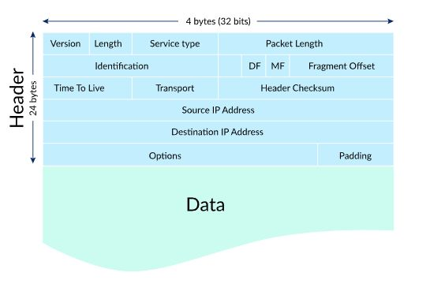
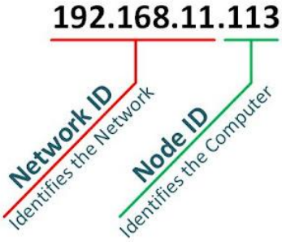
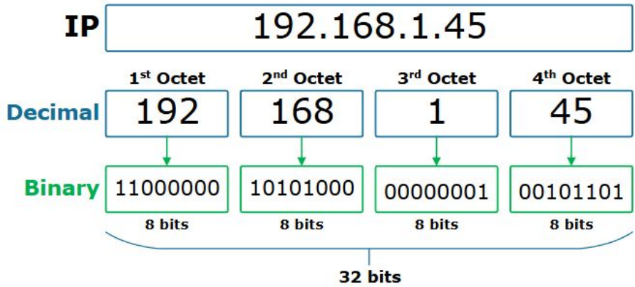
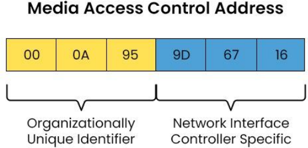
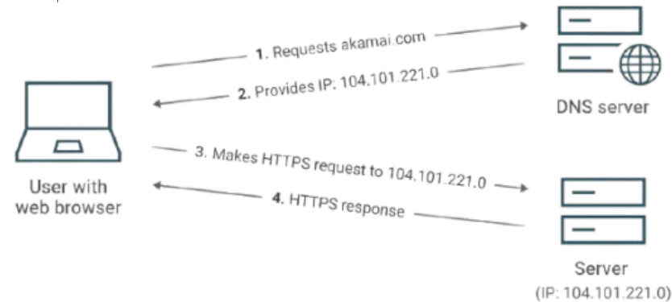
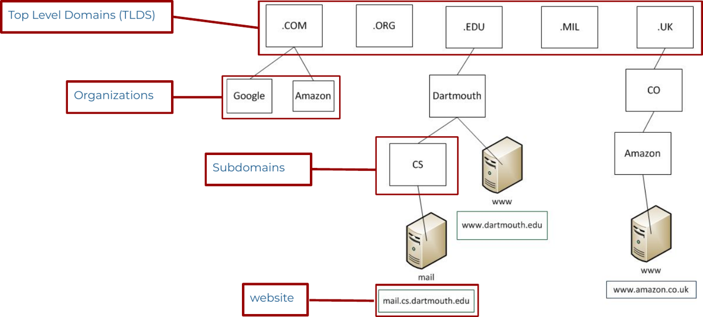
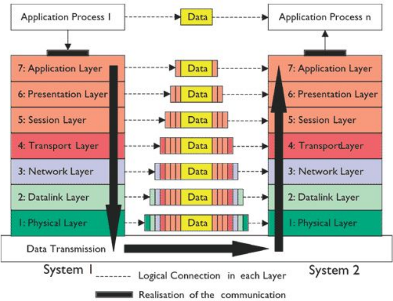

Week 4 covers networking basics: how a packet is like a mailed letter, the key devices and terms, IP and MAC addressing, DNS, the 7-layer OSI model, the TCP/IP model, and Wireshark for capturing traffic.

*Sources: SEC-110 notes "Mod 4 – Network Defense: Networking Basics," plus GeeksforGeeks: [Basics of Computer Networking](https://www.geeksforgeeks.org/computer-networks/basics-computer-networking/), [OSI Model](https://www.geeksforgeeks.org/computer-networks/open-systems-interconnection-model-osi/) and [TCP/IP Model](https://www.geeksforgeeks.org/computer-networks/tcp-ip-model/).*

## Contents

1. [How Networks Work](#1-how-networks-work)
   - [Sending a Letter vs. Sending a Packet](#sending-a-letter-vs-sending-a-packet)
   - [Key Terms](#key-terms)
   - [Network Devices](#network-devices)
2. [Network Addressing](#2-network-addressing)
   - [IP Addresses](#ip-addresses)
   - [Network ID, Host ID & Subnet Mask](#network-id-host-id--subnet-mask)
   - [MAC Addresses](#mac-addresses)
3. [Domain Name System](#3-domain-name-system)
4. [The OSI Model](#4-the-osi-model)
5. [The TCP/IP Model](#5-the-tcpip-model)
6. [Wireshark](#6-wireshark)
7. [Sources & Credits](#7-sources--credits)

---

# 1. How Networks Work

## Sending a Letter vs. Sending a Packet

The class uses the **postal mail analogy**: sending data across a network works a lot like mailing a letter.

| Step | Letter | Packet |
| --- | --- | --- |
| 1 | Look up the recipient's address | Look up the recipient's address: **DNS** converts the hostname to an **IP address** |
| 2 | Put the letter in an envelope and write the recipient and return addresses | Add **headers** to the data, with the recipient (destination) and sender (source) IP addresses |
| 3 | Put the letter in a mailbox | Send the packet to the **Network Interface Controller (NIC)** |
| 4 | The mail carrier picks it up and takes it to the post office | The NIC transmits it onto the network, to the local router (the **default gateway**) |
| 5 | The post office sorts it and sends it to the next facility | The router sends the packet to the next router |
| 6 | How does the post office know where to send it? **Routing lists** | How does the router know? A **routing table** of IP networks |
| 7 | It ends up at the recipient's local post office | It ends up at the recipient's local router |
| 8 | The mail carrier delivers it | Routers and switches deliver it using the **host part of the IP address** and the **MAC address** |

The "envelope" is the **IPv4 header**. The source IP is the return address, the destination IP is the recipient's address, and the data is the letter inside:



> **Clarification:** The diagram labels the header "24 bytes." An IPv4 header is **20 bytes minimum**. It's 24 here only because one 4-byte row of Options is shown, and Options are usually empty. The diagram also uses simplified names: "Length" is the header length (IHL), "Packet Length" is the total length, and "Transport" is the **Protocol** field, which says what's inside (6 = TCP, 17 = UDP).

## Key Terms

From GeeksforGeeks, *Basics of Computer Networking*. A **computer network** is a set of interconnected devices that share data and resources, supporting services like email, file sharing and internet access.

| Term | Meaning |
| --- | --- |
| **Node** | Any device on the network: computer, phone, server, printer |
| **Link** | The connection between nodes, either **wired** (copper cable, fiber optic) or **wireless** (Wi-Fi, radio) |
| **Packet** | A small chunk of data. Data is split into packets for transmission. |
| **Protocol** | An agreed set of rules for how data is formatted, sent, received and acknowledged |
| **IP address** | A logical address that gets data to the right destination |

**How a network works:** nodes send and receive data over links. Data is split into packets, protocols govern how they're formatted and sent, each device has an address, switches and routers forward packets along the best path, and firewalls allow or block traffic based on rules.

**Two architectures:**

| Architecture | How it works | Example |
| --- | --- | --- |
| **Client-server** | Dedicated servers provide services to clients | A web browser (client) loading a website (server) |
| **Peer-to-peer (P2P)** | No central server; each device is both client and server | BitTorrent file sharing |

> **Clarification:** The article says each device has a "unique IP address." Private addresses like `192.168.1.45` are only unique **within** their local network; millions of home networks reuse them. A device can also have several addresses, one per interface.

## Network Devices

| Device | OSI layer | What it does |
| --- | --- | --- |
| **Hub** | 1 | Connects devices but **broadcasts everything to every port**. No filtering, mostly obsolete. |
| **Modem** | 1 | Converts between your network's digital signals and the form your ISP's line uses (cable, DSL, fiber) |
| **Switch** | 2 | Connects devices **within one network** and forwards frames to the right device using **MAC addresses** |
| **Bridge** | 2 | Connects two network segments and filters traffic by MAC address |
| **Access point (AP)** | 2 | Adds Wi-Fi to a wired network |
| **Router** | 3 | Connects **different networks** (e.g. your home to the Internet) and forwards packets along the best path using **IP addresses** |
| **Gateway** | Varies | Connects networks that use **different protocols** and translates between them |
| **Firewall** | 3–7 | Monitors traffic and **blocks or allows** it based on security rules |

> **Clarification:** A switch sends a frame only to the intended device **when it already knows** where that MAC address is. Broadcasts and unknown destinations still go out every port. The article's line that a modem converts "digital to analog" is true of dial-up and DSL, but cable and fiber modems use other signaling.

---

# 2. Network Addressing

There are **3 components** to a computer's network address:

| Component | Postal analogy | Purpose |
| --- | --- | --- |
| **1. Network ID** | Zip code | Identifies the **network** |
| **2. Host ID (Node ID)** | Street address | Identifies the **computer** on that network |
| **3. MAC address** | (see below) | Unique to every **network adapter** |



## IP Addresses

An **IPv4 address** is a **32-bit binary number** divided into **four octets** (8 bits each), written in **dotted decimal**:



**Converting binary to decimal:** each of an octet's 8 bits has a place value. Add up the values where the bit is 1:

| Place value | 128 | 64 | 32 | 16 | 8 | 4 | 2 | 1 | Total |
| --- | --- | --- | --- | --- | --- | --- | --- | --- | --- |
| `11000000` | 1 | 1 | 0 | 0 | 0 | 0 | 0 | 0 | 128 + 64 = **192** |
| `10101000` | 1 | 0 | 1 | 0 | 1 | 0 | 0 | 0 | 128 + 32 + 8 = **168** |
| `00000001` | 0 | 0 | 0 | 0 | 0 | 0 | 0 | 1 | **1** |
| `00101101` | 0 | 0 | 1 | 0 | 1 | 1 | 0 | 1 | 32 + 8 + 4 + 1 = **45** |

The largest value an octet can hold is `11111111` = 255, so each number in an IP address is **0–255**.

## Network ID, Host ID & Subnet Mask

| Part | What it is |
| --- | --- |
| **Network ID** | The **beginning** of the address, anywhere from 8 to 30 bits |
| **Host ID** | Whatever bits are **left over** after the network ID |
| **Subnet mask** | Defines **how many bits** belong to the network ID |

**Worked example from the slides:**

| | |
| --- | --- |
| Binary IP | `10000001 10101010 00010010 11011100` |
| Dotted decimal | **129.170.18.220** |
| Subnet mask | **/24**: the first 24 bits are the network ID (written out, `255.255.255.0`) |
| Network ID | **129.170.18** |
| Host ID | **220** |

I re-checked the conversion: 10000001 = 129, 10101010 = 170, 00010010 = 18, 11011100 = 220. A /24 network leaves 8 host bits, which is 256 addresses, and **254** of those are usable by devices (the first is the network address and the last is the broadcast address).

## MAC Addresses

A **MAC (Media Access Control) address** is a 48-bit hardware address burned into each **network adapter (NIC)**, written as six pairs of hexadecimal digits:



| Half | Meaning |
| --- | --- |
| First 3 bytes (`00:0A:95`) | **Organizationally Unique Identifier (OUI)**: identifies the **manufacturer** |
| Last 3 bytes (`9D:67:16`) | Assigned by the manufacturer to that specific **NIC** |

| | IP address | MAC address |
| --- | --- | --- |
| **Layer** | 3 (Network) | 2 (Data Link) |
| **Size** | 32 bits (IPv4) | 48 bits |
| **Assigned by** | The network (usually DHCP) | The manufacturer |
| **Changes when you move networks?** | Yes | No (usually) |
| **Used for** | Getting across **networks** (end to end) | Getting to the next device on the **local network** (hop to hop) |

> **Clarification:** The slide compares the MAC address to "a street address," the same as the host ID. A better analogy: the IP address is your **mailing address** (it changes when you move), and the MAC address is your **name** (it stays with you). MAC addresses also aren't guaranteed unique: they can be changed in software, and phones now **randomize** their MAC address on Wi-Fi for privacy.

---

# 3. Domain Name System

**DNS** is a hierarchical, distributed system that translates **website names into IP addresses**, like a phonebook for the Internet.



1. Your browser asks a **DNS server** for the IP address of a name (here, `akamai.com`).
2. The DNS server replies with the IP address.
3. Your browser connects to that IP address (here with HTTPS).
4. The web server responds.

**Examples from the slides:** `my.champlain.edu` is `216.93.150.217`.

> **Correction:** The slides say "google.com is 8.8.8.8." It isn't: **8.8.8.8 is Google Public DNS**, a DNS *server* you can use to look names up. google.com itself resolves to many different addresses depending on where you are. Try it yourself:
>
> ```bash
> nslookup google.com
> ```
>
> `nslookup` asks your DNS server for a name's IP address(es) and prints the answer. It works on Windows, macOS and Linux.

## DNS Hierarchy

Names are read **right to left**, from most general to most specific:



| Level | Example in `mail.cs.dartmouth.edu` |
| --- | --- |
| **Top-level domain (TLD)** | `.edu` (others: `.com`, `.org`, `.mil`, `.uk`) |
| **Organization** (domain) | `dartmouth` |
| **Subdomain** | `cs` |
| **Host / website** | `mail` |

> **Note:** Above the TLDs is the **root** (written as a final, usually invisible dot: `dartmouth.edu.`). Country-code TLDs like `.uk` often have their own second level, which is why it's `amazon.co.uk`.

---

# 4. The OSI Model

The **Open Systems Interconnection (OSI) model** is a **7-layer** framework from the International Organization for Standardization (ISO). The layers define the stages that data goes through to travel from one device to another over a network.



| # | Layer | Class summary | What it does (GfG) | Data unit | Devices | Protocols / examples |
| --- | --- | --- | --- | --- | --- | --- |
| 7 | **Application** | What you see and use | Interface between your apps and the network | Data | — | HTTP/HTTPS, SMTP, FTP, DNS, DHCP |
| 6 | **Presentation** | Translating data into a format your device understands | Translates, formats, **compresses** and **encrypts** data | Data | — | TLS/SSL, JPEG, MPEG, GIF, MIME |
| 5 | **Session** | Managing connections, keeping you connected | Opens, maintains and closes sessions; **checkpoints** let a broken transfer resume | Data | — | RPC, NetBIOS |
| 4 | **Transport** | Keeping data in order: TCP and UDP | End-to-end delivery to the right **application** (via **port numbers**); splits and reassembles data | **Segment** (TCP) / **Datagram** (UDP) | — | TCP, UDP |
| 3 | **Network** | Finding the best route: IP addresses and routers | **Logical addressing** and **routing** between networks | **Packet** | Routers | IP, ICMP, OSPF |
| 2 | **Data Link** | Getting data across the wires: MAC addresses | Node-to-node delivery: **framing**, **MAC addressing**, error detection | **Frame** | Switches, bridges | Ethernet, Wi-Fi (802.11), PPP |
| 1 | **Physical** | Wires and signals that carry the data | Sends raw **bits** as electrical, light or radio signals | **Bit** | Hubs, repeaters, cables, modems | Ethernet cables, fiber, USB |

**Mnemonic** (layers 1 → 7): **P**lease **D**o **N**ot **T**hrow **S**ausage **P**izza **A**way = Physical, Data Link, Network, Transport, Session, Presentation, Application. Going 7 → 1: **A**ll **P**eople **S**eem **T**o **N**eed **D**ata **P**rocessing.

## Encapsulation & Decapsulation

As data moves **down** the layers on the sender, each layer adds its own header (**encapsulation**), like putting an envelope inside another envelope. On the receiver, data moves **up** and each layer strips its header off (**decapsulation**).

**Example: sending an email (GfG):**

| Layer | What happens |
| --- | --- |
| 7 Application | You write the message in Gmail or Outlook |
| 6 Presentation | The message is formatted and encrypted |
| 5 Session | A session is set up between sender and mail server |
| 4 Transport | The message is split into segments with sequence numbers and error checks |
| 3 Network | Packets get source and destination IP addresses and a route |
| 2 Data Link | Frames get source and destination MAC addresses |
| 1 Physical | Frames are sent as electrical, optical or radio signals over Ethernet or Wi-Fi |

The receiving side reverses this until the email appears in the inbox.

> **Clarification:** The GfG article lists **switches** at the Network layer. Ordinary switches are **Layer 2** devices; only special "Layer 3 switches" also route. It also says the Data Link layer splits oversized packets; that splitting (**fragmentation**) is done at the **Network** layer by IP. And while textbooks place **TLS** encryption at the Presentation layer, in the real Internet TLS runs between TCP and the application.

---

# 5. The TCP/IP Model

The **TCP/IP model** is the model the Internet actually runs on. GfG describes it with **4 layers**:

| TCP/IP layer | Matches OSI layers | What it does | Protocols |
| --- | --- | --- | --- |
| **Application** | 7, 6, 5 | Where programs like browsers and email clients use the network | HTTP, FTP, SMTP, DNS |
| **Transport** | 4 | End-to-end delivery; uses **ports** so many apps can share one connection | TCP, UDP |
| **Internet** | 3 | IP addressing and **routing** across networks | IP, ICMP |
| **Network Access** (Link) | 2, 1 | Frames, MAC addresses and sending bits over Ethernet, fiber or Wi-Fi | Ethernet, Wi-Fi, ARP |

> **Note:** Many textbooks, including Week 3's notes, use a **5-layer** version that splits Network Access into separate **Data Link** and **Physical** layers. See the [5-layer diagram in Week 3](Week-3-‐-OSINT-&-Data-Security-Principles#states-per-data-abstraction-level).

## TCP vs. UDP

| | **TCP** | **UDP** |
| --- | --- | --- |
| **Connection** | Connection-oriented: sets up a connection first (the **three-way handshake**) | Connectionless: just sends |
| **Reliability** | Guaranteed: acknowledgments and **retransmission** of lost data | No guarantee: lost data stays lost |
| **Order** | Keeps data **in order** | No ordering |
| **Speed** | Slower (more overhead) | Faster |
| **Used for** | Web pages, email, file downloads | Live video, online gaming, voice calls (VoIP), DNS lookups |

Think of TCP as **certified mail** (signed for, resent if lost) and UDP as **dropping postcards** in the mailbox.

## OSI vs. TCP/IP

| | OSI | TCP/IP |
| --- | --- | --- |
| **Layers** | 7 | 4 (or 5) |
| **Origin** | Designed by ISO as a general reference model | Built around the working protocols of the early Internet |
| **Used for** | Teaching, troubleshooting and describing *where* a problem or device sits ("it's a Layer 2 issue") | Actually running the Internet |

**Advantages of TCP/IP (GfG):** it's the foundation of the Internet, platform-independent, scales from small to global networks, and is an open standard no single company controls.

**Disadvantages (GfG):** it's hard to master all the protocols, layer boundaries are loose, TCP's reliability adds overhead, and it has **no built-in security**. Encryption has to be added with protocols like TLS.

> **Clarification:** The GfG TCP/IP article says the Application layer handles encryption and session management. Those aren't core functions of that layer; they're added by protocols like TLS (and the article's own disadvantages section says TLS is needed). It also places **ARP** (which finds the MAC address for an IP address) in the Internet layer; ARP is usually treated as a **Link-layer** helper. The article calls the OSI model "mostly theoretical," but its layer numbers are used every day in networking and security.

---

# 6. Wireshark

**Wireshark** is a popular network security tool for **capturing** network traffic, also called **sniffing**.

- It **captures** the traffic going to and from your computer.
- It **parses** packet **headers** (the "envelopes" from [section 1](#sending-a-letter-vs-sending-a-packet)) and shows them layer by layer, in an organized way.
- It can **filter** results to show specific sessions, protocols, hosts and more.

A few beginner display filters:

| Filter | Shows only |
| --- | --- |
| `dns` | DNS lookups and replies |
| `http` | Unencrypted web traffic |
| `ip.addr == 192.168.1.45` | Traffic to or from that IP address |
| `tcp.port == 443` | HTTPS traffic (TCP port 443) |

> **Safety note:** Only capture traffic on networks **you own or have permission** to monitor, such as your home network or a class lab. Sniffing other people's traffic without authorization can violate laws like the CFAA ([Week 3](Week-3-‐-OSINT-&-Data-Security-Principles#key-laws)) and school acceptable use policies.

---

# 7. Sources & Credits

**Class materials**

- SEC-110 notes: *Mod 4 – Network Defense: Networking Basics*

**Links**

- [GeeksforGeeks: Basics of Computer Networking](https://www.geeksforgeeks.org/computer-networks/basics-computer-networking/)
- [GeeksforGeeks: OSI Model](https://www.geeksforgeeks.org/computer-networks/open-systems-interconnection-model-osi/)
- [GeeksforGeeks: TCP/IP Model](https://www.geeksforgeeks.org/computer-networks/tcp-ip-model/)

<details>
<summary><b>Image credits (from the course slides)</b></summary>

- IPv4 header, network ID/node ID, IP octet, MAC address, DNS lookup, DNS hierarchy and OSI data-flow diagrams: from the Mod 4 Networking Basics notes

</details>
