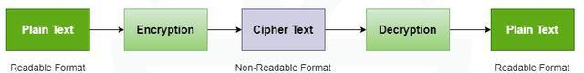
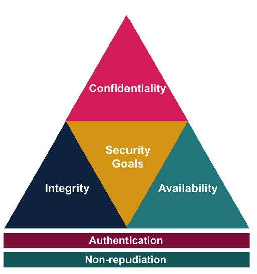
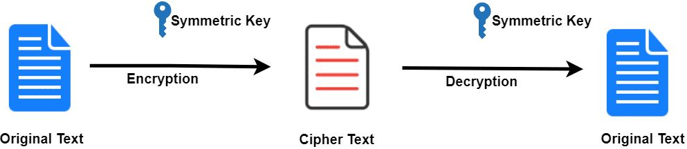
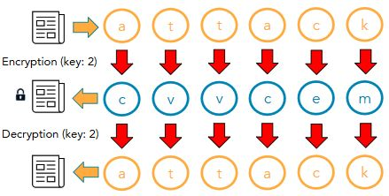
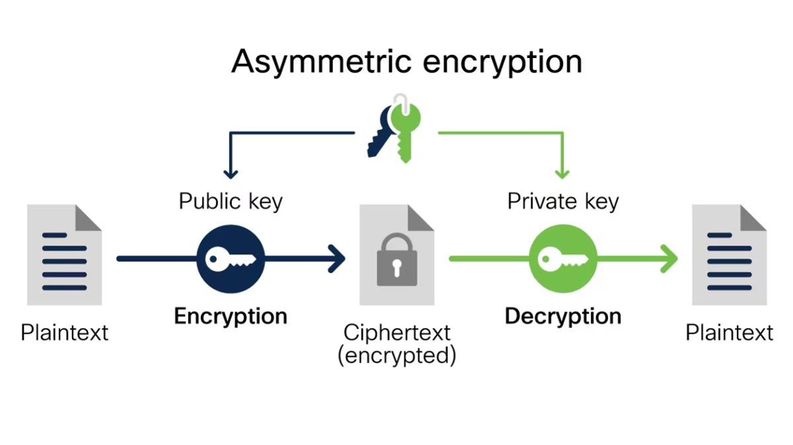
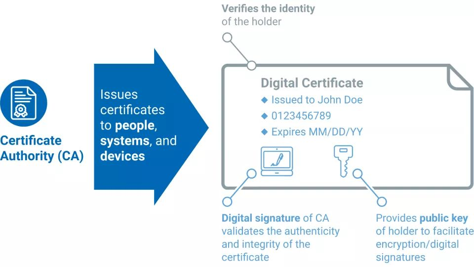
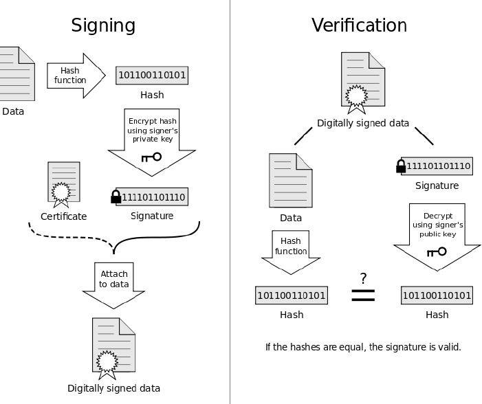

Week 5 covers basic cryptography: the key terms, the CIA triad plus authentication and non-repudiation, multi-factor authentication, symmetric ciphers (Atbash and Caesar), asymmetric encryption, how encryption protects data in transit and at rest, digital certificates, hash functions, digital signatures, and passkeys.

*Sources: SEC-110 notes "Mod 5 – Basic Cryptography," plus Google Safety Center, [Passkeys](https://safety.google/safety/authentication/passkey/).*

## Contents

1. [Cryptology Terms](#1-cryptology-terms)
2. [CIA + Authentication & Non-Repudiation](#2-cia--authentication--non-repudiation)
3. [Multi-Factor Authentication](#3-multi-factor-authentication)
4. [Symmetric Encryption](#4-symmetric-encryption)
   - [Atbash Cipher](#atbash-cipher)
   - [Caesar Cipher](#caesar-cipher)
5. [Asymmetric Encryption](#5-asymmetric-encryption)
6. [Encrypting Data in Transit & at Rest](#6-encrypting-data-in-transit--at-rest)
7. [Digital Certificates](#7-digital-certificates)
8. [Hash Functions](#8-hash-functions)
9. [Digital Signatures](#9-digital-signatures)
10. [Passkeys](#10-passkeys)
11. [Cryptography at a Glance](#11-cryptography-at-a-glance)
12. [Sources & Credits](#12-sources--credits)

---

# 1. Cryptology Terms

| Term | Meaning |
| --- | --- |
| **Cryptography** | The art of writing and solving codes |
| **Cryptology** | The study of cryptography |
| **Cipher** | The method used to disguise text |
| **Plaintext** | The original, readable text |
| **Encrypt / Encode** | The process of disguising the text |
| **Ciphertext** | The disguised, unreadable text |
| **Decrypt / Decode** | Removing the disguise |



> **Clarification:** In everyday security talk, **encoding** isn't the same as **encryption**. Encoding (like Base64) just changes the format, and anyone can reverse it with no key. Encryption needs a **key** to reverse. Never treat encoded data as protected.

---

# 2. CIA + Authentication & Non-Repudiation

Cryptography supports the [CIA triad](Week-2-‐-Security-Concepts-&-Threats-and-Adversaries#the-cia-triad) and adds two more goals:



| Goal | How cryptography helps |
| --- | --- |
| **Confidentiality** | Keeps data private (encryption) |
| **Integrity** | Proves data hasn't been altered (hashing) |
| **Authentication** | Verifies that a user is who they claim to be |
| **Non-repudiation** | Proves a user performed an action, so they **can't deny** it (digital signatures) |

These are the same five goals in [NIST's definition of cybersecurity from Week 1](Week-1-‐-What-Is-Cybersecurity-&-Cyber-Threats#cybersecurity-defined).

---

# 3. Multi-Factor Authentication

How do you verify that a user or system is who they claim to be? **Multi-factor authentication (MFA)** requires **2 of these 3** factor types:

| Factor | Examples |
| --- | --- |
| **Something you know** | Password, PIN, security question |
| **Something you have** | Key card, USB security key, smartphone |
| **Something you are** (biometric) | Fingerprint, facial recognition, voice recognition, retina scan |

The key: the factors must be **different types**. Two things you know is still single-factor.

**Is it multi-factor?**

| Login method | MFA? | Why |
| --- | --- | --- |
| Username/password + a code sent by SMS to your phone | **Yes** | Know (password) + have (phone) |
| Password + a security question | **No** | Both are something you know |
| Thumbprint scan only | **No** | Single factor (something you are) |

> **Clarification:** The slides list a **username** as something you know and an **email address** as something you have. A username isn't secret, so it doesn't count as a factor. An email account is really protected by its own password, so a code sent by email is weaker proof of possession than a phone or security key. Also, SMS codes are the weakest "have" factor because of **SIM-swapping** (an attacker gets your number moved to their SIM card); authenticator apps and security keys are stronger.

---

# 4. Symmetric Encryption

Cryptography has **two basic methods**, symmetric and asymmetric, and **two common applications**: encrypting data at rest and data in transit ([section 6](#6-encrypting-data-in-transit--at-rest)).

**Symmetric encryption** uses **one secret key**:

- The key is applied to a message to change its content in a specific way.
- If the sender and recipient both know the secret key, they can both encrypt and decrypt messages.



The catch: both sides need the **same** key, so how do you share it secretly in the first place? That's the **key exchange problem**, which asymmetric encryption solves.

## Atbash Cipher

The **Atbash cipher** (the "mirror code") simply **reverses the alphabet**: A becomes Z, B becomes Y, and so on.

| Plain | A | B | C | D | E | F | G | H | I | J | K | L | M | N | O | P | Q | R | S | T | U | V | W | X | Y | Z |
| --- | --- | --- | --- | --- | --- | --- | --- | --- | --- | --- | --- | --- | --- | --- | --- | --- | --- | --- | --- | --- | --- | --- | --- | --- | --- | --- |
| **Cipher** | Z | Y | X | W | V | U | T | S | R | Q | P | O | N | M | L | K | J | I | H | G | F | E | D | C | B | A |

Example: **Apple → Zkkov** (A→Z, p→k, p→k, l→o, e→v). I checked this in code. Applying Atbash again turns it back into "Apple."

> **Note:** Atbash has **no key** at all, so anyone who knows the method can read it. It's really a code, not secure encryption.

## Caesar Cipher

The **Caesar cipher** **shifts** each letter a fixed number of places down the alphabet. The number of places is the **key**.



| | a | t | t | a | c | k |
| --- | --- | --- | --- | --- | --- | --- |
| **Shift +2** (encrypt) | c | v | v | c | e | m |

To decrypt, shift back by 2. At the end of the alphabet it wraps around: with key 2, `y → a` and `z → b`.

> **Note:** There are only **25** possible keys, so an attacker can just try them all (a **brute-force attack**). Real symmetric encryption like **AES** uses keys of 128 or 256 bits, which means about 3.4 × 10³⁸ possible keys or more.

---

# 5. Asymmetric Encryption

**Asymmetric encryption** (also called **public-key cryptography**) uses a **key pair**:

| Key | Who has it |
| --- | --- |
| **Public key** | Anyone. It's shared openly. |
| **Private key** | **Only** the owner |

- Anything encrypted with the **public key** can only be decrypted with the matching **private key**.
- Anything encrypted with the **private key** can only be decrypted with the matching **public key**.



**How Bob sends Alice a secret message:**

| Step | What happens |
| --- | --- |
| 1 | Alice publishes her **public key**. |
| 2 | Bob encrypts his message with **Alice's public key**. |
| 3 | Only **Alice's private key** can decrypt it, so even Bob can't undo it. |
| 4 | Alice decrypts it with her private key. |

| Pros | Cons |
| --- | --- |
| No need to **secretly** exchange a key ahead of time | **Slow**: needs much more processing than symmetric encryption |

> **Correction:** The slide titled "Asymmetric Encryption Example" shows Bob and Alice each using a **secret key**. That diagram actually shows **symmetric** encryption. In asymmetric encryption, Bob encrypts with **Alice's public key** and Alice decrypts with **her private key**, as in the table above.
>
> **Clarification:** "No need to exchange keys" means no need to exchange a **secret** key. The public key still has to be shared, and you need a way to trust that it really belongs to Alice. That's what **digital certificates** are for ([section 7](#7-digital-certificates)).

---

# 6. Encrypting Data in Transit & at Rest

These are two of the [information states from Week 3](Week-3-‐-OSINT-&-Data-Security-Principles#7-information-states).

| | **Data in transit** | **Data at rest** |
| --- | --- | --- |
| **How** | Modern protocols use **asymmetric** encryption to **start** the connection and securely share a **symmetric** key, then use that fast symmetric key for the rest of the session | **Symmetric** encryption of a whole disk, a volume or individual files |
| **Examples** | **SSL** (Secure Sockets Layer), **TLS** (Transport Layer Security, the "S" in HTTPS), **SSH** (Secure Shell, for remote logins) | **AES** (Advanced Encryption Standard), used by BitLocker (Windows) and FileVault (macOS) |

This combination is called **hybrid encryption**: asymmetric solves the key exchange problem, and symmetric does the heavy lifting quickly.

> **Modern note:** **SSL is obsolete** and insecure; every version has been retired. What people still call "SSL" today is actually **TLS** (current versions are TLS 1.2 and 1.3).

---

# 7. Digital Certificates

A **digital certificate** is an electronic file that verifies the identity of a **user, device or website**.



- It contains the **public key** for the connection.
- It's **signed** by a **certificate authority (CA)**, a trusted source that creates and issues certificates.
- Systems exchange certificates or public keys using **SSL/TLS** to set up an encrypted connection.

When you visit an `https://` site, your browser checks that the site's certificate is signed by a CA it trusts, is for the right domain name, and **hasn't expired**.

> **Note:** Remember the Equifax breach in [Week 2](Week-2-‐-Security-Concepts-&-Threats-and-Adversaries#loss-of-confidentiality)? An **expired certificate** on a monitoring device meant encrypted traffic wasn't being inspected, which let attackers move stolen data out unnoticed.

---

# 8. Hash Functions

A **hash function** is an algorithm that computes a **fixed-length** string from a block of data. It's used to test the **integrity** of a file. (Week 3 covered hashing and attacks on hashes in depth: see [Hashing](Week-3-‐-OSINT-&-Data-Security-Principles#5-hashing).)

| Term | Meaning |
| --- | --- |
| **Message** | The input data |
| **Message digest** (hash) | The fixed-length output |

**Example from the slides:** a small change to the message completely changes the MD5 hash. I re-ran both and they match.

| Message | MD5 hash |
| --- | --- |
| `This is my original file's message digest!` | `18e0e19183bc67036e226520830b7be3` |
| `This is my altered file's message digest.` | `ab6fb916c7ea5385c44e9995d237c89f` |

If a downloaded file's hash doesn't match the hash the publisher posted, the file was **changed or corrupted**.

**Popular hashing algorithms:**

| Algorithm | Digest size | Status today |
| --- | --- | --- |
| **MD5** | 128 bits (32 hex characters) | **Broken**: collisions can be made easily. Fine for spotting accidental corruption, not for security. |
| **SHA-1** | 160 bits | **Broken**: a real collision was demonstrated in 2017. Being phased out. |
| **SHA-2** (SHA-256, SHA-512, …) | 256 or 512 bits (also 224 and 384) | **Secure** and widely used |

> **Modern note:** The "Status today" column is added; the slides list only the sizes. Use **SHA-256 or stronger** for security. For **passwords**, use a slow password-hashing algorithm instead (see [Password Salting](Week-3-‐-OSINT-&-Data-Security-Principles#6-password-salting)).

Check a file's hash yourself:

```bash
sha256sum downloaded-file.iso
```

| Part | What it does |
| --- | --- |
| `sha256sum` | Computes the SHA-256 hash (on Windows PowerShell: `Get-FileHash downloaded-file.iso`) |
| `downloaded-file.iso` | The file to check. Compare the output with the hash on the download page. |

---

# 9. Digital Signatures

A **digital signature** ensures that a party **can't deny sending a message** they originated (**non-repudiation**).

- It's a "**virtual fingerprint**" unique to a person or entity.
- It uses both **digital certificates** and **hashes**.



| Step | **Signing** (sender) | **Verifying** (receiver) |
| --- | --- | --- |
| 1 | Hash the data | Hash the received data |
| 2 | Encrypt the hash with the **signer's private key**. That's the signature. | Decrypt the signature with the **signer's public key** (from their certificate) |
| 3 | Attach the signature and certificate to the data | Compare the two hashes. **If they're equal, the signature is valid.** |

What a valid signature proves:

| Proves | Because |
| --- | --- |
| **Authentication** | Only the signer's private key could have made the signature |
| **Integrity** | Any change to the data would change its hash |
| **Non-repudiation** | The signer can't later deny it, since only they hold the private key |

> **Clarification:** The slide says signatures use certificates and hashes. The key ingredient is the **signer's private key**: the certificate's job is to deliver the matching **public key** and prove whose it is. Notice that signing uses the private key (the reverse of encryption in [section 5](#5-asymmetric-encryption)), so *anyone* can verify, but *only the owner* can sign.

---

# 10. Passkeys

*From Google Safety Center, [Passkeys](https://safety.google/safety/authentication/passkey/), with notes added.*

**Passkeys** are a **passwordless** way to sign in. Instead of typing a password, you unlock your device the way you normally do: **fingerprint, face scan or screen lock PIN**. Google helped develop passkeys through the **FIDO Alliance**, an industry group working to move beyond passwords.

## How Passkeys Work

Google's page doesn't explain the cryptography, but passkeys are **asymmetric encryption and digital signatures** from this week in action:

| Step | What happens |
| --- | --- |
| 1. **Create** | Your device generates a new **key pair** for that one website. The **public key** goes to the website; the **private key** stays protected on your device (or in your password manager). |
| 2. **Sign in** | The website sends a random **challenge**. |
| 3. **Unlock** | You unlock with your fingerprint, face or PIN. That unlock **never leaves your device**; it just lets the device use the private key. |
| 4. **Sign** | The device **signs** the challenge with the private key. |
| 5. **Verify** | The website checks the signature with your **public key**. If it's valid, you're in. |

## Benefits (per Google)

| Benefit | Why |
| --- | --- |
| **Phishing protection** | Google calls passkeys the strongest protection against phishing |
| **Nothing to guess or reuse** | You never type a passkey, so it can't be guessed, reused or stolen by someone watching you type |
| **Simpler and faster** | No password to remember. Google says passkeys are "4x simpler" than passwords. |
| **Privacy** | Your biometric data stays on your device |
| **Works across devices** | Passkeys can sync across your devices, or be stored on a hardware **security key** |

> **Note: why passkeys stop phishing.** Each passkey is tied to the **exact website** that created it (e.g. `accounts.google.com`). Your device simply won't use it on a look-alike phishing site such as `accounts-google.co`, so there's nothing for the fake site to steal. A password, by contrast, can be typed into any fake page.

## Storage, Syncing & Recovery

- Passkeys are stored on your **phone, computer or a hardware security key**.
- Some platforms **sync** them. For example, Apple's iCloud Keychain makes one passkey available on all your Apple devices, and Google Password Manager syncs across Android and Chrome. Without syncing, you create a separate passkey on each device.
- If you can't use your passkey (say, on a new device without your phone), you can still sign in with your **password and 2-Step Verification**, or use Google's **account recovery**. Google recommends keeping a recovery email and phone number on your account.
- Passkeys are **optional** for now, but Google says it may limit where passwords are accepted over time.

**Passkey vs. MFA:** one passkey sign-in combines **something you have** (your device holding the private key) with **something you are or know** (fingerprint, face or PIN), so a passkey alone covers two factors.

> **Clarification:** Google says passkeys stay on your device and are "never shared with Google or any other third-party partners." The **private key** is never sent to the **website** you sign in to. But **synced** passkeys are also stored, end-to-end encrypted, in your cloud account (Google Password Manager or iCloud Keychain), so "only on your device" is true only for passkeys that aren't synced.

---

# 11. Cryptography at a Glance

| Tool | Type | Main goal | Key(s) |
| --- | --- | --- | --- |
| **Atbash / Caesar** | Classical symmetric cipher | Confidentiality (weak) | None / a shift number |
| **AES** | Symmetric encryption | Confidentiality | One shared secret key |
| **Public-key encryption** (e.g. RSA) | Asymmetric encryption | Confidentiality, key exchange | Encrypt with the recipient's **public** key |
| **Hash** (SHA-256) | One-way function | Integrity | None |
| **Digital signature** | Asymmetric + hash | Authentication, integrity, non-repudiation | Sign with your **private** key |
| **Digital certificate** | Signed by a CA | Proves who owns a public key | The CA's signature |
| **TLS / SSH** | Hybrid protocol | Protects data in transit | Asymmetric to start, then symmetric |
| **Passkey** | Asymmetric challenge-response | Phishing-resistant authentication | Per-site key pair |

---

# 12. Sources & Credits

**Class materials**

- SEC-110 notes: *Mod 5 – Basic Cryptography*

**Links**

- [Google Safety Center: Passkeys](https://safety.google/safety/authentication/passkey/)

<details>
<summary><b>Image credits (from the course slides)</b></summary>

- Encryption/decryption flow: from the Mod 5 notes (GeeksforGeeks diagram)
- Security goals triangle with authentication and non-repudiation, symmetric key encryption, Caesar cipher, asymmetric encryption, digital certificate and digital signature diagrams: from the Mod 5 notes

</details>
