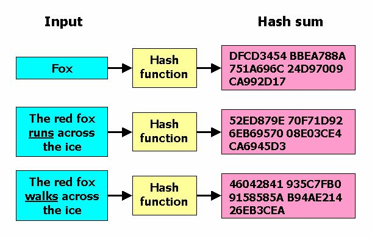
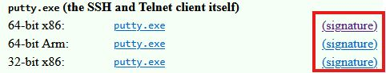
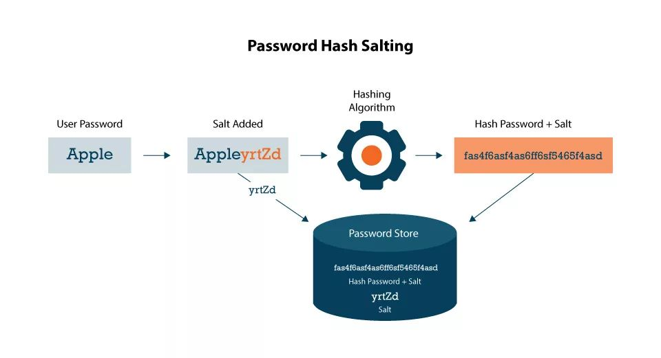

Week 6 goes deeper into hash functions: what makes a hash function cryptographic, how hashes are used (password files, digital signatures, file verification, malware detection, file sync), the MD and SHA algorithm families, salting and rainbow tables, and steganography.

*Sources: SEC-110 notes "Mod 6 – PKI & Hash Functions."*

## Contents

1. [Week 5 Review](#1-week-5-review)
2. [Hash Functions](#2-hash-functions)
3. [Properties of Cryptographic Hash Functions](#3-properties-of-cryptographic-hash-functions)
4. [Uses of Hash Functions](#4-uses-of-hash-functions)
5. [Hash Algorithms](#5-hash-algorithms)
6. [Salting & Rainbow Tables](#6-salting--rainbow-tables)
7. [Steganography](#7-steganography)
8. [Public Key Infrastructure](#8-public-key-infrastructure)
9. [Sources & Credits](#9-sources--credits)

---

# 1. Week 5 Review

Which cryptographic tool provides which goal (see [Week 5](Week-5-‐-Basic-Cryptography-&-Passkeys#2-cia--authentication--non-repudiation)):

| Goal | Provided by |
| --- | --- |
| **Confidentiality** | Encryption/decryption algorithms |
| **Integrity** | Hash functions |
| **Authenticity** | Digital signatures and digital certificates |
| **Non-repudiation** | Digital signatures and digital certificates |

---

# 2. Hash Functions

**The integrity problem:** how does Bob know a message or file **wasn't altered** in transit? The solution is **hash functions**, which can also check whether data was altered **at rest** (in storage).

A **hash function** maps data of **any size** to data of a **fixed size**. The output is called the **hash**, **hash value** or **message digest**.

A **cryptographic hash function** is one where it's practically impossible to **invert** it (get the input back from the hash) or to find **collisions** (two messages with the same hash).

This classic example uses SHA-1. Changing one word changes the entire hash:



I re-ran all three SHA-1 hashes and they match. Notice that a 3-letter word and a 31-character sentence both produce the same **160-bit** (40 hex character) output.

---

# 3. Properties of Cryptographic Hash Functions

| Property | Meaning |
| --- | --- |
| **Variable input / fixed output** | Works on data of practically any size, but the output is always the same number of bits |
| **Preimage resistant** (not reversible) | Virtually impossible to find the input that produced a given hash |
| **Collision resistant** | Infeasible to find two inputs with the same hash |
| **Efficient** | Fast and simple to compute in hardware and software |
| **Pseudorandom** | The output passes randomness tests: no detectable pattern or correlation, and outputs are spread evenly across all possible values |

> **Clarification:** The slide says collisions are "impossible" to find. Collisions **must exist**, since infinitely many inputs map to a fixed number of outputs. A good hash makes them **computationally infeasible** to *find*. When someone does find them, the algorithm is considered broken (which happened to MD5 and SHA-1). See [Week 3's debrief](Week-3-‐-OSINT-&-Data-Security-Principles#debrief).
>
> **Note:** "Efficient" is good for checking files and signing, but **bad for storing passwords**, because it lets attackers make billions of guesses per second. Password storage uses deliberately **slow** hashes like bcrypt or Argon2 ([Week 3](Week-3-‐-OSINT-&-Data-Security-Principles#6-password-salting)).

---

# 4. Uses of Hash Functions

| Use | How hashes help |
| --- | --- |
| **Password files** | Systems store **hashes** of passwords, not the passwords themselves. No one can see the plain password, which adds a layer of security if the password file is stolen. |
| **Digital signatures** | The signer encrypts the message's **hash** with their private key instead of the whole message, which lets messages of any length be signed. (See [Week 5](Week-5-‐-Basic-Cryptography-&-Passkeys#9-digital-signatures).) |
| **File signatures** | A hash acts as a **fingerprint** for a file. You can tell one `Notepad.exe` from another, and verify downloaded files. |
| **Intrusion / virus detection** | If a file's hash **changes** unexpectedly, that can mean an intrusion or a virus. |
| **Pseudorandom number generation** | Because hash output has no detectable pattern, isn't reversible and is spread evenly, hashes are used to build random-looking numbers. |
| **File synchronization** | Cloud storage can decide whether to re-upload a file by checking if its hash **changed** since the last sync. |

**Example: verifying a download.** The PuTTY download page posts a signature next to each file so you can confirm it's genuine:



> **Clarification:** PuTTY's "signature" links are **digital signatures** (GPG), which use a hash plus PuTTY's private key. They prove the file is **authentic** as well as unchanged. Many download pages instead just post a **checksum** (a plain hash, like SHA-256) that you compare with your own `sha256sum` result.
>
> **Note:** "Intrusion detection by hash" is the idea behind **file integrity monitoring** tools like Tripwire. They record the hashes of important system files and alert if any change. Antivirus software also keeps lists of the hashes of known malware.

---

# 5. Hash Algorithms

## MD (Message Digest) Family

| Algorithm | Digest size | Notes |
| --- | --- | --- |
| **MD4** | 128 bits | Broken, obsolete |
| **MD5** | 128 bits | Similar to MD4. Security is **severely compromised**, so it's **not suitable for cryptographic use**. |

> **Correction:** The slide says MD4 is "used in TLS certificates." It isn't: MD4 was never used for TLS certificates (old certificates used MD2 and MD5, both since banned). MD4's best-known remaining use is in Windows **NTLM** password hashes, which is one reason those are easy to crack.

## SHA (Secure Hash Algorithm) Family

| Algorithm | Designed by | Published | Digest size | Status |
| --- | --- | --- | --- | --- |
| **SHA-1** | NSA | 1995 by NIST, as a Federal Information Processing Standard (FIPS) | 160 bits | Broken (a practical collision was shown in 2017), being retired |
| **SHA-2** (SHA-224, SHA-256, SHA-384, SHA-512) | NSA | 2001 by NIST, as a FIPS | 224–512 bits | **Secure**, the current standard |
| **SHA-3** | Public competition (Keccak) | 2015 by NIST | 224–512 bits | Secure, a backup with a completely different design |

> **Correction:** The slide says SHA-1 was published in 1993. The **1993** standard was the original "SHA," now called **SHA-0**, which was withdrawn soon after for a flaw. **SHA-1** replaced it in **1995**.
>
> **Modern note:** SHA-3 isn't in the slides. It was chosen through an open competition rather than designed by the NSA.

**Examples from the slides** (I re-ran both and they match):

| Input | Algorithm | Hash |
| --- | --- | --- |
| `Cybersecurity Rocks` | SHA-1 | `950f2e838ba18fe62fd030b412ec1e4dd2a7b766` |
| `Cybersecurity Rocks` | SHA-256 | `8a7e72a3370e27552d8cf7557f84c64842da9de9e2e4c5713d3b0c72ececf7fb` |

Try it yourself:

```bash
printf '%s' 'Cybersecurity Rocks' | sha1sum
printf '%s' 'Cybersecurity Rocks' | sha256sum
```

| Part | What it does |
| --- | --- |
| `printf '%s' 'Cybersecurity Rocks'` | Prints the text with no trailing newline (a newline would change the hash) |
| `\| sha1sum` / `\| sha256sum` | Hashes that text with SHA-1 or SHA-256 |

---

# 6. Salting & Rainbow Tables

**Salting** is another technique for securing hashes. A **cryptographic salt** is a string of **random characters added to a password before it's hashed** and stored, to add an extra layer of randomness.



A **rainbow table** is a password-cracking tool: a table of **precomputed hash values** used to crack the password hashes in a stolen database.

**Salting prevents rainbow table attacks.** Because each user gets a random salt, the same password used by two users won't produce the same hash, and the attacker's precomputed table no longer matches anything.

| | Without salt | With salt |
| --- | --- | --- |
| Two users with password `Apple` | Identical hashes | Different hashes |
| Precomputed rainbow table | Works | Useless (it would need a table for every salt) |
| Guessing a weak password one account at a time | Possible | Still possible, so strong passwords and slow hashes still matter |

Week 3 covered this in depth, including a tested Python example: see [Password Salting](Week-3-‐-OSINT-&-Data-Security-Principles#6-password-salting).

> **Note:** The diagram shows the **salt stored next to the hash** in the password store. That's normal: salts aren't secret. Their job is to make every hash unique.

---

# 7. Steganography

**Steganography** is concealing information **inside another message or physical object** to avoid detection: **hiding in plain sight**.

| Method | Example |
| --- | --- |
| **Invisible ink** | Writing that only appears under heat or UV light |
| **Embedding in a picture** | Changing the last bit of each pixel's color values to store hidden data. The image looks identical. |
| **Masking in an audio file** | Hiding data in sounds people can't hear |
| **Inserting data into a video frame** | Hiding data across frames of a video |
| **Hiding text in whitespace** | Using spaces and tabs at the ends of lines as hidden bits |
| **Metadata** | Storing data in a file's hidden properties (author, comments, EXIF tags) |

| | **Cryptography** | **Steganography** |
| --- | --- | --- |
| **Goal** | Make the message **unreadable** | Hide that a message **exists at all** |
| **An observer sees** | Obvious scrambled ciphertext | An ordinary picture, song or document |

The two are often combined: encrypt the message first, then hide it.

> **Note:** Week 3 listed steganography as a **confidentiality** control ([Common CIA Controls](Week-3-‐-OSINT-&-Data-Security-Principles#common-cia-controls)). Attackers use it too, for example hiding malware commands or stolen data inside innocent-looking images.

---

# 8. Public Key Infrastructure

The module title includes **PKI**, but the slides don't define it, so here's a short summary tying together the pieces from [Week 5](Week-5-‐-Basic-Cryptography-&-Passkeys#7-digital-certificates).

**Public Key Infrastructure (PKI)** is the system of people, policies and technology that **creates, distributes, verifies and revokes digital certificates**, so you can trust that a public key really belongs to who it claims.

| Part | Role |
| --- | --- |
| **Key pair** | The public and private keys ([Week 5](Week-5-‐-Basic-Cryptography-&-Passkeys#5-asymmetric-encryption)) |
| **Certificate Authority (CA)** | A trusted organization that verifies identities and **signs** certificates |
| **Digital certificate** | Binds a public key to an identity (a person, device or website), and is signed by the CA |
| **Root certificates** | The CAs' own certificates, built into your operating system and browser as the starting point of trust |
| **Revocation** | Cancels a certificate early if its private key is stolen |

This is where hashes come in: the CA's signature on a certificate is a **digital signature** over the certificate's **hash**. That's why certificates moved from MD5 to SHA-1 to **SHA-256**: a hash collision could let an attacker forge a certificate that seems to be signed by the CA.

---

# 9. Sources & Credits

**Class materials**

- SEC-110 notes: *Mod 6 – PKI & Hash Functions*

<details>
<summary><b>Image credits (from the course slides)</b></summary>

- SHA-1 "Fox" hash example: from the Mod 6 notes (a well-known diagram from Wikipedia's "Cryptographic hash function" article)
- PuTTY download page screenshot: from the Mod 6 notes
- Password hash salting diagram: from the Mod 6 notes

</details>
