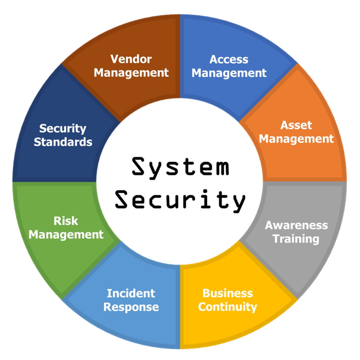
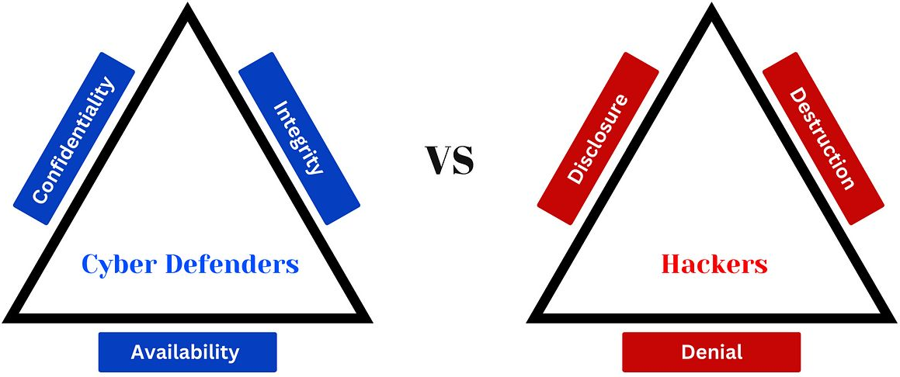
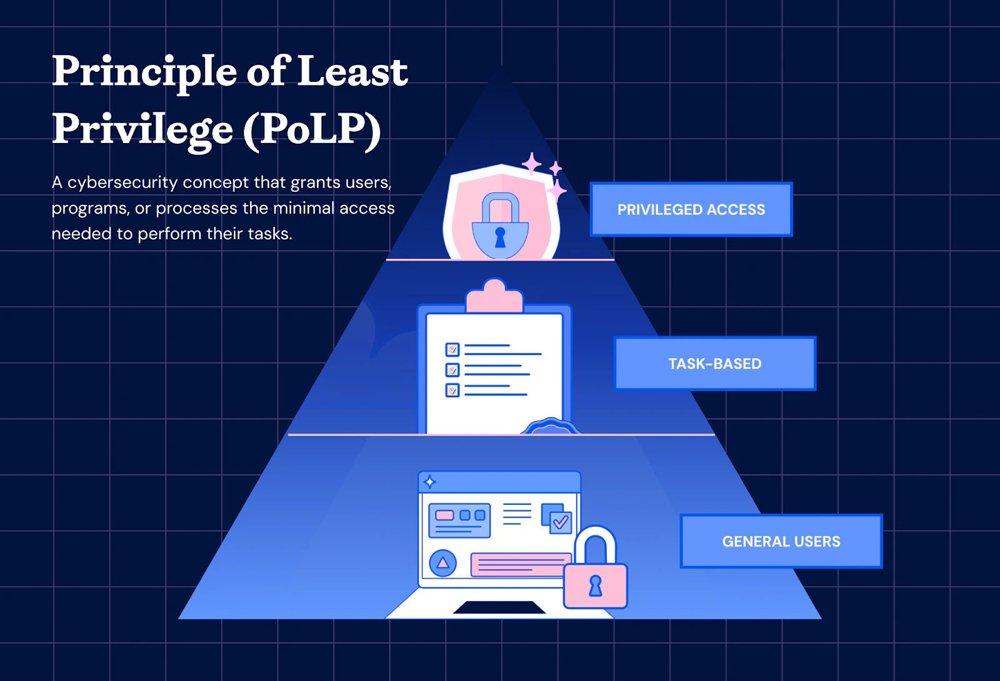
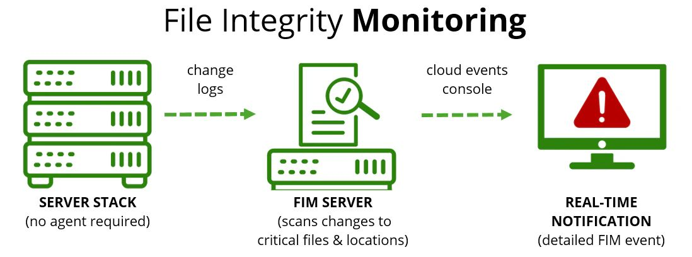

Week 7 covers system security: what it includes, common threats, access control models and the principle of least privilege, perimeter, environmental and system-boundary security, physical and system monitoring (SIEM, SOAR, XDR), integrity monitoring, IoT security, emerging trends, and everyday do's and don'ts.

*Sources: SEC-110 notes "Mod 7 – System Security."*

## Contents

1. [What Is System Security?](#1-what-is-system-security)
2. [Vulnerabilities & Common Threats](#2-vulnerabilities--common-threats)
3. [Access Control](#3-access-control)
4. [Security Types](#4-security-types)
5. [Monitoring](#5-monitoring)
6. [IoT & Physical Security](#6-iot--physical-security)
7. [Emerging Trends](#7-emerging-trends)
8. [Do's & Don'ts](#8-dos--donts)
9. [Sources & Credits](#9-sources--credits)

---

# 1. What Is System Security?

**System security** is the measures and practices put in place to protect computer **systems, networks and data** from **unauthorized access, damage or theft**.

| Area | What it covers |
| --- | --- |
| **Access management** | Who can get in and what they can do ([section 3](#3-access-control)) |
| **Asset management** | Knowing every device, system and piece of data you have to protect |
| **Awareness training** | Teaching people to spot threats like phishing |
| **Business continuity** | Keeping the organization running during and after a disaster |
| **Incident response** | The plan for detecting, containing and recovering from an attack |
| **Risk management** | Deciding what to protect and how ([Week 2](Week-2-‐-Security-Concepts-&-Threats-and-Adversaries#8-risk)) |
| **Security standards** | Following rules and frameworks (e.g. NIST, HIPAA) |
| **Vendor management** | Making sure suppliers and partners don't introduce risk |

## The CIA Triad (Again!)

System security is what protects data so it keeps its **confidentiality, integrity and availability**. Attackers aim for the opposite, the **DAD triad**:

| Defenders protect (CIA) | Attackers aim for (DAD) | Example |
| --- | --- | --- |
| **Confidentiality** | **Disclosure** | Leaking stolen customer data |
| **Integrity** | **Alteration** | Changing grades or bank balances |
| **Availability** | **Denial** | A DoS attack taking a site offline |

> **Clarification:** The slide's diagram pairs Integrity with "Destruction." In the standard **DAD triad**, the opposite of integrity is **Alteration** (unauthorized changes). Destruction is an extreme case that also hurts availability.

---

# 2. Vulnerabilities & Common Threats

**Vulnerabilities** are weaknesses in a system that attackers can exploit to gain unauthorized access or cause harm. *Think of a crack in a wall: it may be small, but it gives someone a way to break in.* (Week 2 covered [threats, vulnerabilities and attacks](Week-2-‐-Security-Concepts-&-Threats-and-Adversaries#2-threats-vulnerabilities--attacks) in detail.)

| Threat | Definition | Example |
| --- | --- | --- |
| **Insider threat** | A security risk from **inside** an organization, such as an employee | An employee misuses their badge access to deliberately let a malicious intruder into the building |
| **Social engineering** | **Tricking people** into giving away confidential information or access | A hacker calls a CEO pretending to be IT to get their login credentials |
| **Malware** | **Malicious software** designed to harm, spy on or take control of systems | A hacker installs a USB **keylogger** on a computer to record everything the user types |
| **Man-in-the-middle (MitM)** | A hacker secretly **intercepts communication** between two parties | On public Wi-Fi, a hacker intercepts traffic between a user and a web server |
| **Denial of service (DoS)** | **Floods** a system or website with traffic so it crashes or goes offline | A school website is hit by a DoS attack and goes down during an online exam |

> **Note:** Week 1's [Maskelyne hack](Week-1-‐-What-Is-Cybersecurity-&-Cyber-Threats#morse-code--wireless) was a 1903 man-in-the-middle attack. Encryption (**HTTPS/TLS**, [Week 5](Week-5-‐-Basic-Cryptography-&-Passkeys#6-encrypting-data-in-transit--at-rest)) is the main defense against MitM on public Wi-Fi.

---

# 3. Access Control

**Access control** decides **who** can get in, and **what** they can do once inside. It comes in many forms: **passwords, PINs, keycards, biometrics, security questions**. (Combining types is [multi-factor authentication](Week-5-‐-Basic-Cryptography-&-Passkeys#3-multi-factor-authentication).)

## Types of Access Control

| Model | Who decides access | Example |
| --- | --- | --- |
| **DAC** (Discretionary) | The resource's **owner** decides who can access it | You share a Google Doc with specific classmates |
| **MAC** (Mandatory) | Access is based on **security labels/classifications** set by the system | Military files labeled Secret or Top Secret, readable only by people with that clearance |
| **RBAC** (Role-Based) | Access depends on your **job role** | All "Teachers" can edit grades; all "Students" can only view their own |
| **ABAC** (Attribute-Based) | Access depends on **attributes** like location, role and time | A nurse can open records only on hospital Wi-Fi during their shift |

> **Note:** Don't confuse **MAC** (Mandatory Access Control) with a **MAC address** ([Week 4](Week-4-‐-Networking-Basics-&-Network-Models#mac-addresses)). Same letters, unrelated ideas.

## Principle of Least Privilege

**Users should only have access to what they need for their job: nothing more.** This reduces the damage if an account is misused or compromised.

The pyramid shows that most people (general users) get basic access, fewer get task-based access, and very few get **privileged** (admin) access.

**Examples:**

- Students shouldn't be able to access their teacher's gradebook.
- Janitors shouldn't be able to access the school's network settings.

## Access Types

| Type | How it limits access |
| --- | --- |
| **Least privilege** | Only the areas and information needed for the job |
| **Time-based access** | Access is restricted to certain **hours of the day** |
| **Geofencing** | Access is allowed only when the user is in a **specific location** |

---

# 4. Security Types

| Type | Protects against | Examples |
| --- | --- | --- |
| **Perimeter** | Unauthorized **outside access**, using physical barriers | Fences, locked doors, security guards |
| **Environmental** | **Natural or physical damage** | Fire alarms, cooling systems, backup power |
| **System boundary** | **Malicious damage** to internal systems | **Firewalls** that filter transmitted packets |

This is [defense in depth](Week-2-‐-Security-Concepts-&-Threats-and-Adversaries#the-six-cybersecurity-concepts): an attacker has to get through the fence, the locked door **and** the firewall.

---

# 5. Monitoring

## Physical Security Monitoring

| Control | Examples |
| --- | --- |
| **Access control** | Keycards, biometrics, PINs |
| **Surveillance** | CCTV cameras, security guards, alarms |
| **Perimeter defense** | Fences, locks, security doors |

## System Surveillance & Monitoring

Monitoring **IT infrastructure, endpoints, networks and applications** lets misuse be **caught early**. Three key types of monitoring tools:

| | **SIEM** | **SOAR** | **XDR** |
| --- | --- | --- | --- |
| **Stands for** | Security Information and Event Management | Security Orchestration, Automation and Response | Extended Detection and Response |
| **What it does** | **Collects, aggregates and analyzes** event data (logs) from many sources | **Analyzes and prioritizes** event data to launch **automated responses** | **Collects and analyzes** event data from endpoints and sources across the whole IT environment |
| **How** | Uses AI to establish a baseline of normal events for analysis | Builds on event data to **speed up incident response** | **Correlates** all the data to analyze it and choose a response |
| **Relationship** | Its data can feed SOAR for a more effective response | Turns SIEM data into automated responses | Handles **every step**, from data collection and analysis to response |

In short: **SIEM** sees and alerts, **SOAR** acts automatically, and **XDR** does both across the environment.

> **Clarification:** Not every SIEM "uses AI." Traditionally SIEMs rely on **correlation rules** (e.g. "alert if one account fails to log in 50 times in a minute"). Many now add machine learning to spot unusual behavior.

## Integrity Monitoring

How do we monitor **integrity**, not just confidentiality and availability? Items to watch include:

- System files and configurations
- Logs
- Installed software
- User permissions

Integrity checking uses **digital fingerprints**. The slide says these are covered in an upcoming module, but you've already seen them: they're **hashes** ([Week 6](Week-6-‐-PKI-&-Hash-Functions#4-uses-of-hash-functions)). A FIM tool records the hash of each important file and alerts when a hash changes.

---

# 6. IoT & Physical Security

**IoT (Internet of Things)** means using internet-connected devices to **monitor or access physical environments**.

**IoT in physical security:**

- **Devices:** badge readers, motion detectors, smart locks
- **Cameras and sensors:** detect unauthorized access and environmental changes (fire, water leaks, etc.)
- They can act as a form of **multi-factor authentication** (e.g. a badge reader plus a PIN pad)

## IoT Risks

IoT risks include **data privacy breaches, DoS attacks and hijacking**, because these devices are interconnected, often lack strong security, and are hard to monitor.

| Case | What happened |
| --- | --- |
| **Mirai botnet** (2016) | One of the most infamous botnets. It took control of **unsecured IoT devices** (mostly using factory-default passwords) and used them for massive DDoS attacks. (See [Week 2](Week-2-‐-Security-Concepts-&-Threats-and-Adversaries#loss-of-availability).) |
| **Ring cameras** (2025) | Thousands of Ring camera owners reported "new" devices logged into their accounts, dated **May 28, 2025** |

> **Clarification:** The Ring reports went viral in **July 2025**; all the suspicious logins were dated May 28. Ring (owned by Amazon) said a **backend bug** made old logins show up with that date and that there was **no evidence of unauthorized access**. Some users doubted that, saying they saw devices they'd never owned. It's still a useful lesson: check your account's logged-in devices, use MFA, and remove devices you don't recognize.

---

# 7. Emerging Trends

| Trend | What it means |
| --- | --- |
| **AI-powered threat detection** | Attackers now use AI and machine learning, so defenders need them too, for **real-time anomaly detection**, malware analysis and more. |
| **Zero Trust Architecture** | **"Never trust, always verify."** No user or device is trusted by default, even inside the network; everyone is verified every time. Already common, it stops more bad actors than it inconveniences regular users. |
| **Securing remote workforces** | With working from home firmly established, **VPNs**, **endpoint protection** and **home network security** are now necessities. |

> **Note:** Zero Trust is the opposite of the old "castle and moat" model, where anyone inside the network perimeter was trusted. That old model is why attackers who got past a firewall (or [insiders](Week-2-‐-Security-Concepts-&-Threats-and-Adversaries#6-insiders-vs-outsiders)) could move around freely.

---

# 8. Do's & Don'ts

*A company's cybersecurity is only as strong as its most vulnerable employee. Don't be the one who clicks the link!*

| ✅ Do | ❌ Don't |
| --- | --- |
| Use **multi-factor authentication** for accounts | Reuse the same password for multiple accounts |
| Use a **password manager** app to store passwords | Keep passwords in unsecured documents, email or on paper |
| Implement **security awareness** programs | Excuse people from learning: cybersecurity is **everyone's** responsibility |
| Be cautious with **unexpected emails** | Click on links or files in unexpected emails |
| Keep all apps and operating systems **up to date** | Delay installing security updates |
| **Change your password** if someone has gotten it | Share your passwords with anybody |
| Submit payment information via **secure sites** only | Submit payment information via email |
| Keep trusted **antivirus** software running | Miss updating your antivirus software |

---

# 9. Sources & Credits

**Class materials**

- SEC-110 notes: *Mod 7 – System Security*

**Links**

- [Malwarebytes: "Ring cameras hacked"? Amazon says no, users not so sure (July 2025)](https://www.malwarebytes.com/blog/news/2025/07/ring-cameras-hacked-amazon-says-no-users-not-so-sure)

<b>Image credits (from the course slides)</b>

- System security wheel, CIA vs. DAD triangles, Principle of Least Privilege pyramid, and File Integrity Monitoring diagram: from the Mod 7 notes
- SIEM vs. SOAR vs. XDR comparison and the Cyber Security Do's and Don'ts infographic (Blue Sky Net): from the Mod 7 notes, typed out as tables

