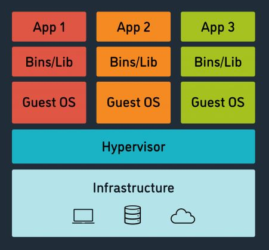
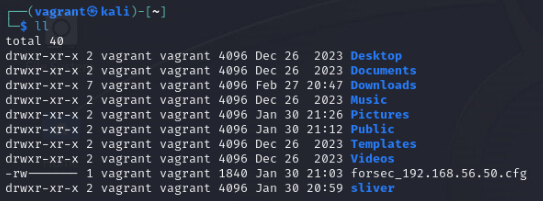
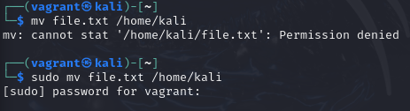
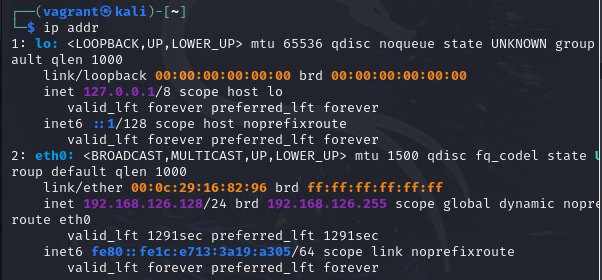
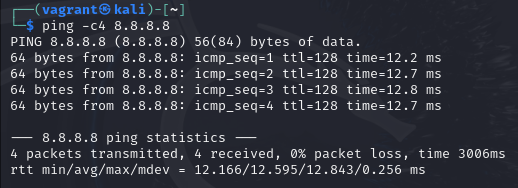
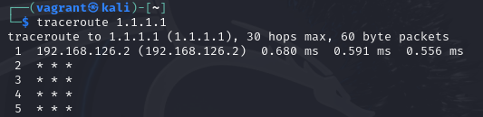

Week 9 introduces the CyberRange lab environment: virtual machines and hypervisors, operating systems, Linux and Kali, the core Kali terminal commands (from the class cheat sheet), `sudo` and file permissions, and an introduction to scripting in Python, Bash, PowerShell and JavaScript.

*Sources: SEC-110 notes "Mod 9 – Intro to CyberRange" and "Week 9 Kali Cheat Sheet."*

## Contents

1. [Virtual Machines & Hypervisors](#1-virtual-machines--hypervisors)
2. [Operating Systems](#2-operating-systems)
3. [Linux & Kali](#3-linux--kali)
4. [Kali Commands](#4-kali-commands)
   - [Directory Commands](#directory-commands)
   - [File Commands](#file-commands)
   - [User Commands & Sudo](#user-commands--sudo)
   - [Networking Commands](#networking-commands)
   - [Misc. Commands](#misc-commands)
5. [File Permissions & chmod](#5-file-permissions--chmod)
6. [Scripting](#6-scripting)
   - [Python](#python)
   - [Bash](#bash)
   - [PowerShell](#powershell)
   - [JavaScript](#javascript)
   - [The Same Scripts Side by Side](#the-same-scripts-side-by-side)
7. [Command Cheat Sheet at a Glance](#7-command-cheat-sheet-at-a-glance)
8. [My Notes](#8-my-notes)
9. [Sources & Credits](#9-sources--credits)

---

# 1. Virtual Machines & Hypervisors

A **virtual machine (VM)**, also called an **image**, is a digital replica of a computer that runs **inside another computer**, called the **host machine**.

**What VMs are used for:**

- Running **multiple operating systems** on one computer
- A **safe virtual environment** for testing software or security vulnerabilities **without affecting the host machine**

A **hypervisor** is the software that lets a host machine create and run VMs. Popular hypervisors: **VirtualBox**, **Proxmox**, **VMware**.



Reading the diagram from the bottom up: the physical **infrastructure** (the host's hardware) runs the **hypervisor**, which splits that hardware among several **guest operating systems**. Each guest has its own libraries and apps, and none of them can see the others.

> **Note:** A **cyber range** (like the class CyberRange) is a lab built out of VMs: a safe, isolated network where you can practice attacks and defenses without touching real systems. If something breaks, you just reset the VM. A **snapshot** saves a VM's state so you can roll back to it later.

---

# 2. Operating Systems

An **operating system (OS)** is the most important software on a computer. It manages **memory**, **processes**, **all software** and **all hardware**.

Users interact with the OS through either:

| Interface | What it is | Example |
| --- | --- | --- |
| **GUI** (graphical user interface) | Windows, icons, menus, mouse | The Windows desktop, macOS Finder |
| **CLI** (command-line interface) | Typing text commands into a terminal | The Kali terminal, Windows PowerShell |

**Common operating systems:**

| Desktop | Mobile / other |
| --- | --- |
| Microsoft Windows | iOS |
| macOS | Android |
| Linux | ChromeOS |

---

# 3. Linux & Kali

**Linux:**

- An operating system created by **Linus Torvalds**
- **Open source:** anyone can read and change the code
- **Zero entry cost:** free to download and use
- Hundreds of different **distributions** for different purposes

> **Clarification:** Strictly speaking, Torvalds wrote the Linux **kernel** (1991), the core of the OS. A full Linux system adds tools from other projects (largely GNU). Android and ChromeOS are also built on the Linux kernel.

A **Linux distribution** ("distro") is a version of Linux bundled with extra software for particular needs. Examples: **Ubuntu** and **Mint** (everyday desktop), **Debian** and **Red Hat** (servers), and **Kali** (security).

**Kali Linux:**

- A **Debian-based** Linux distribution
- Focuses mainly on advanced **penetration testing** (authorized, simulated attacks to find weaknesses)
- Comes with **several hundred tools**, configurations and scripts
- The most popular distribution for cybersecurity work

> **Safety note:** Kali's tools are real attack tools. Only use them against systems **you own or are authorized to test**, like the class CyberRange. Scanning or attacking other systems without permission can break the law (see the CFAA in [Week 3](Week-3-‐-OSINT-&-Data-Security-Principles#key-laws)) and school acceptable use policies.

---

# 4. Kali Commands

The terminal prompt in Kali looks like this:

```text
┌──(vagrant㉿kali)-[~]
└─$
```

| Part | Meaning |
| --- | --- |
| `vagrant` | The logged-in **user** |
| `kali` | The **computer's name** (hostname) |
| `[~]` | The **current directory**. `~` means your home directory (here `/home/vagrant`). |
| `$` | You're a regular user. It changes to `#` when you're **root** (the administrator). |

> **Note:** Linux is **case-sensitive**: `Desktop`, `desktop` and `DESKTOP` are three different names. Press **Tab** to auto-complete file and folder names, and the **up arrow** to bring back previous commands.

## Directory Commands

| Command | What it does | Example |
| --- | --- | --- |
| `pwd` | **P**rint **w**orking **d**irectory: shows which folder you're in | `pwd` → `/home/vagrant` |
| `ls` | **L**i**s**t the files and folders in the current directory | `ls` |
| `ls -l` (or `ll`) | Long listing, with permissions, owner, size and date | `ll` |
| `cd` | **C**hange **d**irectory | `cd Desktop` |
| | Go down several levels at once | `cd Desktop/folder1` |
| | Go to your home directory | `cd ~` |
| | Go up one level (not in the slides) | `cd ..` |
| `mkdir` | **M**a**k**e a new **dir**ectory | `mkdir newdirectory` |
| `rmdir` | **R**e**m**ove an **empty** **dir**ectory | `rmdir newdirectory` |

Example of `ll` output:



The first column is the **permissions** (explained in [section 5](#5-file-permissions--chmod)). A `d` at the start means it's a directory; `-` means a regular file.

## File Commands

| Command | What it does | Example |
| --- | --- | --- |
| `touch` | Creates an empty file without opening an editor | `touch newfile.txt` |
| `cat` | Con**cat**enate: prints a file's contents to the screen | `cat newfile.txt` → `Hello SEC-110!` |
| `mv` | **M**o**v**es a file (also used to **rename** one) | `mv newfile.txt different_directory/new_dir/` |
| `cp` | **C**o**p**ies a file to a new location or name | `cp copy_file.txt different_directory/new_dir/` |
| `rm` | **R**e**m**oves (deletes) a file | `rm copy_file.txt` |
| `rm -r` | Deletes a directory and **everything inside it** (recursive) | `rm -r newdirectory` |
| `file` | Shows what type a file really is | `file test.jpeg` → `JPEG image data, JFIF standard 1.01, ...` |
| `nano` | Opens a simple text editor | `nano file.txt` |

**In nano:** type your text, then press **Ctrl + X** to quit, **Y** to save the changes, and **Enter** to keep the file name.

> **Correction:** The slides' examples `mv 123.txt home/desktop` and `cp file.txt home/Desktop` won't work as written. Without a leading `/`, Linux looks for a folder named `home` **inside the current folder**, and `desktop` must match the real folder's capitalization. Use `mv 123.txt ~/Desktop` (or the full path, `/home/vagrant/Desktop`).
>
> **Clarification:** The slides say `rm` deletes "the given file or directory." Plain `rm` only deletes **files**; for a directory you need `rm -r` (the cheat sheet's `rm newdirectory -r`, usually written `rm -r newdirectory`).
>
> **Safety note:** Linux has **no Recycle Bin**: `rm` deletes immediately and permanently. Double-check before using `rm -r`, and never run `sudo rm -r` on a path you aren't sure about. Practice in your lab VM, not on your own computer.

**`file` is a security tool too.** Attackers often disguise files by changing the extension (e.g. naming a program `invoice.pdf`). `file` looks at what's **inside** the file, not its name.

## User Commands & Sudo

Changing the system (like adding or removing users) usually requires **sudo**.

| Command | What it does | Example |
| --- | --- | --- |
| `whoami` | Shows which user is logged in | `whoami` → `vagrant` |
| `sudo` | Runs one command with **administrator (root) privileges**, after you enter **your** password | `sudo mv file.txt /home/kali` |
| `su` | **S**ubstitute (switch) **u**ser | `sudo su -` (become root); `sudo su username` |
| `useradd` | **Low-level** command to create an account (minimal: no prompts) | `sudo useradd newuser` |
| `adduser` | **Higher-level** script: prompts for details and creates a home directory | `sudo adduser newuser` |
| `passwd` | Sets a user's password | `sudo passwd newuser` |
| `userdel` | Deletes a user account | `sudo userdel newuser` |

**What is sudo?** **Sudo** ("superuser do") runs a command with **elevated privileges**. It's needed for commands like `systemctl` (which starts and stops system services), and users must be **given permission** to use it. Here's what happens without it:



> **Note:** `sudo` is the [principle of least privilege](Week-7-‐-System-Security#principle-of-least-privilege) in action. You work as a normal user and only borrow admin rights for the one command that needs them, so a mistake or a piece of malware can't easily damage the whole system. That's also why staying logged in as root (`sudo su -`) is risky: everything you run has full power.
>
> **Clarification:** The cheat sheet's `useradd`/`adduser` examples don't show `sudo`, but both need it unless you're already root. `useradd` alone doesn't create a home directory unless you add `-m`.

## Networking Commands

These connect directly to [Week 4: Networking Basics](Week-4-‐-Networking-Basics-&-Network-Models).

| Command | What it does | Example |
| --- | --- | --- |
| `ip addr` | Shows your machine's IP addresses (and MAC addresses) | `ip addr` |
| `ping` | Tests whether a remote host is reachable | `ping hostname.com` or `ping 100.100.100.100` |
| `ping -c4` | Pings a set number of times (here 4), then stops | `ping -c4 8.8.8.8` |
| `traceroute` | Shows the path (each router "hop") packets take to a host | `traceroute 1.1.1.1` |
| `nslookup` | Sends a **DNS** query: name → IP address, or IP → name | `nslookup hostname.com` |

> **Note:** Without `-c`, `ping` on Linux runs **forever**. Press **Ctrl + C** to stop it (Ctrl + C stops any running command).

**Reading `ip addr`:**



| Line | Meaning |
| --- | --- |
| `lo` … `inet 127.0.0.1/8` | The **loopback** interface: the computer talking to itself ("localhost") |
| `eth0` | The real network card (Ethernet interface 0) |
| `link/ether 00:0c:29:16:82:96` | eth0's **MAC address**. Its first half, `00:0c:29`, is the OUI for **VMware**, which tells you this is a virtual machine ([MAC addresses, Week 4](Week-4-‐-Networking-Basics-&-Network-Models#mac-addresses)). |
| `inet 192.168.126.128/24` | eth0's **IPv4 address** with a **/24** subnet mask, so the network ID is `192.168.126` and the host ID is `128` ([Week 4](Week-4-‐-Networking-Basics-&-Network-Models#network-id-host-id--subnet-mask)) |
| `brd 192.168.126.255` | The **broadcast** address for that network |
| `inet6 fe80::…` | An IPv6 **link-local** address (only valid on the local network) |

**Reading `ping`:**



| Part | Meaning |
| --- | --- |
| `icmp_seq=1` | The reply's sequence number. Gaps mean lost packets. |
| `ttl=128` | **Time to live**: how many more router hops the packet could have made (the TTL field in the [IPv4 header](Week-4-‐-Networking-Basics-&-Network-Models#sending-a-letter-vs-sending-a-packet)) |
| `time=12.2 ms` | **Round-trip time**: how long the reply took |
| `0% packet loss` | All 4 pings got answers, so the host is reachable |

**Reading `traceroute`:**



Hop 1 (`192.168.126.2`) is the default gateway, the VM's virtual router. Each later line is the next router along the path.

> **Clarification:** The cheat sheet says `* * *` means a router "has been set to remain anonymous." More precisely, `* * *` means **no reply came back** for that hop before the timeout. That's often because a router or firewall is configured not to answer traceroute probes, but it can also be packet filtering or loss. Here, hops 2–5 are probably blocked by the VM's virtual network (NAT), even though `ping` gets through.

## Misc. Commands

| Command | What it does | Example |
| --- | --- | --- |
| `clear` | Clears the terminal screen | `clear` |
| `echo` | Prints text to the terminal | `echo Hello World` |
| `>` | **Redirects** output into a file instead of the screen (**overwrites** the file) | `echo Hello World > file.txt` |
| `>>` | **Appends** output to the end of a file (not in the slides) | `echo More text >> file.txt` |

```bash
echo Hello World > file.txt
cat file.txt
```

| Line | What it does |
| --- | --- |
| `echo Hello World > file.txt` | Writes "Hello World" into `file.txt` (creating it, or replacing what was there) |
| `cat file.txt` | Prints the file, showing `Hello World` |

---

# 5. File Permissions & chmod

Scripts must be made **executable** before they'll run. That's done with **`chmod`** ("change mode").

Each file has three permissions:

| Permission | Letter | Number | On a file it means… |
| --- | --- | --- | --- |
| **Read** | `r` | 4 | You can open/view it |
| **Write** | `w` | 2 | You can edit it |
| **Execute** | `x` | 1 | You can run it as a program |
| **None** | `-` | 0 | That permission isn't granted |

Add the numbers to combine permissions:

| Symbolic | Number | Permission |
| --- | --- | --- |
| `---` | 0 | None |
| `--x` | 1 | Execute |
| `-w-` | 2 | Write |
| `-wx` | 3 | Write + Execute |
| `r--` | 4 | Read |
| `r-x` | 5 | Read + Execute |
| `rw-` | 6 | Read + Write |
| `rwx` | 7 | Read + Write + Execute |

**Three groups of people.** The slides show one set of `rwx`, but every file actually has **three** sets, for the **owner**, the file's **group**, and **everyone else**. That's why `ll` shows nine letters:

```text
drwxr-xr-x  2 vagrant vagrant 4096 Dec 26  2023 Desktop
-rw-------  1 vagrant vagrant 1840 Jan 30 21:03 forsec_192.168.56.50.cfg
```

| | Type | Owner | Group | Others | Number |
| --- | --- | --- | --- | --- | --- |
| `Desktop` | `d` (directory) | `rwx` | `r-x` | `r-x` | **755** |
| `forsec_…cfg` | `-` (file) | `rw-` | `---` | `---` | **600** (only the owner can read or edit it) |

**Making a script executable and running it:**

```bash
chmod +x hello.sh
./hello.sh
```

| Command | What it does |
| --- | --- |
| `chmod +x hello.sh` | Adds **execute** permission to `hello.sh` |
| `chmod 755 hello.sh` | Same idea with numbers: owner `rwx` (7), group and others `r-x` (5) |
| `./hello.sh` | Runs the script. `./` means "in the current folder." |

> **Note:** A Bash script should start with the line `#!/bin/bash` (the **shebang**) so the system knows which program should run it. Python scripts can be run with `python3 script.py`, which doesn't need execute permission.
>
> **Note (security):** Avoid `chmod 777`, which lets **anyone** on the system edit and run the file. That's the opposite of least privilege, and a classic way attackers modify scripts that later run with higher privileges.

---

# 6. Scripting

To run a script file, it first needs execute permission ([section 5](#5-file-permissions--chmod)).

**Scripting** is writing a set of instructions (a **script**) that a computer follows to do tasks **automatically**. Unlike full programming, which builds whole apps, scripting is mostly used to **automate repetitive tasks**, manage files, or connect programs together.

| Language | Runs on | File extension | Best for |
| --- | --- | --- | --- |
| **Python** | Any OS (with Python installed) | `.py` | File handling, data processing, working with other software; huge library collection |
| **Bash** | Linux/Unix (and macOS) | `.sh` | Automating terminal commands |
| **PowerShell** | Windows (also Linux/macOS) | `.ps1` | Windows system administration |
| **JavaScript** | Web browsers | `.js` (often inside `.html`) | Making web pages interactive |

## Python

Python is a programming language often used for scripts. It's useful for file manipulation, data processing and interacting with other software, and has a wide range of **libraries** (ready-made code) for almost anything. Scripts use the **`.py`** extension and run with `python3 script.py`.

## Bash

**Bash** (**B**ourne **A**gain **Sh**ell) is the command shell for Unix/Linux: the program that reads what you type in the terminal. It's also a programming language, so you can save a series of commands as a **script**. Every command in [section 4](#4-kali-commands) can go in a Bash script.

## PowerShell

**PowerShell** is Microsoft's command-line shell and scripting language. It's built on the **.NET framework**, so it works with **objects** (structured data with properties) instead of just text, which makes it more powerful and flexible than traditional command-line tools. It's mainly used for **system administration** and automating tasks.

## JavaScript

**JavaScript** (**JS**) is a high-level programming language that makes **web pages interactive**. It works together with **HTML** (the page's structure) and **CSS** (its style).

**Example from the slides:** you type your name, click Submit, and the page greets you.

```html
<p>What's your name?</p>
<input name="yourname" placeholder="" />
<button type="button" onclick="go();">Submit</button>
<pre id="output"></pre>
<script>
  function go() {
    var name = document.getElementsByName("yourname")[0].value;
    document.getElementById("output").innerHTML = "Hello " + name + "!";
  }
</script>
```

| Line | What it does |
| --- | --- |
| `<input name="yourname">` | A text box for the user's name |
| `<button … onclick="go();">` | When clicked, runs the `go()` function |
| `<pre id="output">` | An empty area where the greeting will appear |
| `var name = document.getElementsByName("yourname")[0].value;` | Reads what the user typed into the box |
| `document.getElementById("output").innerHTML = "Hello " + name + "!";` | Puts "Hello *name*!" on the page |

Typing **Matt** and clicking Submit displays **Hello Matt!**

> **Note (security):** Putting user input into `innerHTML` is risky. If someone types HTML or a `<script>`-style payload instead of a name, the browser will run it. That's called **cross-site scripting (XSS)**. Using `textContent` instead of `innerHTML` displays the input as plain text and avoids the problem.

## The Same Scripts Side by Side

The slides wrote the same three scripts in Python, Bash and PowerShell. Comparing them is a good way to see how the languages differ.

### Script 1: Greeting

Asks for your name and greets you.

**Python**

```python
print("Hello world!")
name = input("What's your name? ")
print(f"Nice to meet you, {name}! :D")
```

**Bash**

```bash
echo "Hello world!"
read -p "What's your name?" name
echo "Nice to meet you, $name! :D"
```

**PowerShell**

```powershell
Write-Host "Hello world!"
Read-Host -Prompt "What's your name?" -OutVariable name
Write-Host "Nice to meet you, $name!"
```

| Task | Python | Bash | PowerShell |
| --- | --- | --- | --- |
| Print text | `print("…")` | `echo "…"` | `Write-Host "…"` |
| Ask for input | `name = input("…")` | `read -p "…" name` | `Read-Host -Prompt "…"` |
| Use a variable in text | `f"…{name}…"` | `"…$name…"` | `"…$name…"` |

### Script 2: Calculator

Asks for two numbers and an operator (`+`, `-`, `*`, `/`) and prints the answer.

**Python**

```python
first = int(input("Enter the first number: "))
second = int(input("Enter the second number: "))
operator = input("Enter the operator: ")
print(f"{first} {operator} {second} = " + str(eval(f"{first}{operator}{second}")))
```

**Bash**

```bash
read -p "Enter the first number: " first
read -p "Enter the second number: " second
read -p "Enter the operator: " op
res=$(echo "$first $op $second" | bc)
echo "$first $op $second = $res"
```

**PowerShell**

```powershell
$first = [decimal](Read-Host -Prompt "Enter the first number")
$second = [decimal](Read-Host -Prompt "Enter the second number")
$op = Read-Host -Prompt "Enter the operator (e.g., +, -, *, /)"
$expression = "$first $op $second"
$res = Invoke-Expression -Command $expression
Write-Host "$first $op $second = $res"
```

| Step | Python | Bash | PowerShell |
| --- | --- | --- | --- |
| Turn text into a number | `int(…)` | (not needed; `bc` reads text) | `[decimal](…)` |
| Do the math | `eval(…)` runs the text as Python code | Pipes the text into `bc`, a calculator program | `Invoke-Expression` runs the text as PowerShell |
| `$( … )` in Bash | | Runs a command and captures its output into `res` | |

I ran the Python and Bash versions with `7 / 2`: Python prints `7 / 2 = 3.5`, but Bash prints `7 / 2 = 3`, because `bc` does **whole-number division** unless you set `scale` (e.g. `echo "scale=2; 7/2" | bc` gives `3.50`).

> **Note (security):** `eval` (Python) and `Invoke-Expression` (PowerShell) **run whatever text they're given as code**. In the Python version the numbers are checked by `int()`, but the **operator** isn't, so a user could type code instead of `+` and the script would run it. This is called **code injection**. It's fine in a classroom demo, but real scripts should only accept the four allowed operators (e.g. with an `if`/`elif` check).

### Script 3: Password Check

Keeps asking for the password until you get it right.

**Python**

```python
PASSWORD = "myfavoritepassword"

letmein = input("Enter the password: ")
while letmein != PASSWORD:
    print("Sorry, that is not the correct password")
    letmein = input("Enter the password: ")

print("you may enter")
```

**Bash**

```bash
export PASSWORD="pleaseletmein"
while true; do
    read -p "Enter the password: " letmein
    if [[ "$letmein" == "$PASSWORD" ]]; then
        echo "Well done."
        break
    else
        echo "Wrong password."
    fi
done
```

**PowerShell**

```powershell
$PASSWORD = "pleaseletmein"

while ($true) {
    $letmein = Read-Host -Prompt "Enter the password"

    if ($letmein -eq $PASSWORD) {
        Write-Host "Well done."
        break
    } else {
        Write-Host "Wrong password"
    }
}
```

| Idea | Python | Bash | PowerShell |
| --- | --- | --- | --- |
| Loop | `while letmein != PASSWORD:` (loops while wrong) | `while true; do … done` (loops forever until `break`) | `while ($true) { … }` |
| Compare | `!=` (not equal) | `[[ "$a" == "$b" ]]` | `-eq` (equal) |
| Exit the loop | Loop ends when the condition is false | `break` | `break` |
| Block structure | **Indentation** | `then … else … fi`, `do … done` | `{ … }` braces |

> **Note (security):** These scripts store the password **in plain text** right in the file, so anyone who can read the script can read the password (`cat script.sh`). Real systems store a **hash** of the password instead and compare hashes ([Week 6](Week-6-‐-PKI-&-Hash-Functions#4-uses-of-hash-functions)). They also limit how many wrong guesses you get, unlike these loops, which allow unlimited guessing.

---

# 7. Command Cheat Sheet at a Glance

| Category | Commands |
| --- | --- |
| **Where am I / moving around** | `pwd`, `ls`, `ls -l` / `ll`, `cd`, `cd ~`, `cd ..` |
| **Folders** | `mkdir`, `rmdir`, `rm -r` |
| **Files** | `touch`, `cat`, `nano`, `cp`, `mv`, `rm`, `file` |
| **Users & privileges** | `whoami`, `sudo`, `su`, `useradd`, `adduser`, `passwd`, `userdel` |
| **Permissions** | `chmod +x`, `chmod 755` |
| **Networking** | `ip addr`, `ping -c4`, `traceroute`, `nslookup` |
| **Misc.** | `clear`, `echo`, `>`, `>>`, **Ctrl + C** (stop), **Tab** (auto-complete) |

> **Tip:** Add `--help` to almost any command (e.g. `ls --help`), or run `man ls`, to see all of its options.

---

# 8. My Notes

*From my tech journal. Lightly cleaned up for spelling.*

- **VMs:** putting a computer in a computer. (See [Virtual Machines & Hypervisors](#1-virtual-machines--hypervisors).)
- Used for testing/troubleshooting stuff.
- Our computers have a lot more processing power than they really need, more often than not.

> **Note:** That spare power is exactly what makes VMs practical: one physical machine can run several guest operating systems at once. It's also why data centers use virtualization: one powerful server can replace many mostly idle ones.

---

# 9. Sources & Credits

**Class materials**

- SEC-110 notes: *Mod 9 – Intro to CyberRange*
- SEC-110 handout: *Week 9 Kali Cheat Sheet*

<details>
<summary><b>Image credits (from the course materials)</b></summary>

- Virtual machine / hypervisor stack: from the Mod 9 notes (diagram by Virtasant, cropped to the VM half)
- Kali terminal screenshots (`ll`, `sudo`, `ip addr`, `ping`, `traceroute`): from the Week 9 Kali Cheat Sheet
- Script code: typed out from the Mod 9 notes' screenshots

</details>
